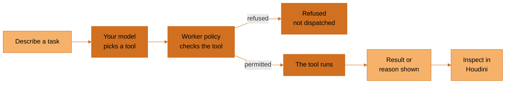
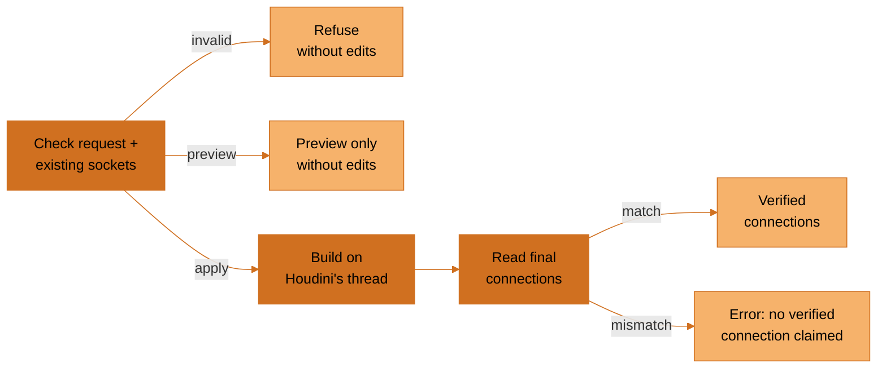
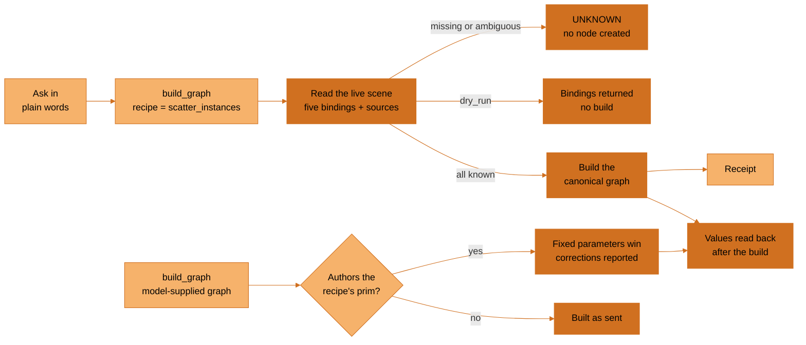

<p align="center">
  
</p>

<p align="center"><strong>Your AI assistant inside Houdini.</strong><br>Describe a task. Inspect the nodes. Keep creative control.</p>

<p align="center"><sub>v5.97.7 · Houdini 22.0.400 · Python 3.13 runtime<br>tags: v5.97.7 is Latest</sub></p>

[](https://github.com/JosephOIbrahim/Synapse/releases/latest)
[](https://github.com/JosephOIbrahim/Synapse/actions/workflows/ci.yml)
[](LICENSE)

**[▶️ Instructions](INSTRUCTIONS.md)** · [🏷️ Versions and tags](TAGS.md) · [What's new](docs/releases/v5.97.7.md) · [Help](#when-you-get-stuck)

## Start here

**5.97.7 changes no product code.** The panel, the Setup behaviour, Moneta 1.3.0 and the native-artifact policy are unchanged from [5.97.6](docs/releases/v5.97.6.md). One thing does change: the Anthropic SDK is now capped below 2.0, because the model-access guard needs the 1.x auth header. What this release adds is evidence. [What changed in 5.97.7](#what-changed-in-5977) walks through it.

### Get 5.97.7

- 📦 **Download:** [Windows Setup](https://github.com/JosephOIbrahim/Synapse/releases/download/v5.97.7/SYNAPSE-5.97.7-Setup.exe) or [source ZIP](https://github.com/JosephOIbrahim/Synapse/releases/download/v5.97.7/SYNAPSE-5.97.7-source.zip).
- 🔎 **Check the download:** Setup is **unsigned**. Compare its [SHA-256 checksum](https://github.com/JosephOIbrahim/Synapse/releases/download/v5.97.7/SHA256SUMS.txt).
- 🦀 **Rust when verified:** Setup includes a pinned native artifact. Fresh supported setups enable it after actual execution checks. Explicit OFF stays OFF. [Existing setups](INSTRUCTIONS.md#existing-native-on-or-off-setups).
- ✅ **What was checked:** native execution, encrypted-mirror reopen and migration/restoration controls. Read the [final artifact evidence and limits](docs/releases/v5.97.7.md#tests). The interactive wizard and the clean-machine checks are separate, and remain unqualified.

Setup includes the panel as of v5.97.7, including Spatial, the Render footer row and the scene-reading Scatter recipe.

### Install in four steps

1. Save your scene and close Houdini. Follow **[source installation](docs/getting-started/installation.md#source-installation)** for v5.97.7, or run the v5.97.7 **[Windows Setup](docs/getting-started/installation.md#windows-installer)**.
2. Restart Houdini. Open **New Pane Tab → Synapse**.
3. Open **Connect models**. Choose a provider and model; add its key if needed.
4. For node creation, select **Build and edit networks**. Choose **Check connection → Use this model**.

💡 Using Ollama? Start its service first. **Connect** starts the separate Houdini bridge; **Doctor** checks the setup without a model.

**Published, installed and running can differ.** This page does not update your seat or an open Houdini session. Install separately and restart Houdini to load the update. The 5.97.6 tag and assets remain unchanged.

**Jump to:** [First build](#your-first-build) · [Controls](#find-the-right-control) · [Stop safely](#three-ways-to-stop) · [What changed](#what-changed-in-5977) · [Troubleshooting](#when-you-get-stuck)

## What changed in 5.97.7

Five things landed. Four of them change nothing about what SYNAPSE does. The fifth changes what it installs.

### The Anthropic SDK is now capped below 2.0

The model-access guard checks the API key in the `x-api-key` header and refuses any request that carries an `Authorization` header. That is the **1.x** convention. **anthropic 2.x changed it** — the key becomes `Authorization: Bearer <key>`, and no `x-api-key` header is sent at all — so under 2.x the guard refuses **every** model call. That is not a test failing. It is the product refusing to talk to the model.

anthropic 2.3.0 landed on 2026-10-23 and turned **five of the six CI jobs** red. The sixth stayed green because it still resolved the vendored SDK. The pin is `anthropic>=1.0.0,<2`, and it was measured across six SDK versions: 0.75.0 fails, 0.96.0 through 1.17.0 pass, 2.3.0 fails.

Teaching the guard the 2.x convention is deferred to v5.98. It is a security-control change, and it needs its own tests plus live panel verification against the new wire protocol.

Producers: [the release note](docs/releases/v5.97.7.md) · [the migration ticket](docs/tickets/ANTHROPIC_SDK_2X_MIGRATION.md)

### An external blueprint was audited, and its script does not run

A World Labs Gaussian-splat blueprint supplied to the project was executed call by call against Houdini 22.0.400. The findings came from the raised exception, not from documentation.

The script dies on **line 27** — the third node creation it makes, and the first that raises. **Six** of its calls raise, across **six** source lines; the record holds them as eight rows, because the one `setParms` at line 41 is written down once and again per key. **Ten** of its parameter writes name parameters that do not exist. **Eight** of the claims in its own "Corrected Error Audit" section are not implemented by its own code; six of them are measured by counting the terms the claim would need.

A corrected script ships as a probe and verifies **11 of 11** live on the pinned build. The eight unproven claims stay open, each with the probe that would settle it. No World Labs asset was available, so nothing was closed by argument.

Producers: [the audit](docs/intake/worldlabs-gaussian-pipeline-audit.md) · [the corrected script](harness/probes/worldlabs_pipeline_corrected.py) · [the receipt](harness/probes/worldlabs_pipeline_verification.json)

### The catalogue was cleared — the finding that accused it was wrong

The audit's own strongest claim was wrong, and the audit is corrected in place. The shipped node catalogue matches the live build: 17/17, 42/42, 131/131, 123/123, 194/194 and 73/73, with a Jaccard match of 1.000 on each.

A standing probe now reads the live build and compares the catalogue against it. It exits non-zero on divergence, and it also fails when the catalogue does not name an audited type at all — a target it could not compare is not a target it cleared. It exits zero today.

Two hazards remain, and both are rules for whoever *reads* the catalogue:

- **Alias resolution.** `createNode("gltf")` returns a `gltf::2.0` node, and `createNode("distantlight")` returns a `distantlight::2.0` node. Parameter names read from the unversioned entry are absent on the node you actually get. Read the catalogue entry for the type `createNode()` returned.
- **`#` in parameter names.** Names like `animid#` are Houdini's spare parameter slots — present in the node's interface, exposing no value to set. **7,155 of 152,918** catalogue parameter names (4.7%) carry one, across eleven category files.

Producers: [the standing probe](harness/probes/catalog_types_check.py) · [its receipt](harness/probes/catalog_types_check_receipt.json)

### Two harness boards land

`harness/attest/` is a refinement loop that attacks its own seed defects. Its blueprint is DRAFT and unratified. Its own gate block reads `blueprint_ratification: OPEN_AWAITING_JOE`, `contract_ratification: NOT_REACHED`, and `merges_pushes_tags_version: ALWAYS_HALT` — so nothing on that board merges, pushes, tags or touches `VERSION` without your word, per act. Its first wave completed: **17** seats dispatched, **17** returned, **11** seats of headroom left.

`harness/harness2/` now carries a compose guard, a graph guard and a threshold calibration. It has no spec and no gate, so it fails closed: with no Jev answer the decision is "adopt nothing".

Producers: [the wave record](harness/attest/WAVE-RECORD.md), written by `harness/attest/record_final_wave.py`, which names the journal's SHA-256 · [the attest board](harness/attest/) · [harness2](harness/harness2/)

### Four test suites are now collected, and one test was fixed

`harness/harness2/tests` (47 tests), `harness/attest/tests` (20), `harness/notes/release-v5.97.7/tests` (26) and `harness/probes/tests` (5) were collected by nothing before this release, so every assertion in them had been decorative. All four are in CI now. `harness/jev/tests` (97) was already wired, and `installer/tests` (84) is a changed-area control the release measured.

Each of those suites now pins a defect it was written for. The compose guard refused to adopt a candidate whose probe was never answered, and adopted two secondaries that claimed the same file. The attest recorder printed `state: IN_FLIGHT` beside `seats_outstanding: 0` when two seats shared a label, and dropped the second seat's payload. The catalogue probe skipped a target the catalogue did not name and still printed `AGREEMENT`.

`tests/test_detached_launch.py` polled for a detached child's marker file and read it the instant it appeared. Windows refuses a read while the writer still holds the handle, so the gate is now "readable **and** complete". Both content assertions are unchanged, and no assertion was weakened.

Producers: [`pyproject.toml`](pyproject.toml) `testpaths` · [the CI workflow](.github/workflows/ci.yml) · [the fixed test](tests/test_detached_launch.py) · [the release's evidence](docs/releases/v5.97.7.md#tests)

**What this release does not change.** The audit is of an external blueprint, not of SYNAPSE's own World Labs import path, which is unchanged and unqualified here. The corrected pipeline script is a probe: it verifies the eleven corrections on the live build, and it has not rendered a World Labs export, because no export was available. The attest board's verdicts carry no authority over the product — its blueprint is DRAFT. Setup remains unsigned. The SDK ceiling is a containment, not a resolution: **2.x remains unsupported.**

## Your first build

In a scratch scene, send:

```text
make a box
```

Inspect the nodes, change a parameter, then try **Undo**.



**Undo covers a recorded operation.** It does not reverse a whole conversation, and it does not reverse files written to disk. A failed build can leave partial nodes until you deliberately undo them.

**The default worker refuses more than it allows.** It permits read-only tools and the inform-level edits — create a node, set a parameter, connect a wire, create a material — plus the artist's own Undo and Redo, which are inform-gated too. It refuses node deletion, arbitrary Python and VEX, renders, exports, memory pruning and batch PDG cooks, and it refuses any tool it does not recognise. Three composite Solaris builders are the exception; each is one undo-wrapped call made only of inform-level primitives. [Tool policy and execution boundaries](docs/architecture/overview.md#permission-and-undo-boundaries).

## Safer Solaris wiring

**An insertion keeps the exact upstream output.** Every connection into a node that already exists reserves its slot before other wires are appended. Merge-style targets also get an order warning — never a silent reorder.

**Invalid requests stop before scene changes.** Preview must be a boolean. Managed parameters must be an object. A supplied display selector must be the id of a node in the request.

**Verified connections come from the final wires.** If a later cook changes a wire, the builder reports an error instead of returning a stale success receipt. A failed build tries to take back the one undo group it opened, and only when the undo stack still shows it; if that take-back fails, the partial build is left for you to undo.



**Checked in Houdini 22.0.400:** the seven-fix controls passed in fresh headless sessions. A separate graphical session then passed the real production bridge checks, including repeat builds and artist Undo after a refused wire change.

These checks do not measure a complex scene's time savings, and they do not qualify every panel interaction. See [release notes and evidence](docs/releases/v5.97.2.md#what-was-measured).

The inherited merge-warning fix has standalone tests; its original limits remain in the [5.97.3 notes](docs/releases/v5.97.3.md#solaris-merge-warning-side-fix).

## Build from a verified recipe

Some requests have a recipe that was built and checked on Houdini 22.0.400. Scatter Instances on an imported Gaussian-splat world is one that reads the scene for you before it builds.

Ask in plain words:

```text
Scatter rocks along the cobblestone lane.
```

SYNAPSE reads the scene before it builds. It finds the camera, the world, the world's collider and the place in the chain where the new nodes go, and it tells you where it read each one.

If anything is missing or ambiguous, the answer is **UNKNOWN** and nothing is built.

If everything is known, it builds the recipe with the recipe's own values. An older note in memory cannot change them, and any value it had to correct is listed in the reply.

The reply carries a receipt, and the receipt carries **Revert**. One click takes back that turn's own SYNAPSE-labelled undo group, and only while nothing else sits above it in Houdini's undo stack.



The reader knows one scene shape today: the `/stage` network, exactly one camera, a Camera node feeding the render settings directly, and one imported world that still carries its import record — with its source `.ply` and a sibling collider `.glb` beside it. Anything else is UNKNOWN. The [release notes](docs/releases/v5.94.1.md) list what was seen in Houdini and what was not.

## See what nodes do

Select one or more nodes in a network editor. Then click **Identify** at the bottom of the panel, or send `/identify`.

A short bubble appears beside each node, drawn over the network editor. It says what the node does, which parameters you changed, and whether the node has an error, a warning or a bypass.

The bubble comes from the node itself and its page in your local SideFX help library, found the way Houdini's own help finds it, or from an HDA's own help when the library has no page for it. No model runs, and nothing leaves your machine.

Click **Identify** again, or send `/identify off`, to clear the bubbles. The overlay is not saved into your scene. Identify can also remove its own old-format comment blocks in one undo group while preserving artist text. [Cleanup details](docs/architecture/overview.md#identify).

```mermaid
flowchart LR
    accTitle: Identify draws a short local bubble beside each selected node
    accDescr: The panel reads facts for up to 60 selected nodes on Houdini's main thread. A worker finds each type's exact local help page, or an HDA's own help, and builds each bubble without a model. Old Identify-generated comment blocks are removed in one undo group, artist text kept. The main thread then draws an overlay that follows pan and zoom. The overlay is not saved.
    S["Selected nodes<br/>(up to 60)"] --> I["Click Identify"]
    I --> F["Read node facts<br/>on the main thread"]
    F --> L["Find each type's exact<br/>help page once"]
    L --> C["Build each bubble<br/>without a model"]
    C --> K["Remove old comment blocks<br/>in one undo group"]
    K --> W["Draw an overlay<br/>above the editor"]
    W --> V["Follow pan and zoom;<br/>overlay not saved"]
    classDef default fill:#F6B26B,stroke:#D07020,color:#000000
    classDef artist fill:#F6B26B,stroke:#D07020,color:#000000
    classDef synapse fill:#D07020,stroke:#D07020,color:#000000
    class S,I artist
    class F,L,C,K,W,V synapse
    linkStyle default stroke:#D07020
```



Each click reads and draws the first 60 selected nodes. The cap is `CAP = 60` in `python/synapse/identify/bubble.py`, applied before the fact read, and the chip still reports your full selection. The [release notes](docs/releases/v5.85.0.md) explain the details and the current limits.

## Find the right control

| I want to… | Open or use… |
|---|---|
| Change the generation model | The model name at the top, or **Connect models**. |
| Add my JEV / TypeSafe key | **Connect models → JEV / TypeSafe key setup → Save session key**. [Setup guide](docs/getting-started/jev-setup.md). |
| Make more room for my prompt | Drag **Resize** above the input box. |
| Find an action | **Commands** below the input box. |
| See what selected nodes do | **Identify** at the bottom of the panel, or send `/identify`. |
| Read how the shot's camera moves | **Spatial** at the bottom of the panel, or send `/spatial`. It draws the path in one undo step, with no model call. |
| Ask what SYNAPSE remembers about this scene | Ask in plain words. It reads this scene's saved notes first, and it says the answer is recalled, not measured again. |
| Import a Marble world or Gaussian `.ply` | **World Labs** beside **Cloud relay**. [Import flow and limits](docs/architecture/overview.md#world-labs-import). |
| Connect the SideFX help library | Follow **[Build and connect](docs/studio/SIDEFX_LIBRARY.md#build-and-connect)**; Scout searches the published local index. |
| Check a connection | **Connect**, then **Doctor**. |

Saving a JEV key keeps it in memory until Houdini closes. **It does not enable JEV, verify the key or grant data permission.** The setup guide walks through those separate controls.

### Three ways to stop

| Control | What it reaches | Limit |
|---|---|---|
| **Stop** | The panel's current turn. | Does not prove an active cook or render has stopped. |
| **Cancel cook** · overflow menu | One known cooking node. | Unavailable when SYNAPSE cannot identify the node. |
| **Emergency halt** · overflow menu | Cooking TOP networks under `/tasks`, `/obj`, `/stage`, `/out`; captures a session report. | Background renders are reported, not stopped. |

**A turn also stops itself.** It ends after 25 tool rounds, 10 minutes or 3,000,000 input tokens, whichever comes first. The last line of the reply says which limit it reached, and no tool runs after that line. The numbers are `_MAX_TOOL_ITERATIONS`, `SYNAPSE_TURN_BUDGET_S` and `SYNAPSE_TURN_BUDGET_TOKENS` in `python/synapse/panel/claude_worker.py`.

## What's ready

- **Network work:** build and inspect through permitted tools; keep the result editable in Houdini.
- **Verified recipes:** Scatter Instances reads its scene bindings in one call and builds with fixed values, or answers UNKNOWN and builds nothing.
- **Identify:** a short bubble beside each selected node, built from the node and local SideFX help with no model call.
- **Model choice:** Claude, Gemini, NVIDIA Nemotron, Ollama and custom OpenAI-compatible endpoints. Tool support varies.
- **Claude Code:** use SYNAPSE's tools from Claude Code through [MCP](docs/mcp/SETUP.md#claude-code). It asks before each tool call unless you allow that tool.
- **Optional JEV assistance:** rank selected-network actions or measure routing. Your generation model stays selected.
- **Local knowledge:** [SideFX library](docs/studio/SIDEFX_LIBRARY.md), [project memory](docs/architecture/overview.md#project-and-scene-memory) and [checked lookdev suggestions](docs/development/rsi_stage0.md).

[Current limits](docs/status.md) · [Latest release notes](docs/releases/v5.97.7.md) · [Changelog](CHANGELOG.md)

## When you get stuck

| What you see | Try this first |
|---|---|
| No Synapse pane | Restart Houdini, then [verify installation](docs/getting-started/installation.md#verify-the-installation). |
| Missing Ollama models | Start Ollama; reopen **Connect models → Check connection**. |
| Unsure where the TypeSafe key goes | [JEV key setup](docs/getting-started/jev-setup.md#add-your-key). |
| No saved suggestion | Read its reason. A checked record, matching version and project memory owner are required. |
| Build running away | Use [Cancel cook or Emergency halt](#three-ways-to-stop), then inspect the scene. |
| Identify bubbles say **Not in the local SideFX library** | [Build and connect the SideFX library](docs/studio/SIDEFX_LIBRARY.md#build-and-connect), then restart Houdini. |

[Report a bug](https://github.com/JosephOIbrahim/Synapse/issues/new/choose) · [First-session walkthrough](docs/getting-started/quickstart.md)

## Watch it work

[](https://vimeo.com/1225720538)

[Watch the recorded demonstration on Vimeo →](https://vimeo.com/1225720538)

<details>
<summary><strong>For developers: architecture, checks and memory</strong></summary>

**139 tools, two paths.** The registry count comes from [`TOOL_DEFS`](python/synapse/mcp/_tool_registry.py), checked by [tool-count tests](tests/test_phase0c_doc1_toolcount.py).

Panel requests prefer HTTP `/mcp`; its ordinary mutations use the execution bridge. Reads, farm controls and Doctor route separately. The configured stdio client forwards Houdini calls over WebSocket `/synapse` to direct handlers. Those paths have different policy and evidence boundaries. Setting `SYNAPSE_MCP_READ_ONLY=1` limits every `/mcp` and WebSocket caller, the panel included, to read-only tools; stop controls always pass ([read-only mode](docs/mcp/SETUP.md#read-only-mode)).

[Execution diagrams and limits](docs/architecture/overview.md#execution-paths) · [External MCP setup](docs/mcp/SETUP.md) · [Source development and tests](docs/getting-started/installation.md#for-contributors)

### What CI runs

CI runs the suite in six pytest invocations: `tests/`, `harness/jev/tests`, `harness/harness2/tests`, `harness/attest/tests`, `harness/notes/release-v5.97.7/tests` and `harness/probes/tests`, plus one targeted re-check of the Moneta-backed memory tests. The first four are also in `testpaths` in [`pyproject.toml`](pyproject.toml), so a bare `pytest` run collects them. See [the workflow](.github/workflows/ci.yml).

**CI never runs the Houdini-dependent tests.** No Houdini runtime exists on a CI runner, so the **186** tests under `tests/` that need one are deselected there and never execute — 12,519 of the 12,705 collected in that directory run. Those tests are measured by hand on a maintainer's machine, not by CI.

CI runs stock Python 3.11 and 3.14 on Linux, macOS and Windows. On the release host the stock suite is **12,240 passed, 0 failed** ([the release's evidence](docs/releases/v5.97.7.md#tests)).

**The suites that need Houdini are not green on the release host.** The panel suite gives 9 failures on the release tree and 10 on master; the full suite under that interpreter gives 125 to 126 on the release tree and 124 to 131 on master. **Those counts move between runs** — the same unchanged tree gives different numbers on different days, because the host stalls under load and the panel-timing tests answer to that. The measured numbers, the commit each was measured on, and the load the box was under are in [the release's evidence](docs/releases/v5.97.7.md#tests).

The Moneta step, which runs only when the deploy key is configured, shows that Moneta imports; it does not show that the Rust extension runs. Native Houdini behavior and Windows installer qualification are separate checks. See each [release's evidence](docs/releases/v5.97.7.md) before relying on it.

### How SYNAPSE remembers

Configured memory and scene/project notes supply recalled context. Recall is advice; it does not authorize a scene action.

A scene's notes come back through `synapse_project_setup`. Search and recall read saved decisions, and they do not cover those notes. The panel asks for the notes first when you ask what it remembers about a scene.

Explicit memory writes, decisions and error rows are recorded. Automatic session and action rows are off unless `SYNAPSE_AUTO_MEMORY=1`. A returned record ID alone does not prove that it will survive a restart; [storage and recall limits](docs/architecture/overview.md#project-and-scene-memory) explain the separate writes.

Moneta's USD mirror is an inspection view, not the storage owner. Missing services and unknown outcomes remain visible. A memory store that cannot be read is reported as a failure, not as an empty answer.

**Native policy depends on the installation route.** The [source package](packages/synapse.json) retains OFF. Windows Setup 5.97.7 can enable a fresh Windows x64 / H22.0.400 / Python 3.13.10 setup only after pinned-artifact and actual execution checks. Explicit OFF and existing default-OFF choices stay OFF. Existing ON needs the same host/artifact/execution qualification. Memory status reports the module as `loaded`, `blocked` or `not_loaded`; a flag alone proves no execution. [Measured limits](docs/releases/v5.97.7.md#tests).

**A native panic is caught in four places.** If the Moneta store panics while it is built, SYNAPSE logs it, records the fallback and serves the JSONL store. A panic inside `synapse_sleep_pass` returns `ran=False`. Since 5.97.4, a panic that reaches the command dispatcher gets a failed reply under its request id, and with `SYNAPSE_AUTO_MEMORY=1` a panic in an automatic session row is logged and that row is skipped. The connection handlers themselves still catch `Exception` only.

**`synapse_sleep_pass` is refused unless `SYNAPSE_ALLOW_SLEEP_PASS=1` is set.** It prunes memory, and a request cannot opt in. It only prunes when the active store is Moneta-backed; under the default JSONL store it does nothing. Over the WebSocket connection it opens no undo group, so it cannot take back your last edit. On the in-Houdini HTTP `/mcp` route and the panel's tool route, an opted-in pass still runs inside the bridge's undo group. A pass that fails after pruning is still audited. A second, separate prune can run inside ordinary writes, and only when `SYNAPSE_AUTO_CONSOLIDATE` is set; it is independent of the sleep pass.

**Attention durability has a bounded contract.** Moneta 1.3.0 implements preservation of undrained attention in attached keyed snapshots; its degraded/keyless and unattached save paths have separate limits. The local reopen probes do not establish every attention/save/switch/quit path. See [current storage limits](docs/releases/v5.97.7.md#limits).

[Storage and recall diagram](docs/architecture/overview.md#project-and-scene-memory) · [Optional memory LOOP](docs/architecture/overview.md#memory-loop) · [Saved suggestions](docs/development/rsi_stage0.md)

</details>

## License

[MIT](LICENSE).

Moneta 1.3.0 is bundled under the MIT License by its copyright holder's written
grant of 2026-10-19. Its pinned upstream metadata still declares "Proprietary";
the bundle includes the grant notice and full MIT text.

Third-party packages retain their own licenses. The installer's `DEPENDENCIES.txt`
lists the included components and license-text locations. The SideFX PDF, MPM
masterclass transcripts and rewritten guides are excluded from this release.

Patent applications pending on the USD cognitive-state substrate, digital injection, and predictive lighting — see [PATENTS](PATENTS).
