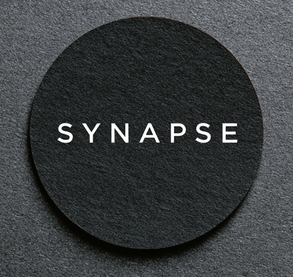
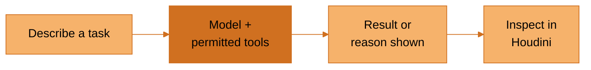
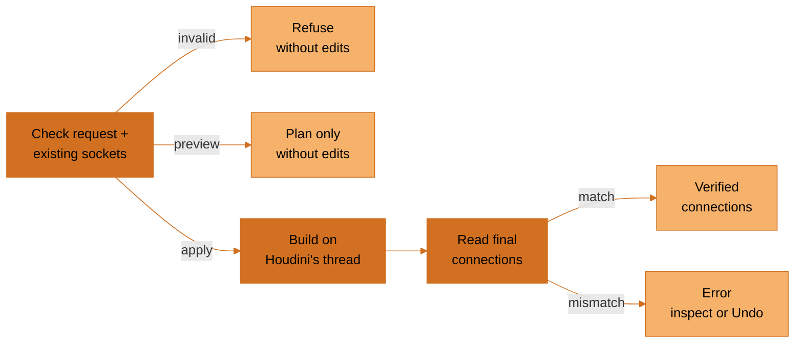
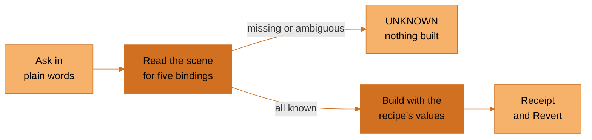

<p align="center">
  
</p>

<p align="center"><strong>Your AI assistant inside Houdini.</strong><br>Describe a task. Inspect the nodes. Keep creative control.</p>

<p align="center"><sub>Published v5.97.5 · Windows · Houdini 22.0.400 · Python 3.13</sub></p>

[](https://github.com/JosephOIbrahim/Synapse/releases/latest)
[](https://github.com/JosephOIbrahim/Synapse/actions/workflows/ci.yml)
[](LICENSE)

**[▶️ Instructions](INSTRUCTIONS.md)** · [🏷️ Versions and tags](TAGS.md) · [What's new](docs/releases/v5.97.5.md) · [Help](#when-you-get-stuck)

## Start here

- 📦 **Get 5.97.5:** [Windows Setup](https://github.com/JosephOIbrahim/Synapse/releases/download/v5.97.5/SYNAPSE-5.97.5-Setup.exe) or [source ZIP](https://github.com/JosephOIbrahim/Synapse/releases/download/v5.97.5/SYNAPSE-5.97.5-source.zip).
- 🔎 **Check the download:** Setup is **unsigned**. Compare its [SHA-256 checksum](https://github.com/JosephOIbrahim/Synapse/releases/download/v5.97.5/SHA256SUMS.txt).
- 🦀 **Public Rust default:** no native wheel is bundled. A separately verified local Rust-ON setup is a different configuration. [Existing setups](INSTRUCTIONS.md#existing-native-on-or-off-setups).
- ✅ **Measured:** six stock-Python CI jobs and isolated checks of the actual final installer. The interactive Windows wizard, registry/shortcuts and clean-machine installation remain untested. [Evidence and limits](docs/releases/v5.97.5.md#tests).

**New in 5.97.5:** pinned Moneta 1.3.0, reviewed packaging and one experimental LIGHT operation for explicitly approved disposable headless tests. LIGHT is not a new panel command or the full RC+ξ framework. [Release notes](docs/releases/v5.97.5.md).

**Published, installed and running can differ.** This page does not update your seat or an open Houdini session. A proposed installer correction is **unreleased**; the 5.97.5 download remains unchanged.

**🚀 Pick one install path, then take four steps.**

1. Save your scene and close Houdini. Follow **[source installation](docs/getting-started/installation.md#source-installation)** for v5.97.5, or run the v5.97.5 **[Windows Setup](docs/getting-started/installation.md#windows-installer)**.
2. Restart Houdini. Open **New Pane Tab → Synapse**.
3. Open **Connect models**. Choose a provider and model; add its key if needed.
4. For node creation, select **Build and edit networks**. Choose **Check connection → Use this model**.

💡 Using Ollama? Start its service first. **Connect** starts the separate Houdini bridge; **Doctor** checks the setup without a model.

**Jump to:** [First build](#your-first-build) · [Controls](#find-the-right-control) · [Stop safely](#three-ways-to-stop) · [Troubleshooting](#when-you-get-stuck)

## Your first build

In a scratch scene, send:

```text
make a box
```

Inspect the nodes, change a parameter, then try **Undo**.



**Undo covers a recorded operation.** It does not reverse a whole conversation or files written to disk. A failed build can leave partial nodes until you deliberately undo them.

The normal panel worker blocks node deletion, arbitrary Python/VEX, rendering, exporting and PDG cooking. See [tool policy and execution boundaries](docs/architecture/overview.md#permission-and-undo-boundaries).

## Safer Solaris wiring

**An insertion keeps the exact upstream output.** Existing merge inputs reserve explicit slots before appending other wires.

**Invalid requests stop before scene changes.** Preview must be a boolean. Managed parameters must be an object. A supplied display selector must be a node name.

**Verified connections come from the final wires.** If a later cook changes a wire, the builder reports an error instead of returning a stale success receipt.



**Checked in Houdini 22.0.400:** the seven-fix controls passed in fresh headless sessions. A separate graphical session then passed the real production bridge checks, including repeat builds and artist Undo after a refused wire change.

These checks do not measure a complex scene's time savings or qualify every panel interaction. See [release notes and evidence](docs/releases/v5.97.2.md#what-was-measured).

The inherited merge-warning fix has standalone tests; its original limits remain in the [5.97.3 notes](docs/releases/v5.97.3.md#solaris-merge-warning-side-fix).

## Build from a verified recipe

Some requests have a recipe that was built and checked on Houdini 22.0.400. Scatter Instances on an imported Gaussian-splat world is the first recipe that reads the scene for you.

Ask in plain words:

```text
Scatter rocks along the cobblestone lane.
```

SYNAPSE reads the scene before it builds. It finds the camera, the world, the world's collider and the place in the chain where the new nodes go, and it tells you where it read each one.

If anything is missing or ambiguous, the answer is **UNKNOWN** and nothing is built.

If everything is known, it builds the recipe with the recipe's own values. An older note in memory cannot change them, and any value it had to correct is listed in the reply.



The reader knows one scene shape today: a `/stage` network, one camera, and a Camera node feeding the render settings directly. The [release notes](docs/releases/v5.94.1.md) list what was seen in Houdini and what was not.

## See what nodes do

Select one or more nodes in a network editor. Then click **Identify** at the bottom of the panel, or send `/identify`.

A short bubble appears beside each node, drawn over the network editor. It says what the node does, which parameters you changed, and whether the node has an error, a warning or a bypass.

The bubble comes from the node itself and its page in your local SideFX help library, found the way Houdini's own help finds it, or from an HDA's own help when the library has no page for it. No model runs, and nothing leaves your machine.

Click **Identify** again, or send `/identify off`, to clear the bubbles. The overlay is not saved into your scene. Identify can also remove its own old-format comment blocks in one undo group while preserving artist text. [Cleanup details](docs/architecture/overview.md#identify).

```mermaid
flowchart LR
    accTitle: How Identify explains selected nodes
    accDescr: You select nodes and click Identify. SYNAPSE reads each node and finds its exact local help page, or uses an HDA's help, without a model. A short bubble appears over the editor. The overlay is not saved; old Identify-generated comment blocks can be removed in an undo group while artist text is preserved.
    S["Select nodes"] --> I["Click Identify"]
    I --> R["Read the node +<br/>its exact help page"]
    R --> N["Short bubble<br/>beside each node"]
    N --> F["Overlay not saved<br/>legacy cleanup is undoable"]
    classDef default fill:#F6B26B,stroke:#D07020,color:#000000
    classDef artist fill:#F6B26B,stroke:#D07020,color:#000000
    classDef synapse fill:#D07020,stroke:#D07020,color:#000000
    class S,I artist
    class R,N synapse
    linkStyle default stroke:#D07020
```



Each click shows up to 60 bubbles. The [release notes](docs/releases/v5.85.0.md) explain the details and current limits.

## Find the right control

| I want to… | Open or use… |
|---|---|
| Change the generation model | The model name at the top, or **Connect models**. |
| Add my JEV / TypeSafe key | **Connect models → JEV / TypeSafe key setup → Save session key**. [Setup guide](docs/getting-started/jev-setup.md). |
| Make more room for my prompt | Drag **Resize** above the input box. |
| Find an action | **Commands** below the input box. |
| See what selected nodes do | **Identify** at the bottom of the panel, or send `/identify`. |
| Read how the shot's camera moves | **Spatial** at the bottom of the panel, or send `/spatial`. It draws the path in one undo step, with no model call. |
| Ask what SYNAPSE remembers about this scene | Ask in plain words. It reads this scene's saved notes first, and it says the answer is recalled, not measured again. |
| Import a Marble world or Gaussian `.ply` | **World Labs** beside **Cloud relay**. [Import flow and limits](docs/architecture/overview.md#world-labs-import). |
| Connect the SideFX help library | Follow **[Build and connect](docs/studio/SIDEFX_LIBRARY.md#build-and-connect)**; Scout searches the published local index. |
| Check a connection | **Connect**, then **Doctor**. |

Saving a JEV key keeps it in memory until Houdini closes. **It does not enable JEV, verify the key or grant data permission.** The setup guide walks through those separate controls.

### Three ways to stop

| Control | What it reaches | Limit |
|---|---|---|
| **Stop** | The panel's current turn. | Does not prove an active cook or render has stopped. |
| **Cancel cook** · overflow menu | One known cooking node. | Unavailable when SYNAPSE cannot identify the node. |
| **Emergency halt** · overflow menu | Cooking TOP networks under `/tasks`, `/obj`, `/stage`, `/out`; captures a session report. | Background renders are reported, not stopped. |

**A turn also stops itself.** It ends after 25 tool rounds, 10 minutes or 3,000,000 input tokens, whichever comes first. The last line of the reply says which limit it reached, and no tool runs after that line.

## What's ready

- **Network work:** build and inspect through permitted tools; keep the result editable in Houdini.
- **Verified recipes:** Scatter Instances reads its scene bindings in one call and builds with fixed values, or answers UNKNOWN and builds nothing.
- **Identify:** a short bubble beside each selected node, built from the node and local SideFX help with no model call.
- **Model choice:** Claude, Gemini, NVIDIA Nemotron, Ollama and custom OpenAI-compatible endpoints. Tool support varies.
- **Claude Code:** use SYNAPSE's tools from Claude Code through [MCP](docs/mcp/SETUP.md#claude-code). It asks before each tool call unless you allow that tool.
- **Optional JEV assistance:** rank selected-network actions or measure routing. Your generation model stays selected.
- **Local knowledge:** [SideFX library](docs/studio/SIDEFX_LIBRARY.md), [project memory](docs/architecture/overview.md#project-and-scene-memory) and [checked lookdev suggestions](docs/development/rsi_stage0.md).

[Current limits](docs/status.md) · [Latest release notes](docs/releases/v5.97.5.md) · [Changelog](CHANGELOG.md)

## When you get stuck

| What you see | Try this first |
|---|---|
| No Synapse pane | Restart Houdini, then [verify installation](docs/getting-started/installation.md#verify-the-installation). |
| Missing Ollama models | Start Ollama; reopen **Connect models → Check connection**. |
| Unsure where the TypeSafe key goes | [JEV key setup](docs/getting-started/jev-setup.md#add-your-key). |
| No saved suggestion | Read its reason. A checked record, matching version and project memory owner are required. |
| Build running away | Use [Cancel cook or Emergency halt](#three-ways-to-stop), then inspect the scene. |
| Identify bubbles say **Not in the local SideFX library** | [Build and connect the SideFX library](docs/studio/SIDEFX_LIBRARY.md#build-and-connect), then restart Houdini. |

[Report a bug](https://github.com/JosephOIbrahim/Synapse/issues/new/choose) · [First-session walkthrough](docs/getting-started/quickstart.md)

## Watch it work

[](https://vimeo.com/1225720538)

[Watch the recorded demonstration on Vimeo →](https://vimeo.com/1225720538)

<details>
<summary><strong>For developers: architecture, checks and memory</strong></summary>

**139 tools, two paths.** The registry count comes from [`TOOL_DEFS`](python/synapse/mcp/_tool_registry.py), checked by [tool-count tests](tests/test_phase0c_doc1_toolcount.py).

Panel requests prefer HTTP `/mcp`; its ordinary mutations use the execution bridge. Reads, farm controls and Doctor route separately. The configured stdio client forwards Houdini calls over WebSocket `/synapse` to direct handlers. Those paths have different policy and evidence boundaries. Setting `SYNAPSE_MCP_READ_ONLY=1` limits every `/mcp` and WebSocket caller, the panel included, to read-only tools; stop controls always pass ([read-only mode](docs/mcp/SETUP.md#read-only-mode)).

[Execution diagrams and limits](docs/architecture/overview.md#execution-paths) · [External MCP setup](docs/mcp/SETUP.md) · [Source development and tests](docs/getting-started/installation.md#for-contributors)

### How SYNAPSE remembers

Configured memory and scene/project notes supply recalled context. Recall is advice; it does not authorize a scene action.

A scene's notes come back through `synapse_project_setup`. Search and recall read saved decisions, and they do not cover those notes. The panel asks for the notes first when you ask what it remembers about a scene.

Explicit memory writes, decisions and error rows are recorded. Automatic session and action rows are off unless `SYNAPSE_AUTO_MEMORY=1`. A returned record ID alone does not prove that it will survive a restart; [storage and recall limits](docs/architecture/overview.md#project-and-scene-memory) explain the separate writes.

Moneta's USD mirror is an inspection view, not the storage owner. Missing services and unknown outcomes remain visible. A memory store that cannot be read is reported as a failure, not as an empty answer.

**Moneta's native module stays out unless you opt in.** `MONETA_NATIVE=0`, set before Moneta first loads, keeps it out of the Houdini process, and [`packages/synapse.json`](packages/synapse.json) retains that default. Separate disposable H22 probes qualify a local opt-in, actual native scan/decay and persistent-key reopen; they do not qualify every artist store or turn on the public installer's native-off default. See [the measured limits](docs/releases/v5.97.5.md#tests). Memory status and provenance report the module as `loaded`, `blocked` or `not_loaded`.

**A native panic is caught in four places.** If the Moneta store panics while it is built, SYNAPSE logs it, records the fallback and serves the JSONL store. A panic inside `synapse_sleep_pass` returns `ran=False`. Since 5.97.4, a panic that reaches the command dispatcher gets a failed reply under its request id, and with `SYNAPSE_AUTO_MEMORY=1` a panic in an automatic session row is logged and that row is skipped. The connection handlers themselves still catch `Exception` only.

**`synapse_sleep_pass` is refused unless `SYNAPSE_ALLOW_SLEEP_PASS=1` is set.** It prunes memory, and a request cannot opt in. Over the WebSocket connection it opens no undo group, so it cannot take back your last edit. On the in-Houdini HTTP `/mcp` route and the panel's tool route, an opted-in pass still runs inside the bridge's undo group. A pass that fails after pruning is still audited.

**Attention durability has a bounded contract.** Moneta 1.3.0 implements preservation of undrained attention in attached keyed snapshots; its degraded/keyless and unattached save paths have separate limits. The local reopen probes do not establish every attention/save/switch/quit path. See [current storage limits](docs/releases/v5.97.5.md#limits).

[Storage and recall diagram](docs/architecture/overview.md#project-and-scene-memory) · [Optional memory LOOP](docs/architecture/overview.md#memory-loop) · [Saved suggestions](docs/development/rsi_stage0.md)

**CI covers stock Python on Linux, macOS and Windows.** Its Moneta step shows that Moneta imports, not that the Rust extension runs. Native Houdini behavior and Windows installer qualification are separate checks. See each [release's evidence](docs/releases/v5.97.5.md) before relying on it.

</details>

## License

[MIT](LICENSE).

Moneta 1.3.0 is bundled under the MIT License by its copyright holder's written
grant of 2026-10-19. Its pinned upstream metadata still declares "Proprietary";
the bundle includes the grant notice and full MIT text.

Third-party packages retain their own licenses. The installer's `DEPENDENCIES.txt`
lists the included components and license-text locations. The SideFX PDF, MPM
masterclass transcripts and rewritten guides are excluded from this release.

Patent applications pending on the USD cognitive-state substrate, digital injection, and predictive lighting — see [PATENTS](PATENTS).
