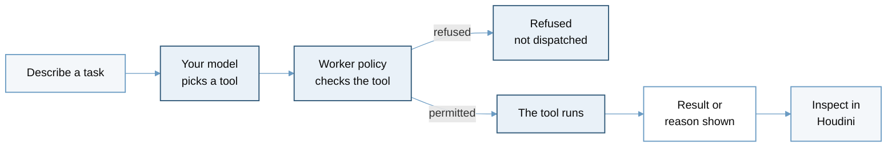
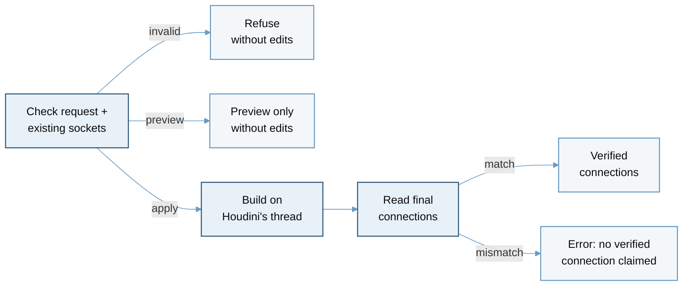
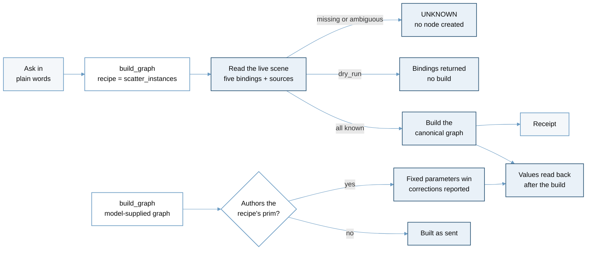
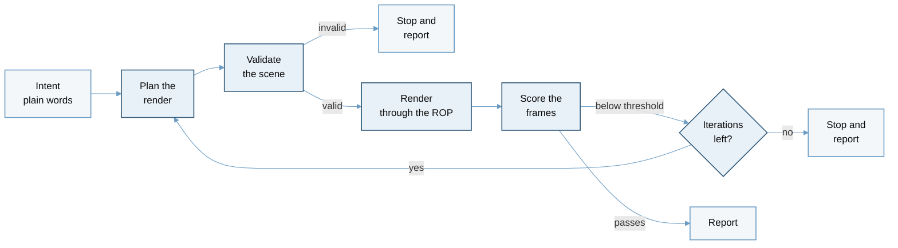

<p align="center">
  <picture>
    <source media="(prefers-color-scheme: dark)" srcset="assets/synapse-lockup-dark.svg">
    
  </picture>
</p>

<h3 align="center">An AI assistant that runs inside Houdini 22.</h3>

<p align="center">Connect a local or cloud model, describe the task in plain words, and SYNAPSE builds real nodes you can inspect and edit.</p>

<p align="center"><sub>v5.104.2 · Houdini 22.0.400 · Python 3.13 runtime<br>tags: v5.104.2 is Latest</sub></p>

<p align="center">
  <a href="https://github.com/JosephOIbrahim/Synapse/releases/latest"></a>
  <a href="https://github.com/JosephOIbrahim/Synapse/actions/workflows/ci.yml"></a>
  <a href="LICENSE"></a>
</p>

<div align="center">

**[01 Install](#01-install)** · **[02 What it does](#02-what-it-does)** · **[03 Controls](#03-controls)** · **[04 When you get stuck](#04-when-you-get-stuck)** · **[05 Reference](#05-reference)**

[What's new](docs/releases/v5.104.2.md) · [Versions and tags](TAGS.md) · [Current limits](docs/status.md)

</div>

[](https://vimeo.com/1225720538)

[Watch the recorded demonstration on Vimeo](https://vimeo.com/1225720538)

SYNAPSE does the work inside your Houdini scene through tools you can inspect, and what it builds stays yours to edit.

> **Before you start**
>
> SYNAPSE acts without asking first. Start in a scratch scene.
>
> The default worker is limited. It reads, creates nodes, sets parameters, connects wires, creates materials, writes memory notes and can cook a single TOP node, which may render. It refuses node deletion, the `execute_python` and `execute_vex` tools, ROP renders, the export-gated tools (farm prepare, HDA packaging, texture bake), memory pruning, batch PDG cooks and any tool it does not recognise. It can still create a wrangle or Python node and set its code, and `houdini_hda_create` can still write an `.hda` file.
>
> Undo covers a recorded operation. It does not reverse a whole conversation, or files written to disk.

## 01 Install

1. Save your scene and close Houdini. Run the [Windows Setup](docs/getting-started/installation.md#windows-installer), or follow [source installation](docs/getting-started/installation.md#source-installation) for v5.104.2.
2. Restart Houdini. Open New Pane Tab, then Synapse.
3. Open Connect models. Choose a provider and model, and add its key if it needs one.
4. For node creation, select Build and edit networks. Choose Check connection, then Use this model.

Using Ollama? Start its service first. Connect starts the separate Houdini bridge, and Doctor checks the setup without a model.

**Setup creates a key, and in the default local mode SYNAPSE listens on this machine only.** If `~/.synapse/auth.key` holds no readable key line, Setup writes one; a file that holds a readable key line is left alone; any other `auth.key` is replaced. A source install creates no key: put one line of random text in `~/.synapse/auth.key` to turn authentication on. Restart Claude Code and any other MCP client after installing so they read it.

### Which build to get

| You want | Get | Know this |
|---|---|---|
| An installer | [Windows Setup v5.104.2](https://github.com/JosephOIbrahim/Synapse/releases/download/v5.104.2/SYNAPSE-5.104.2-Setup.exe) | Setup remains unsigned. Check the file against the release's [SHA-256 checksum](https://github.com/JosephOIbrahim/Synapse/releases/download/v5.104.2/SHA256SUMS.txt). |
| The source | `git clone https://github.com/JosephOIbrahim/Synapse && git checkout v5.104.2` | The annotated tag is the release's source. |
| To check the tag | `git rev-parse 'v5.104.2^{commit}'` | Resolves the annotated tag to its source commit. |

**Published, installed and running can differ.** This page does not update your seat or an open Houdini session. Install separately, then restart Houdini to load the update.

<sub>What was checked: the [5.104.2 note](docs/releases/v5.104.2.md) carries the test lines from before the release commit, which checks run on that commit, what they do not cover, and every limit. Setup includes the panel as of v5.104.2, including Spatial, the Render footer row and the scene-reading Scatter recipe.</sub>

## 02 What it does

Five workflows on one pattern. The bold line says what it does, Try shows how to start, the diagram is the whole mechanism, and Limits says what it does not do.

| | Workflow | You do | SYNAPSE does |
|---|---|---|---|
| 02.1 | [Build in plain words](#021-build-in-plain-words) | Describe a task | Builds through permitted tools; the result stays editable |
| 02.2 | [Safer Solaris wiring](#022-safer-solaris-wiring) | Request a Solaris graph | Checks the request, builds, verifies the final wires |
| 02.3 | [Build from a verified recipe](#023-build-from-a-verified-recipe) | Ask in plain words | Reads the scene first; builds with fixed values, or answers UNKNOWN |
| 02.4 | [See what nodes do](#024-see-what-nodes-do) | Select nodes, click Identify | A local bubble beside each node, with no model |
| 02.5 | [Hands-off render](#025-hands-off-render) | Give an intent | Plans, renders, scores and retries within three bounds |

### 02.1 Build in plain words

**SYNAPSE builds real nodes through the tools the worker permits, and the result stays editable in Houdini.**

**Try** in a scratch scene:

```text
make a box
```

Inspect the nodes, change a parameter, then try Undo in Houdini.



**Limits**

- Undo covers a recorded operation. It does not reverse a whole conversation, and it does not reverse files written to disk.
- A failed build can leave partial nodes until you deliberately undo them.
- The default worker permits read-only tools and the inform-level edits (create a node, set a parameter, connect a wire, create a material). It refuses node deletion, the `execute_python` and `execute_vex` tools, ROP renders, the export-gated tools (farm prepare, HDA packaging, texture bake), memory pruning and batch PDG cooks, and it refuses any tool it does not recognise; it can still create a wrangle or Python node and set its code, and `houdini_hda_create` can still write an `.hda` file. Single TOP-node cooks (`tops_cook_node`, `houdini_wedge`) count as parameter edits, so it permits them, and they may render.
- Since 5.104.0 SYNAPSE's Undo and Redo tools are review-gated, so the default worker refuses them; use Houdini's own Undo. Those tools take back only a step an agent tool recorded since the session started, never the artist's own work, and redo only a step they undid, while no SYNAPSE command that can change the scene has been dispatched since and the history lists are as their last Undo or Redo left them.
- Three composite Solaris builders, listed in `_WORKER_BUILDER_ALLOWLIST` in `python/synapse/panel/worker_policy.py`, are the exception; each is one undo-wrapped call made only of inform-level primitives.

<sub>[Tool policy and execution boundaries](docs/architecture/overview.md#permission-and-undo-boundaries)</sub>

### 02.2 Safer Solaris wiring

**An insertion keeps the exact upstream output.** Every connection into a node that already exists reserves its slot before other wires are appended. Merge-style targets also get an order warning, never a silent reorder.

Invalid requests stop before scene changes:

- Preview must be a boolean.
- Managed parameters must be an object.
- A supplied display selector must be the id of a node in the request.



Verified connections come from the final wires. If a later cook changes a wire, the builder reports an error instead of returning a stale success receipt.

**Limits**

- A failed build tries to take back the one undo group it opened, and only when the undo stack still shows it. If that take-back fails, the partial build is left for you to undo.
- These checks do not measure a complex scene's time savings, and they do not qualify every panel interaction.

<sub>Checked in Houdini 22.0.400: the seven-fix controls passed in fresh headless sessions. A separate graphical session then passed the real production bridge checks, including repeat builds and artist Undo after a refused wire change. See [release notes and evidence](docs/releases/v5.97.2.md#what-was-measured). The inherited merge-warning fix has standalone tests; its original limits remain in the [5.97.3 notes](docs/releases/v5.97.3.md#solaris-merge-warning-side-fix).</sub>

### 02.3 Build from a verified recipe

**SYNAPSE reads the scene before it builds. If anything is missing or ambiguous, the answer is UNKNOWN and nothing is built.**

Some requests have a recipe that was built and checked on Houdini 22.0.400. Scatter Instances on an imported Gaussian-splat world is one. It finds the camera, the world, the world's collider and the place in the chain where the new nodes go, and it tells you where it read each one.

**Try** in plain words:

```text
Scatter rocks along the cobblestone lane.
```



If everything is known, it builds the recipe with the recipe's own values. An older note in memory cannot change them, and any value it had to correct is listed in the reply. The reply carries a receipt, and the receipt carries Revert.

**Limits**

- The reader knows one scene shape today: the `/stage` network; exactly one camera; a Camera node feeding the render settings directly; one imported world that still carries its import record, with its source `.ply` and a sibling collider `.glb` beside it. Anything else is UNKNOWN.
- Revert takes back that turn's own SYNAPSE-labelled undo group, and only while nothing else sits above it in Houdini's undo stack.

<sub>The [release notes](docs/releases/v5.94.1.md) list what was seen in Houdini and what was not.</sub>

### 02.4 See what nodes do

**A short bubble appears beside each selected node.** It says what the node does, which parameters you changed, and whether the node has an error, a warning or a bypass. **No model runs, and nothing leaves your machine.**

**Try** selecting one or more nodes in a network editor, then click Identify at the bottom of the panel, or send:

```text
/identify
```

Click Identify again, or send `/identify off`, to clear the bubbles. Each bubble comes from the node itself and its page in your local SideFX help library, found the way Houdini's own help finds it, or from an HDA's own help when the library has no page for it.

```mermaid
flowchart LR
    accTitle: Identify draws a short local bubble beside each selected node
    accDescr: The panel reads facts for up to 60 selected nodes on Houdini's main thread. A worker finds each type's exact local help page, or an HDA's own help, and builds each bubble without a model. Old Identify-generated comment blocks are removed in one undo group, artist text kept. The main thread then draws an overlay that follows pan and zoom. The overlay is not saved.
    S["Selected nodes<br/>(up to 60)"] --> I["Click Identify"]
    I --> F["Read node facts<br/>on the main thread"]
    F --> L["Find each type's exact<br/>help page once"]
    L --> C["Build each bubble<br/>without a model"]
    C --> K["Remove old comment blocks<br/>in one undo group"]
    K --> W["Draw an overlay<br/>above the editor"]
    W --> V["Follow pan and zoom;<br/>overlay not saved"]
    classDef default fill:#FFFFFF,stroke:#6A9BC3,stroke-width:1.5px,color:#0A0A0A
    classDef artist fill:#F4F7FA,stroke:#6A9BC3,color:#0A0A0A
    classDef synapse fill:#E9F1F8,stroke:#2F5878,color:#0A0A0A
    class S,I artist
    class F,L,C,K,W,V synapse
    linkStyle default stroke:#6A9BC3
```



**Limits**

- Each click reads and draws the first 60 selected nodes. The cap is `CAP = 60` in `python/synapse/identify/bubble.py`, applied before the fact read, and the chip still reports your full selection.
- The overlay is not saved into your scene.
- Identify can also remove its own old-format comment blocks in one undo group while preserving artist text. [Cleanup details](docs/architecture/overview.md#identify).

<sub>The [release notes](docs/releases/v5.85.0.md) explain the details and the current limits.</sub>

### 02.5 Hands-off render

**`synapse_autonomous_render` takes an intent in plain words and runs the whole render loop:** plan, validate, render the frames through the render ROP (`render_sequence`), score the result, and re-plan when the score falls short.

**It answers at once with a task id.** The loop runs on a worker thread. Call the tool again with that `task_id` to read the status and, once it finishes, the report. A second start with the same intent and settings joins the running task instead of starting another. The default panel worker refuses it (it is approve-gated); start it from Claude Code or another MCP client.



**Limits.** Three bounds apply:

- `max_iterations`: 3 by default, clamped to 10 on the server.
- `quality_threshold`: 0.85 by default.
- A per-run wall-clock bound of 600 seconds by default. It stops at the next step boundary and reports `stop_reason='wall_clock_exceeded'`.

<sub>Producer: the loop and the 10-iteration clamp are `python/synapse/autonomy/driver.py`; the 600-second default is `python/synapse/core/timeouts.py`; the tool contract is `python/synapse/mcp/_tool_registry.py`.</sub>

### Models and clients

- **Model choice:** Claude, Gemini, NVIDIA Nemotron, Ollama and custom OpenAI-compatible endpoints. Tool support varies.
- **Claude Code:** use SYNAPSE's tools from Claude Code through [MCP](docs/mcp/SETUP.md#claude-code). It asks before each tool call unless you allow that tool.
- **Optional JEV assistance:** rank selected-network actions or measure routing. Your generation model stays selected.
- **Local knowledge:** the [SideFX library](docs/studio/SIDEFX_LIBRARY.md), [project memory](docs/architecture/overview.md#project-and-scene-memory) and [checked lookdev suggestions](docs/development/rsi_stage0.md).

[Current limits](docs/status.md) (reviewed for v5.99.0) · [Latest release notes](docs/releases/v5.104.2.md) · [Changelog](CHANGELOG.md)

## 03 Controls

| I want to… | Open or use… |
|---|---|
| Change the generation model | The model name at the top, or Connect models. |
| Add my JEV / TypeSafe key | Connect models, then JEV / TypeSafe key setup, then Save session key. [Setup guide](docs/getting-started/jev-setup.md). |
| Make more room for my prompt | Drag Resize above the input box. |
| Find an action | Commands below the input box. |
| See what selected nodes do | Identify at the bottom of the panel, or send `/identify`. |
| Read how the shot's camera moves | Spatial at the bottom of the panel, or send `/spatial`. It draws the path in one undo step, with no model call. |
| Ask what SYNAPSE remembers about this scene | Ask in plain words. It reads this scene's saved notes first, and it says the answer is recalled, not measured again. |
| Import a World Labs Atlas splat scene, or a Gaussian `.spz` / `.ply` | World Labs beside Cloud relay. [Import flow and limits](docs/architecture/overview.md#world-labs-import). |
| Connect the SideFX help library | Follow [Build and connect](docs/studio/SIDEFX_LIBRARY.md#build-and-connect); Scout searches the published local index. |
| Check a connection | Connect, then Doctor. |

Saving a JEV key keeps it in memory until Houdini closes.

**Saving the key does not enable JEV, verify it or grant data permission.** The setup guide walks through those separate controls.

### Three ways to stop

| Control | What it reaches | Limit |
|---|---|---|
| Stop | The panel's current turn. | Does not prove an active cook or render has stopped. |
| Cancel cook, in the overflow menu | One known cooking node. | Unavailable when SYNAPSE cannot identify the node. |
| Emergency halt, in the overflow menu | Cooking TOP networks under `/tasks`, `/obj`, `/stage`, `/out`; captures a session report. | Background renders are reported, not stopped. |

**A turn also stops itself.** It ends after 25 tool rounds, 10 minutes or 3,000,000 input tokens, whichever comes first. The last line of the reply says which limit it reached, and no tool runs after that line.

The numbers are `_MAX_TOOL_ITERATIONS`, `SYNAPSE_TURN_BUDGET_S` and `SYNAPSE_TURN_BUDGET_TOKENS` in `python/synapse/panel/claude_worker.py`.

## 04 When you get stuck

| What you see | Try this first |
|---|---|
| No Synapse pane | Restart Houdini, then [verify installation](docs/getting-started/installation.md#verify-the-installation). |
| "SynapseHandler could not be loaded (…)" | The message names the failing import and says it is a panel import/setup error, not a Houdini connection problem. Check the named module and the seat's Python environment. Producer: `python/synapse/panel/tool_executor.py`. |
| Missing Ollama models | Start Ollama, then reopen Connect models and Check connection. |
| Unsure where the TypeSafe key goes | [JEV key setup](docs/getting-started/jev-setup.md#add-your-key). |
| No saved suggestion | Read its reason. A checked record, matching version and project memory owner are required. |
| Build running away | Use [Cancel cook or Emergency halt](#three-ways-to-stop), then inspect the scene. |
| Identify bubbles say "Not in the local SideFX library" | [Build and connect the SideFX library](docs/studio/SIDEFX_LIBRARY.md#build-and-connect), then restart Houdini. |

[Report a bug](https://github.com/JosephOIbrahim/Synapse/issues/new/choose) · [First-session walkthrough](docs/getting-started/quickstart.md)

## 05 Reference

Detail you can come back to. Each block opens in place.

<details>
<summary><strong>What's new in 5.104.2</strong></summary>

**5.104.2 takes project setup out of Connect,** the MCP handshake the panel sends with its first tool call (Doctor included). The first Connect after a 5.104.0 install once held Houdini's main thread in project setup until Windows closed Houdini. Why it never returned is still unknown.

Connect now runs no project setup and makes no Houdini call. Ending a session queues its record instead of writing it on the thread that ended it.

What you will notice: Connect no longer creates the scene's `claude/` notes. The first call that writes them creates them, such as `synapse_project_setup` or a memory write. `SYNAPSE_MCP_SESSION_END_RECORDS=0` turns session-end records off.

Still open: `synapse_project_setup` itself still runs on Houdini's main thread and cannot be stopped once it starts. [What changed in 5.104.2](docs/releases/v5.104.2.md) has the detail and every limit.

**5.104.1 fixes two faults found on the first seat installed with 5.104.0, and World Labs import now reads Atlas.** Setup keeps the Moneta schema registered when the package keeps an earlier schema path beside it, and Claude Code authenticates to Houdini again once Setup has created the key. World Labs' API now supports Atlas only: the World Labs dialog imports finished Atlas splat scenes and local `.spz` or `.ply` files, never starts a paid task, and no longer asks for a Marble world. [What changed in 5.104.1](docs/releases/v5.104.1.md) has the detail and every limit.

**5.104.0: SYNAPSE listens on this machine only by default, with a key.** The Houdini server binds 127.0.0.1 in local mode and refuses a wider bind without a key, and Setup creates `~/.synapse/auth.key` when no readable key exists. 5.104.0 also lands the first two waves of the 2026-11-20 repair program: 35 fixes across security, scene safety and truthful results. [What changed in 5.104.0](docs/releases/v5.104.0.md) has the detail and every limit.

anthropic 2.x is still unsupported.

</details>

<details>
<summary><strong>Release history: 5.103.0 and 5.102.0</strong></summary>

**5.103.0** added a self-improvement memory plane under `harness/sim`, which nothing on the runtime path imports, and changed no product behaviour. [What changed in 5.103.0](docs/releases/v5.103.0.md).

**5.102.0.** No shipped code changes. Five files that reach you change, and only their text: two that Setup installs no longer name folders on this project's machines, and three in the source ZIP name a redaction token instead of the account.

The rest of the release is a test and the release audit, and neither reaches your seat.

**Paths from this project's machines, removed or redacted**

- **Source ZIP, three files.** Four paths into the release machine's account folder now name `Example`, the repository's redaction token, instead of the account: `docs/SYNAPSE_MULTI_PROVIDER_LEG1_PROBE_DATA.json` (2), `tools/_hy_parity_gui.json` (1) and `tools/_hy_verbs_sweep_22.0.400.json` (1).

- **Setup, the SideFX Labs corpus.** 409 entries in `rag/corpus/sidefxlabs_entries.json` name their source file from `SideFXLabs` onward, not from a staging folder.

- **Setup, a reference skill.** `rag/skills/houdini21-reference/solaris_compound_node_anatomy.md` keeps a transcript's title and drops its folder.

- **A test keeps them out.** [`tests/test_shipped_files_carry_no_owner_paths.py`](tests/test_shipped_files_carry_no_owner_paths.py) fails if any of the five files carries those paths again.

The release audit now reads the spelling these paths used, so a path into the account folder written with any run of slashes or backslashes stops a release when it is in the source ZIP or in a Setup file with one of the audit's 16 text suffixes. The audit that passed v5.101.0 and v5.101.1 could not see it.

Producer: `scripts/product_surface.py --diff v5.101.1 1194373d` reports no product change, and the [release notes](docs/releases/v5.102.0.md#what-changes) name the producer of every count.

The version bump in the release commit also rewrites the version string in shipped files.

5.102.0 keeps everything 5.101.1 changed, including the optional ceiling on the panel worker's tools, `SYNAPSE_WORKER_TOOL_ALLOWLIST`: [what it does and how to set it](docs/releases/v5.101.1.md#how-to-use-it). It also keeps everything 5.101.0 changed: the import error that quotes what went wrong, the Render QC timing measurement and the stricter release gates.

**What 5.102.0 does not change, and its limits**

- At least 77 paths from this project's machines remain in 17 files that only the source ZIP carries, including a scene path in `tools/_hy_parity_gui.json`. Setup does not install those files. The scan that counted them read only JSON, Markdown, text and log files, and two Python files that Setup installs name a local corpus folder in their comments.

- For the optional tool ceiling from 5.101.1:

  - A name that matches no tool is ignored without a warning.
  - A list in which no name is both real and permitted by the mode leaves the worker with no tools.
  - The list limits tool names, not what a listed tool can do: in the default mode, with `houdini_create_node` and `houdini_set_parm` listed, the worker can still make a wrangle or Python node and write its code.
  - The ceiling limits the panel's model worker only. Claude Code and other MCP clients do not pass through it; [read-only mode](docs/mcp/SETUP.md#read-only-mode) is the switch that limits them.
  - Read-only mode also limits the panel's own worker while its calls go through `/mcp`, and it always lets the stop controls through.

- No artist sees a finding from the timing harness or from Render QC.

- **anthropic 2.x is still unsupported.** The pin stays `anthropic>=1.0.0,<2`, and under 2.x the model-access guard still refuses every model call ([the migration ticket](docs/tickets/ANTHROPIC_SDK_2X_MIGRATION.md)).

- Setup remains unsigned.

- Durable worker receipts are not in this release. That lane waits on its own review.

- The import error from 5.101.0 still has rare failures of its own:

  - A stub `anthropic` or `pydantic` module without an import spec, or an import finder that raises, replaces the diagnostic with its own error.
  - A local file named `anthropic.py` that shadows the package makes the message blame a dependency.

  Nothing in SYNAPSE causes these today. They are not fixed in 5.102.0, and no release is named for them.

- Doctor behaviour from 5.100.0 is unchanged. Its limits are in [5.100.0's notes](docs/releases/v5.100.0.md#limits).

The full list is in the release notes' [Limits](docs/releases/v5.102.0.md#limits) section.

</details>

<details>
<summary><strong>For developers: architecture, checks and memory</strong></summary>

**140 tools, two paths.** The registry count comes from [`TOOL_DEFS`](python/synapse/mcp/_tool_registry.py), checked by [tool-count tests](tests/test_phase0c_doc1_toolcount.py).

Panel requests prefer HTTP `/mcp`; its ordinary mutations use the execution bridge. Reads, farm controls and Doctor route separately.

The configured stdio client forwards Houdini calls over WebSocket `/synapse` to direct handlers. Those paths have different policy and evidence boundaries.

Setting `SYNAPSE_MCP_READ_ONLY=1` limits every `/mcp` and WebSocket caller, the panel included, to read-only tools; stop controls always pass ([read-only mode](docs/mcp/SETUP.md#read-only-mode)).

[Execution diagrams and limits](docs/architecture/overview.md#execution-paths) · [External MCP setup](docs/mcp/SETUP.md) · [Source development and tests](docs/getting-started/installation.md#for-contributors)

### What CI runs

CI runs the suite in six pytest invocations:

- `tests/`
- `harness/jev/tests`
- `harness/harness2/tests`
- `harness/attest/tests`
- `harness/notes/release-v5.97.7/tests`
- `harness/probes/tests`

The first four are also in `testpaths` in [`pyproject.toml`](pyproject.toml), so a bare `pytest` run collects them.

CI also runs one targeted re-check of the Moneta-backed memory tests. See [the workflow](.github/workflows/ci.yml).

**CI never runs the Houdini-dependent tests.** No Houdini runtime exists on a CI runner, so tests that need one are deselected there and never execute. Those tests are measured by hand on a maintainer's machine, not by CI.

CI runs stock Python 3.11 and 3.14 on Linux, macOS and Windows. CI on `f50d9515` passed six of six jobs, with between 12,663 and 12,673 tests under `tests/` passed and 0 failed on each job ([Actions run 43615813442](https://github.com/JosephOIbrahim/Synapse/actions/runs/43615813442)).

For 5.100.0, the stock suite on the release host was 12,906 passed, 506 skipped, 11 xfailed and 0 failed. Run locally with CI's marker expression (`-m "not needs_houdini"`, `--collect-only`), 13,219 of the 13,405 tests under `tests/` were collected and 186 deselected. Both figures were measured on `00629530` ([5.100.0's evidence](docs/releases/v5.100.0.md#tests)), and neither is a CI-runner count.

The suites that need Houdini were not green on the 5.100.0 release host.

Under hython 22.0.400 the 5.100.0 release tree (`00629530`) gave 116 failed and 4 errors, 120 failing nodes, and master `26861cf9` gave the same 120 on the same host; 1 failed on the release tree without also failing on `26861cf9` ([5.100.0's evidence](docs/releases/v5.100.0.md#tests)).

The seat runs do not exercise Moneta, and those counts move between runs. They were not re-measured for 5.101.0, 5.101.1 or 5.102.0, so this page carries no seat-suite figure for any of them.

The Moneta step, which runs only when the deploy key is configured, shows that Moneta imports; it does not show that the Rust extension runs.

Native Houdini behavior and Windows installer qualification are separate checks. See each [release's evidence](docs/releases/v5.104.2.md) before relying on it.

### How SYNAPSE remembers

Configured memory and scene/project notes supply recalled context. Recall is advice; it does not authorize a scene action.

A scene's notes come back through `synapse_project_setup`. Search and recall read saved decisions, and they do not cover those notes. The panel asks for the notes first when you ask what it remembers about a scene.

Explicit memory writes, decisions and error rows are recorded. Automatic session and action rows are off unless `SYNAPSE_AUTO_MEMORY=1`.

A returned record ID alone does not prove that it will survive a restart; [storage and recall limits](docs/architecture/overview.md#project-and-scene-memory) explain the separate writes.

Moneta's USD mirror is an inspection view, not the storage owner. Missing services and unknown outcomes remain visible. A memory store that cannot be read is reported as a failure, not as an empty answer.

Native policy depends on the installation route. The [source package](packages/synapse.json) retains OFF. Windows Setup can enable a fresh Windows x64 / H22.0.400 / Python 3.13.10 setup only after pinned-artifact and actual execution checks.

5.104.0 changes `installer/` so Setup creates the local auth key when none exists. It changes no file under `packages/` (`git diff --stat v5.103.0 v5.104.0 -- packages/` is empty). 5.104.1 changes `installer/` so Setup writes a kept `PXR_PLUGINPATH_NAME` list, and a `PYTHONPATH` list kept under `replace`, as one path string; it changes no file under `packages/` either (`git diff --stat v5.104.0 v5.104.1 -- packages/` is empty).

5.104.2 changes no installer code and no file under `packages/`: `git diff --stat v5.104.1 724d766d -- installer/ packages/` is empty, and under `installer/` its release commit changes only the text of `installer/README.md`.

Explicit OFF and existing default-OFF choices stay OFF. Existing ON needs the same host, artifact and execution qualification. Memory status reports the module as `loaded`, `blocked` or `not_loaded`; a flag alone proves no execution. [Measured limits](docs/releases/v5.97.7.md#tests).

A native panic is caught in four places. If the Moneta store panics while it is built, SYNAPSE logs it, records the fallback and serves the JSONL store. A panic inside `synapse_sleep_pass` returns `ran=False`.

Since 5.97.4, a panic that reaches the command dispatcher gets a failed reply under its request id, and with `SYNAPSE_AUTO_MEMORY=1` a panic in an automatic session row is logged and that row is skipped.

The connection handlers themselves still catch `Exception` only.

**`synapse_sleep_pass` is refused unless `SYNAPSE_ALLOW_SLEEP_PASS=1` is set.** It prunes memory, and a request cannot opt in. It only prunes when the active store is Moneta-backed; under the default JSONL store it does nothing.

Over the WebSocket connection the sleep pass opens no undo group, so it cannot take back your last edit. On the in-Houdini HTTP `/mcp` route and the panel's tool route, an opted-in pass still runs inside the bridge's undo group. A pass that fails after pruning is still audited.

A second, separate prune can run inside ordinary writes, and only when `SYNAPSE_AUTO_CONSOLIDATE` is set; it is independent of the sleep pass.

Attention durability has a bounded contract. Moneta 1.3.0 implements preservation of undrained attention in attached keyed snapshots; its degraded/keyless and unattached save paths have separate limits. The local reopen probes do not establish every attention/save/switch/quit path. See [current storage limits](docs/releases/v5.97.7.md#limits).

[Storage and recall diagram](docs/architecture/overview.md#project-and-scene-memory) · [Optional memory LOOP](docs/architecture/overview.md#memory-loop) · [Saved suggestions](docs/development/rsi_stage0.md)

</details>

## License

[MIT](LICENSE).

Moneta 1.3.0 is bundled under the MIT License by its copyright holder's written grant of 2026-10-19. Its pinned upstream metadata still declares "Proprietary"; the bundle includes the grant notice and full MIT text.

Third-party packages retain their own licenses. The installer's `DEPENDENCIES.txt` lists the included components and license-text locations.

The SideFX PDF, MPM masterclass transcripts and rewritten guides are excluded from this release.

Patent applications are pending on the USD cognitive-state substrate, digital injection, and predictive lighting. See [PATENTS](PATENTS).
