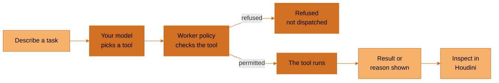
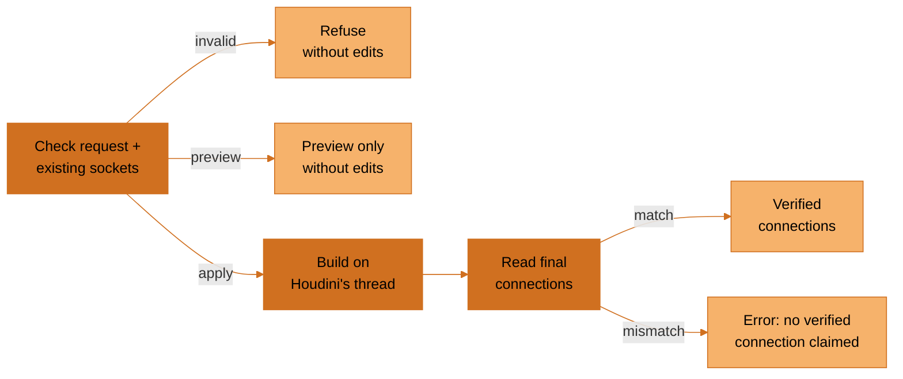
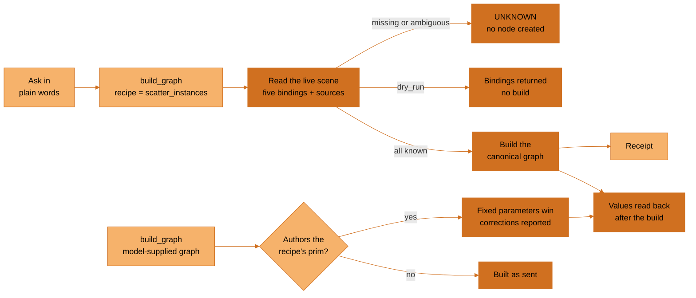

<p align="center">
  <picture>
    <source media="(prefers-color-scheme: dark)" srcset="assets/synapse-lockup-dark.svg">
    
  </picture>
</p>

<p align="center"><strong>SYNAPSE is an AI assistant that runs inside Houdini 22.</strong></p>

<p align="center">Connect a local or cloud AI model that can use tools, describe a task in plain words, and SYNAPSE builds real nodes in your scene that you can inspect and edit.</p>

<p align="center">By default it makes changes without asking first, so start in a scratch scene.</p>

<p align="center"><sub>v5.103.0 · Houdini 22.0.400 · Python 3.13 runtime<br>tags: v5.103.0 is Latest</sub></p>

[](https://github.com/JosephOIbrahim/Synapse/releases/latest)
[](https://github.com/JosephOIbrahim/Synapse/actions/workflows/ci.yml)
[](LICENSE)

**[Instructions](INSTRUCTIONS.md)** · [Versions and tags](TAGS.md) · [What's new](docs/releases/v5.103.0.md) · [Help](#when-you-get-stuck)

How to read this page: Start here and Install get you running. Everything after them is reference you can come back to when you need it.

## Start here

5.103.0 changes no product behaviour. It adds a self-improvement memory plane under harness/sim - a place to record a harness edit, the failure it addresses, the delta it predicted and the delta it measured - which nothing on the runtime path imports. 5.102.0 took paths from this project's machines out of two files that Setup installs. [What changed in 5.103.0](docs/releases/v5.103.0.md) has the detail and every limit.

Otherwise the panel, the Setup behaviour, Moneta 1.3.0, the native-artifact policy and 5.101.1's optional ceiling on the panel worker's tools are unchanged from [5.101.1](docs/releases/v5.101.1.md).

anthropic 2.x is still unsupported.

### Get 5.103.0

**5.103.0 is a source release.** It publishes no Setup, no source ZIP and no checksum
file, because it changes no product behaviour — the `harness/sim` plane it adds is
not imported by anything the product runs.

- **If you want an installer:** the newest one is
  [Windows Setup v5.102.0](https://github.com/JosephOIbrahim/Synapse/releases/download/v5.102.0/SYNAPSE-5.102.0-Setup.exe),
  and a 5.102.0 seat behaves exactly as a 5.103.0 seat does.

- **If you want the source:** it is the tag —
  `git clone https://github.com/JosephOIbrahim/Synapse && git checkout v5.103.0`.

- **Check the tag:** `git rev-parse 'v5.103.0^{commit}'` resolves the annotated tag
  to its source commit. Setup remains unsigned; the v5.102.0 Setup's
  [SHA-256 checksum](https://github.com/JosephOIbrahim/Synapse/releases/download/v5.102.0/SHA256SUMS.txt)
  still applies to that file and to nothing in this release.

- **What was checked:** the [5.103.0 note](docs/releases/v5.103.0.md) carries the
  stock-suite line, what it does not cover, and every limit. The v5.102.0
  [tests and limits](docs/releases/v5.102.0.md#tests) still describe that Setup.

Setup includes the panel as of v5.102.0, including Spatial, the Render footer row and the scene-reading Scatter recipe.

### Install in four steps

01\. Save your scene and close Houdini. Follow [source installation](docs/getting-started/installation.md#source-installation) for v5.103.0, or run the v5.102.0 [Windows Setup](docs/getting-started/installation.md#windows-installer).

02\. Restart Houdini. Open New Pane Tab, then Synapse.

03\. Open Connect models. Choose a provider and model, and add its key if it needs one.

04\. For node creation, select Build and edit networks. Choose Check connection, then Use this model.

Using Ollama? Start its service first.

Connect starts the separate Houdini bridge, and Doctor checks the setup without a model.

**Published, installed and running can differ.** This page does not update your seat or an open Houdini session. Install separately, then restart Houdini to load the update.

The 5.101.1 tag and its assets remain unchanged.

Jump to: [First build](#your-first-build) · [Controls](#find-the-right-control) · [Stop safely](#three-ways-to-stop) · [What changed](#what-changed-in-51020) · [Troubleshooting](#when-you-get-stuck)

## What changed in 5.102.0

No shipped code changes. Five files that reach you change, and only their text: two that Setup installs no longer name folders on this project's machines, and three in the source ZIP name a redaction token instead of the account.

The rest of the release is a test and the release audit, and neither reaches your seat.

### Paths from this project's machines, removed or redacted

- **Source ZIP, three files.** Four paths into the release machine's account folder now name `Example`, the repository's redaction token, instead of the account: `docs/SYNAPSE_MULTI_PROVIDER_LEG1_PROBE_DATA.json` (2), `tools/_hy_parity_gui.json` (1) and `tools/_hy_verbs_sweep_22.0.400.json` (1).

- **Setup, the SideFX Labs corpus.** 409 entries in `rag/corpus/sidefxlabs_entries.json` name their source file from `SideFXLabs` onward, not from a staging folder.

- **Setup, a reference skill.** `rag/skills/houdini21-reference/solaris_compound_node_anatomy.md` keeps a transcript's title and drops its folder.

- **A test keeps them out.** [`tests/test_shipped_files_carry_no_owner_paths.py`](tests/test_shipped_files_carry_no_owner_paths.py) fails if any of the five files carries those paths again.

The release audit now reads the spelling these paths used, so a path into the account folder written with any run of slashes or backslashes stops a release when it is in the source ZIP or in a Setup file with one of the audit's 16 text suffixes. The audit that passed v5.101.0 and v5.101.1 could not see it.

Producer: `scripts/product_surface.py --diff v5.101.1 1194373d` reports no product change, and the [release notes](docs/releases/v5.102.0.md#what-changes) name the producer of every count.

The version bump in the release commit also rewrites the version string in shipped files.

5.102.0 keeps everything 5.101.1 changed, including the optional ceiling on the panel worker's tools, `SYNAPSE_WORKER_TOOL_ALLOWLIST`: [what it does and how to set it](docs/releases/v5.101.1.md#how-to-use-it). It also keeps everything 5.101.0 changed: the import error that quotes what went wrong, the Render QC timing measurement and the stricter release gates.

### What 5.102.0 does not change, and its limits

- At least 77 paths from this project's machines remain in 17 files that only the source ZIP carries, including a scene path in `tools/_hy_parity_gui.json`. Setup does not install those files. The scan that counted them read only JSON, Markdown, text and log files, and two Python files that Setup installs name a local corpus folder in their comments.

- For the optional tool ceiling from 5.101.1:

  - A name that matches no tool is ignored without a warning.
  - A list in which no name is both real and permitted by the mode leaves the worker with no tools.
  - The list limits tool names, not what a listed tool can do: in the default mode, with `houdini_create_node` and `houdini_set_parm` listed, the worker can still make a wrangle or Python node and write its code.
  - The ceiling limits the panel's model worker only. Claude Code and other MCP clients do not pass through it; [read-only mode](docs/mcp/SETUP.md#read-only-mode) is the switch that limits them.
  - Read-only mode also limits the panel's own worker while its calls go through `/mcp`, and it always lets the stop controls through.

- No artist sees a finding from the timing harness or from Render QC.

- **anthropic 2.x is still unsupported.** The pin stays `anthropic>=1.0.0,<2`, and under 2.x the model-access guard still refuses every model call ([the migration ticket](docs/tickets/ANTHROPIC_SDK_2X_MIGRATION.md)).

- Setup remains unsigned.

- Durable worker receipts are not in this release. That lane waits on its own review.

- The import error from 5.101.0 still has rare failures of its own:

  - A stub `anthropic` or `pydantic` module without an import spec, or an import finder that raises, replaces the diagnostic with its own error.
  - A local file named `anthropic.py` that shadows the package makes the message blame a dependency.

  Nothing in SYNAPSE causes these today. They are not fixed in 5.102.0, and no release is named for them.

- Doctor behaviour from 5.100.0 is unchanged. Its limits are in [5.100.0's notes](docs/releases/v5.100.0.md#limits).

The full list is in the release notes' [Limits](docs/releases/v5.102.0.md#limits) section.

## Your first build

In a scratch scene, send:

```text
make a box
```

Inspect the nodes, change a parameter, then try Undo.



**Undo covers a recorded operation.** It does not reverse a whole conversation, and it does not reverse files written to disk. A failed build can leave partial nodes until you deliberately undo them.

The default worker refuses more than it allows. It permits read-only tools and the inform-level edits (create a node, set a parameter, connect a wire, create a material), plus the artist's own Undo and Redo, which are inform-gated too.

It refuses node deletion, arbitrary Python and VEX, renders, exports, memory pruning and batch PDG cooks, and it refuses any tool it does not recognise.

Three composite Solaris builders, listed in `_WORKER_BUILDER_ALLOWLIST` in `python/synapse/panel/worker_policy.py`, are the exception; each is one undo-wrapped call made only of inform-level primitives. [Tool policy and execution boundaries](docs/architecture/overview.md#permission-and-undo-boundaries).

## Safer Solaris wiring

**An insertion keeps the exact upstream output.** Every connection into a node that already exists reserves its slot before other wires are appended. Merge-style targets also get an order warning, never a silent reorder.

Invalid requests stop before scene changes:

- Preview must be a boolean.
- Managed parameters must be an object.
- A supplied display selector must be the id of a node in the request.

Verified connections come from the final wires. If a later cook changes a wire, the builder reports an error instead of returning a stale success receipt.

A failed build tries to take back the one undo group it opened, and only when the undo stack still shows it. If that take-back fails, the partial build is left for you to undo.



Checked in Houdini 22.0.400: the seven-fix controls passed in fresh headless sessions. A separate graphical session then passed the real production bridge checks, including repeat builds and artist Undo after a refused wire change.

These checks do not measure a complex scene's time savings, and they do not qualify every panel interaction. See [release notes and evidence](docs/releases/v5.97.2.md#what-was-measured).

The inherited merge-warning fix has standalone tests; its original limits remain in the [5.97.3 notes](docs/releases/v5.97.3.md#solaris-merge-warning-side-fix).

## Build from a verified recipe

Some requests have a recipe that was built and checked on Houdini 22.0.400. Scatter Instances on an imported Gaussian-splat world is one that reads the scene for you before it builds.

Ask in plain words:

```text
Scatter rocks along the cobblestone lane.
```

SYNAPSE reads the scene before it builds. It finds the camera, the world, the world's collider and the place in the chain where the new nodes go, and it tells you where it read each one.

**If anything is missing or ambiguous, the answer is UNKNOWN and nothing is built.**

If everything is known, it builds the recipe with the recipe's own values. An older note in memory cannot change them, and any value it had to correct is listed in the reply.

The reply carries a receipt, and the receipt carries Revert. One click takes back that turn's own SYNAPSE-labelled undo group, and only while nothing else sits above it in Houdini's undo stack.



The reader knows one scene shape today:

- the `/stage` network
- exactly one camera
- a Camera node feeding the render settings directly
- one imported world that still carries its import record, with its source `.ply` and a sibling collider `.glb` beside it

Anything else is UNKNOWN. The [release notes](docs/releases/v5.94.1.md) list what was seen in Houdini and what was not.

## See what nodes do

Select one or more nodes in a network editor. Then click Identify at the bottom of the panel, or send `/identify`.

A short bubble appears beside each node, drawn over the network editor. It says what the node does, which parameters you changed, and whether the node has an error, a warning or a bypass.

The bubble comes from the node itself and its page in your local SideFX help library, found the way Houdini's own help finds it, or from an HDA's own help when the library has no page for it.

**No model runs, and nothing leaves your machine.**

Click Identify again, or send `/identify off`, to clear the bubbles. The overlay is not saved into your scene.

Identify can also remove its own old-format comment blocks in one undo group while preserving artist text. [Cleanup details](docs/architecture/overview.md#identify).

```mermaid
flowchart LR
    accTitle: Identify draws a short local bubble beside each selected node
    accDescr: The panel reads facts for up to 60 selected nodes on Houdini's main thread. A worker finds each type's exact local help page, or an HDA's own help, and builds each bubble without a model. Old Identify-generated comment blocks are removed in one undo group, artist text kept. The main thread then draws an overlay that follows pan and zoom. The overlay is not saved.
    S["Selected nodes<br/>(up to 60)"] --> I["Click Identify"]
    I --> F["Read node facts<br/>on the main thread"]
    F --> L["Find each type's exact<br/>help page once"]
    L --> C["Build each bubble<br/>without a model"]
    C --> K["Remove old comment blocks<br/>in one undo group"]
    K --> W["Draw an overlay<br/>above the editor"]
    W --> V["Follow pan and zoom;<br/>overlay not saved"]
    classDef default fill:#F6B26B,stroke:#D07020,color:#000000
    classDef artist fill:#F6B26B,stroke:#D07020,color:#000000
    classDef synapse fill:#D07020,stroke:#D07020,color:#000000
    class S,I artist
    class F,L,C,K,W,V synapse
    linkStyle default stroke:#D07020
```



Each click reads and draws the first 60 selected nodes. The cap is `CAP = 60` in `python/synapse/identify/bubble.py`, applied before the fact read, and the chip still reports your full selection. The [release notes](docs/releases/v5.85.0.md) explain the details and the current limits.

## Find the right control

| I want to… | Open or use… |
|---|---|
| Change the generation model | The model name at the top, or Connect models. |
| Add my JEV / TypeSafe key | Connect models, then JEV / TypeSafe key setup, then Save session key. [Setup guide](docs/getting-started/jev-setup.md). |
| Make more room for my prompt | Drag Resize above the input box. |
| Find an action | Commands below the input box. |
| See what selected nodes do | Identify at the bottom of the panel, or send `/identify`. |
| Read how the shot's camera moves | Spatial at the bottom of the panel, or send `/spatial`. It draws the path in one undo step, with no model call. |
| Ask what SYNAPSE remembers about this scene | Ask in plain words. It reads this scene's saved notes first, and it says the answer is recalled, not measured again. |
| Import a Marble world or Gaussian `.ply` | World Labs beside Cloud relay. [Import flow and limits](docs/architecture/overview.md#world-labs-import). |
| Connect the SideFX help library | Follow [Build and connect](docs/studio/SIDEFX_LIBRARY.md#build-and-connect); Scout searches the published local index. |
| Check a connection | Connect, then Doctor. |

Saving a JEV key keeps it in memory until Houdini closes.

**Saving the key does not enable JEV, verify it or grant data permission.** The setup guide walks through those separate controls.

### Three ways to stop

| Control | What it reaches | Limit |
|---|---|---|
| Stop | The panel's current turn. | Does not prove an active cook or render has stopped. |
| Cancel cook, in the overflow menu | One known cooking node. | Unavailable when SYNAPSE cannot identify the node. |
| Emergency halt, in the overflow menu | Cooking TOP networks under `/tasks`, `/obj`, `/stage`, `/out`; captures a session report. | Background renders are reported, not stopped. |

**A turn also stops itself.** It ends after 25 tool rounds, 10 minutes or 3,000,000 input tokens, whichever comes first. The last line of the reply says which limit it reached, and no tool runs after that line.

The numbers are `_MAX_TOOL_ITERATIONS`, `SYNAPSE_TURN_BUDGET_S` and `SYNAPSE_TURN_BUDGET_TOKENS` in `python/synapse/panel/claude_worker.py`.

## What's ready

- **Network work:** build and inspect through permitted tools, and keep the result editable in Houdini.

- **Verified recipes:** Scatter Instances reads its scene bindings in one call and builds with fixed values, or answers UNKNOWN and builds nothing.

- **Identify:** a short bubble beside each selected node, built from the node and local SideFX help with no model call.

- **Model choice:** Claude, Gemini, NVIDIA Nemotron, Ollama and custom OpenAI-compatible endpoints. Tool support varies.

- **Claude Code:** use SYNAPSE's tools from Claude Code through [MCP](docs/mcp/SETUP.md#claude-code). It asks before each tool call unless you allow that tool.

- **Optional JEV assistance:** rank selected-network actions or measure routing. Your generation model stays selected.

- **Local knowledge:** the [SideFX library](docs/studio/SIDEFX_LIBRARY.md), [project memory](docs/architecture/overview.md#project-and-scene-memory) and [checked lookdev suggestions](docs/development/rsi_stage0.md).

[Current limits](docs/status.md) · [Latest release notes](docs/releases/v5.103.0.md) · [Changelog](CHANGELOG.md)

## When you get stuck

| What you see | Try this first |
|---|---|
| No Synapse pane | Restart Houdini, then [verify installation](docs/getting-started/installation.md#verify-the-installation). |
| Missing Ollama models | Start Ollama, then reopen Connect models and Check connection. |
| Unsure where the TypeSafe key goes | [JEV key setup](docs/getting-started/jev-setup.md#add-your-key). |
| No saved suggestion | Read its reason. A checked record, matching version and project memory owner are required. |
| Build running away | Use [Cancel cook or Emergency halt](#three-ways-to-stop), then inspect the scene. |
| Identify bubbles say "Not in the local SideFX library" | [Build and connect the SideFX library](docs/studio/SIDEFX_LIBRARY.md#build-and-connect), then restart Houdini. |

[Report a bug](https://github.com/JosephOIbrahim/Synapse/issues/new/choose) · [First-session walkthrough](docs/getting-started/quickstart.md)

## Watch it work

[](https://vimeo.com/1225720538)

[Watch the recorded demonstration on Vimeo](https://vimeo.com/1225720538)

SYNAPSE does the work inside your Houdini scene through tools you can inspect, and what it builds stays yours to edit.

<details>
<summary><strong>For developers: architecture, checks and memory</strong></summary>

**139 tools, two paths.** The registry count comes from [`TOOL_DEFS`](python/synapse/mcp/_tool_registry.py), checked by [tool-count tests](tests/test_phase0c_doc1_toolcount.py).

Panel requests prefer HTTP `/mcp`; its ordinary mutations use the execution bridge. Reads, farm controls and Doctor route separately.

The configured stdio client forwards Houdini calls over WebSocket `/synapse` to direct handlers. Those paths have different policy and evidence boundaries.

Setting `SYNAPSE_MCP_READ_ONLY=1` limits every `/mcp` and WebSocket caller, the panel included, to read-only tools; stop controls always pass ([read-only mode](docs/mcp/SETUP.md#read-only-mode)).

[Execution diagrams and limits](docs/architecture/overview.md#execution-paths) · [External MCP setup](docs/mcp/SETUP.md) · [Source development and tests](docs/getting-started/installation.md#for-contributors)

### What CI runs

CI runs the suite in six pytest invocations:

- `tests/`
- `harness/jev/tests`
- `harness/harness2/tests`
- `harness/attest/tests`
- `harness/notes/release-v5.97.7/tests`
- `harness/probes/tests`

The first four are also in `testpaths` in [`pyproject.toml`](pyproject.toml), so a bare `pytest` run collects them.

CI also runs one targeted re-check of the Moneta-backed memory tests. See [the workflow](.github/workflows/ci.yml).

**CI never runs the Houdini-dependent tests.** No Houdini runtime exists on a CI runner, so tests that need one are deselected there and never execute. Those tests are measured by hand on a maintainer's machine, not by CI.

CI runs stock Python 3.11 and 3.14 on Linux, macOS and Windows. CI on `f50d9515` passed six of six jobs, with between 12,663 and 12,673 tests under `tests/` passed and 0 failed on each job ([Actions run 43615813442](https://github.com/JosephOIbrahim/Synapse/actions/runs/43615813442)).

For 5.100.0, the stock suite on the release host was 12,906 passed, 506 skipped, 11 xfailed and 0 failed. Run locally with CI's marker expression (`-m "not needs_houdini"`, `--collect-only`), 13,219 of the 13,405 tests under `tests/` were collected and 186 deselected. Both figures were measured on `00629530` ([5.100.0's evidence](docs/releases/v5.100.0.md#tests)), and neither is a CI-runner count.

The suites that need Houdini were not green on the 5.100.0 release host.

Under hython 22.0.400 the 5.100.0 release tree (`00629530`) gave 116 failed and 4 errors, 120 failing nodes, and master `26861cf9` gave the same 120 on the same host; 1 failed on the release tree without also failing on `26861cf9` ([5.100.0's evidence](docs/releases/v5.100.0.md#tests)).

The seat runs do not exercise Moneta, and those counts move between runs. They were not re-measured for 5.101.0, 5.101.1 or 5.102.0, so this page carries no seat-suite figure for any of them.

The Moneta step, which runs only when the deploy key is configured, shows that Moneta imports; it does not show that the Rust extension runs.

Native Houdini behavior and Windows installer qualification are separate checks. See each [release's evidence](docs/releases/v5.103.0.md) before relying on it.

### How SYNAPSE remembers

Configured memory and scene/project notes supply recalled context. Recall is advice; it does not authorize a scene action.

A scene's notes come back through `synapse_project_setup`. Search and recall read saved decisions, and they do not cover those notes. The panel asks for the notes first when you ask what it remembers about a scene.

Explicit memory writes, decisions and error rows are recorded. Automatic session and action rows are off unless `SYNAPSE_AUTO_MEMORY=1`.

A returned record ID alone does not prove that it will survive a restart; [storage and recall limits](docs/architecture/overview.md#project-and-scene-memory) explain the separate writes.

Moneta's USD mirror is an inspection view, not the storage owner. Missing services and unknown outcomes remain visible. A memory store that cannot be read is reported as a failure, not as an empty answer.

Native policy depends on the installation route. The [source package](packages/synapse.json) retains OFF. Windows Setup can enable a fresh Windows x64 / H22.0.400 / Python 3.13.10 setup only after pinned-artifact and actual execution checks.

5.102.0 changes no file under `installer/` or `packages/` (`git diff --stat v5.101.1 1194373d -- installer/ packages/` is empty).

Explicit OFF and existing default-OFF choices stay OFF. Existing ON needs the same host, artifact and execution qualification. Memory status reports the module as `loaded`, `blocked` or `not_loaded`; a flag alone proves no execution. [Measured limits](docs/releases/v5.97.7.md#tests).

A native panic is caught in four places. If the Moneta store panics while it is built, SYNAPSE logs it, records the fallback and serves the JSONL store. A panic inside `synapse_sleep_pass` returns `ran=False`.

Since 5.97.4, a panic that reaches the command dispatcher gets a failed reply under its request id, and with `SYNAPSE_AUTO_MEMORY=1` a panic in an automatic session row is logged and that row is skipped.

The connection handlers themselves still catch `Exception` only.

**`synapse_sleep_pass` is refused unless `SYNAPSE_ALLOW_SLEEP_PASS=1` is set.** It prunes memory, and a request cannot opt in. It only prunes when the active store is Moneta-backed; under the default JSONL store it does nothing.

Over the WebSocket connection the sleep pass opens no undo group, so it cannot take back your last edit. On the in-Houdini HTTP `/mcp` route and the panel's tool route, an opted-in pass still runs inside the bridge's undo group. A pass that fails after pruning is still audited.

A second, separate prune can run inside ordinary writes, and only when `SYNAPSE_AUTO_CONSOLIDATE` is set; it is independent of the sleep pass.

Attention durability has a bounded contract. Moneta 1.3.0 implements preservation of undrained attention in attached keyed snapshots; its degraded/keyless and unattached save paths have separate limits. The local reopen probes do not establish every attention/save/switch/quit path. See [current storage limits](docs/releases/v5.97.7.md#limits).

[Storage and recall diagram](docs/architecture/overview.md#project-and-scene-memory) · [Optional memory LOOP](docs/architecture/overview.md#memory-loop) · [Saved suggestions](docs/development/rsi_stage0.md)

</details>

## License

[MIT](LICENSE).

Moneta 1.3.0 is bundled under the MIT License by its copyright holder's written grant of 2026-10-19. Its pinned upstream metadata still declares "Proprietary"; the bundle includes the grant notice and full MIT text.

Third-party packages retain their own licenses. The installer's `DEPENDENCIES.txt` lists the included components and license-text locations.

The SideFX PDF, MPM masterclass transcripts and rewritten guides are excluded from this release.

Patent applications are pending on the USD cognitive-state substrate, digital injection, and predictive lighting. See [PATENTS](PATENTS).
