# How SYNAPSE works

[Back to README](../../README.md) · [Current limits](../status.md) · [Artist intent](../../INTENT.md)

These diagrams describe implemented behavior. Each section links to its source. Future modes in `INTENT.md` are not implied by an arrow here.

The current release is **[5.99.0](../releases/v5.99.0.md)**.
[Tag identities](../../TAGS.md) distinguish it from later default-branch edits.

## Published 5.99.0 installation

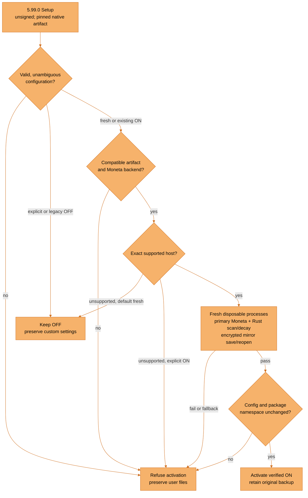

Sources: [configuration and transaction](../../installer/synapse_setup/engine.py),
[native policy](../../installer/synapse_setup/native_policy.py),
[disposable native check](../../installer/synapse_setup/native_check.py),
[actual execution check](../../installer/synapse_setup/native_probe.py),
[registration](../../installer/synapse_setup/registration.py),
[final installer verification](https://github.com/JosephOIbrahim/Synapse/releases/download/v5.99.0/installer-verification.json).
The source-install scripts retain their separate OFF default. Interactive wizard,
clean-machine and arbitrary artist-scene qualification remain separate.

### Published 5.97.5 installation

The [unchanged 5.97.5 installer](../releases/v5.97.5.md) contains no native wheel.
It refuses edited installer-owned packages, but manual migration generates a new
registration without the old native/custom entries. Use the current 5.99.0
release for the policy shown above; older tags and assets are preserved.

| Follow a workflow | Start here |
|---|---|
| A model calls a tool | [Execution paths](#execution-paths) |
| The panel worker's tools are capped | [Worker tool ceiling](#worker-tool-ceiling) |
| JEV offers advice | [JEV assistance](#jev-assistance) |
| Selected nodes are explained | [Identify](#identify) |
| An Atlas splat scene enters Houdini | [World Labs import](#world-labs-import) |
| Scout searches SideFX help | [Library ingestion and lookup](../studio/SIDEFX_LIBRARY.md#ingestion-and-lookup) |
| A project decision is remembered | [Memory](#project-and-scene-memory) |
| A build becomes a release | [Publication](#release-process) |

## Artist workflow

The artist chooses a model, a task and the permitted data destination. The panel worker applies its tool policy, then shows results, refusals or uncertainty. The artist inspects and edits the resulting scene.

Sources: [panel](../../python/synapse/panel/synapse_panel.py), [connections](../../python/synapse/panel/connections.py), [worker policy](../../python/synapse/panel/worker_policy.py).

## Execution paths

HTTP `/mcp` and WebSocket `/synapse` share one local Houdini server. **The connection determines the dispatch path.** Being inside Houdini does not remove the transport.

### Panel and HTTP clients

In the diagrams below, a path that starts with `panel/`, `mcp/`, `server/` or `host/` is under `python/synapse/`: `panel/worker_policy.py` is `python/synapse/panel/worker_policy.py`. Every other path starts at the repository root.

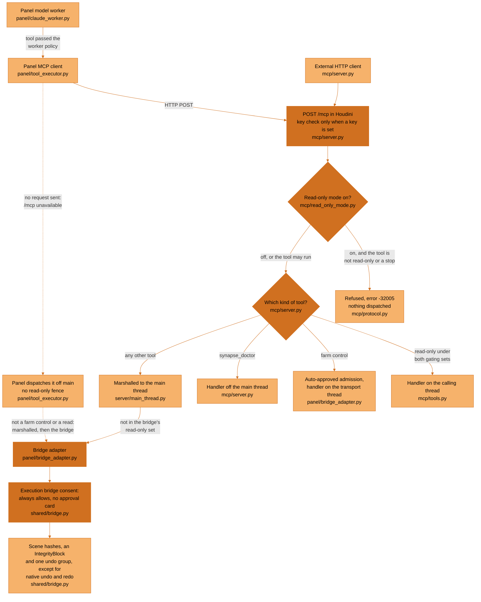

Read-classified tools skip the mutation bridge. Farm controls use their own admission and job I/O; Doctor uses its own off-main handler path. Houdini API access still belongs on the main thread.

**The bridge's consent never blocks.** The one process-wide bridge is built with an approve-everything callback and no approval gate, and the panel points that callback at its own, which also approves. So consent is recorded, never asked for.

The read-only fence is off by default. With `SYNAPSE_MCP_READ_ONLY=1` in Houdini's environment, it refuses every tool that is not read-only under both gating sets, for every caller of `/mcp`, the panel included. Stop controls always pass. [Read-only mode](../mcp/SETUP.md#read-only-mode).

**The panel's own fallback skips the fence.** When the panel's request to `/mcp` was never sent, because the endpoint is unavailable, the panel dispatches the tool itself, off Houdini's main thread. That path routes changes through the same bridge, but it never consults read-only mode. The worker's own policy, including the [worker tool ceiling](#worker-tool-ceiling), still applies first.

If bridge imports are unavailable, non-farm handlers can fall back to direct dispatch without bridge wrapping. Farm controls fail closed in that case.

**Cancel cook** and **Emergency halt** are direct artist actions. They dispatch off the UI thread without asking a model. Their re-entry guards are per tool, so one does not silently swallow the other.

Sources: [HTTP dispatch](../../python/synapse/mcp/tools.py), [HTTP server](../../python/synapse/mcp/server.py), [read-only mode](../../python/synapse/mcp/read_only_mode.py), [bridge adapter](../../python/synapse/panel/bridge_adapter.py), [bridge construction](../../shared/bridge.py), [main-thread marshal](../../python/synapse/server/main_thread.py), [panel tool executor](../../python/synapse/panel/tool_executor.py), [panel worker](../../python/synapse/panel/claude_worker.py), [direct safety controls](../../python/synapse/panel/direct_tool.py).

### Configured stdio and WebSocket clients

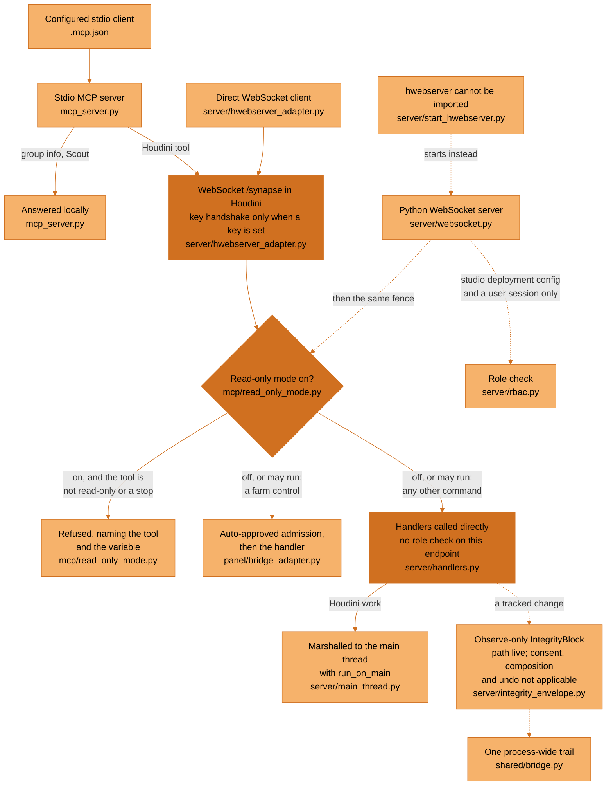

These handlers do not inherit the panel worker's restrictions or the worker tool ceiling. Bridge consent reaches only farm controls, and it always approves. Tracked mutations produce path-qualified, observe-only `IntegrityBlock` evidence; an unavailable check is not recorded as a passed check.

**The in-Houdini `/synapse` endpoint runs no role check.** Role permissions live in `python/synapse/server/rbac.py`, and only one server applies them: the Python WebSocket server in `python/synapse/server/websocket.py`.

SYNAPSE starts that server only when Houdini's `hwebserver` module cannot be imported, and it starts it without a deployment configuration. Without one, the server runs in local mode, creates no user sessions and checks no roles. A role check needs a caller that builds that server with a studio deployment configuration, and a client with a user session.

**Undo grouping on this path is per handler.** Some handlers wrap their edits in one undo group, such as node creation in `python/synapse/server/handlers_node.py`; not every handler has been checked for it. Grouping is not rollback.

Sources: [configured client](../../.mcp.json), [stdio adapter](../../mcp_server.py), [in-Houdini WebSocket](../../python/synapse/server/hwebserver_adapter.py), [server start](../../python/synapse/server/start_hwebserver.py), [fallback WebSocket server](../../python/synapse/server/websocket.py), [roles](../../python/synapse/server/rbac.py), [handlers](../../python/synapse/server/handlers.py), [node handlers](../../python/synapse/server/handlers_node.py), [main-thread marshal](../../python/synapse/server/main_thread.py), [integrity envelope](../../python/synapse/server/integrity_envelope.py).

### A verified recipe reads the scene, then builds

`synapse_solaris_build_graph` takes `recipe="scatter_instances"`. With `dry_run` it reads the scene and returns the recipe's five bindings, each with the place it was read from. Without `dry_run` it reads again in the same main-thread turn and builds only when every binding is known.

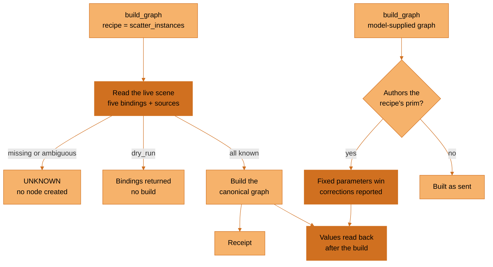

The reader supports one scene shape: the `/stage` network, exactly one camera, a Camera LOP feeding a Render Settings or Karma Render Settings node directly, and one imported world that still carries its import record, with its source `.ply` and a sibling collider `.glb` beside it. Anything else is UNKNOWN.

Enforcement is keyed on the prim path. A Scatter Instances node that authors `/World/scatter_rocks` is the recipe's node; any other is an artist's own scatter and is built exactly as sent.

Sources: [recipes and resolver](../../python/synapse/routing/solaris_recipes.py), [graph handler](../../python/synapse/server/handlers_solaris_graph.py), [resolver tests](../../tests/test_scatter_resolver.py).

### A missing reply is not permission to repeat

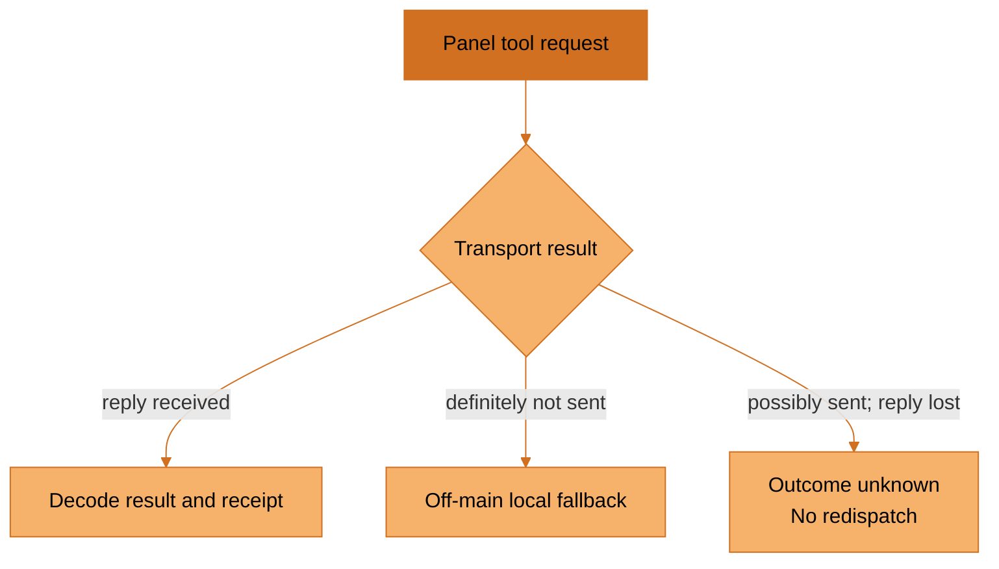

Source: [panel tool executor](../../python/synapse/panel/tool_executor.py).

### Permission and undo boundaries

| Boundary | What it controls |
|---|---|
| Model-data permission | Which provider may receive permitted task data. |
| Standard panel worker | Allows classified reads and edits; refuses higher-risk tools and unknown tools. |
| Optional `proposal` worker | Allows reads, knowledge tools and declared proposals; blocks direct mutation and graph instantiation. Default remains `standard`. |
| Worker tool ceiling | `SYNAPSE_WORKER_TOOL_ALLOWLIST`, since 5.101.1. A tool not on a set list is refused in every worker mode; a listed tool still gets its mode's decision. Panel worker only. [Worker tool ceiling](#worker-tool-ceiling). |
| Production bridge | Uses nonblocking auto-approval at its admission layer. No interactive approval card is attached. |
| Direct WebSocket handlers | Their own authentication, when a key is set, and their own handler rules. The in-Houdini endpoint checks no roles ([above](#configured-stdio-and-websocket-clients)). They do not inherit panel policy or the worker tool ceiling. |
| Undo grouping | Groups supported scene edits. It does not reverse file/network effects or guarantee exception rollback. |
| Turn budget | Ends a panel turn after 25 tool rounds, 600 seconds (`SYNAPSE_TURN_BUDGET_S`) or 3,000,000 input tokens (`SYNAPSE_TURN_BUDGET_TOKENS`). The last round runs no tool and the reply names the limit. |

The bridge has a `HumanGate` API, but attaching its blocking approval poll to the GUI thread would deadlock the panel. Panel worker refusals are a separate control. External direct handlers can still execute Python/VEX under their own rules.

If construction fails halfway, inspect the partial scene before undoing. Native Undo/Redo traverse existing history outside a new undo group. Composition checks and operation receipts do not guarantee a rollback.

Use the external bridge on a **single-user local machine**. [MCP setup and authentication](../mcp/SETUP.md).

Sources: [worker policy](../../python/synapse/panel/worker_policy.py), [bridge construction](../../shared/bridge.py), [nonblocking consent tests](../../tests/test_panel_consent_no_freeze.py).

### Worker tool ceiling

`SYNAPSE_WORKER_TOOL_ALLOWLIST` caps the tools the panel's model worker can use. It is a comma-separated list of exact tool names.

As above, a diagram path that starts with `panel/`, `mcp/`, `server/` or `host/` is under `python/synapse/`, and every other path starts at the repository root.

**Unset, empty, or only spaces and commas, it changes nothing.**

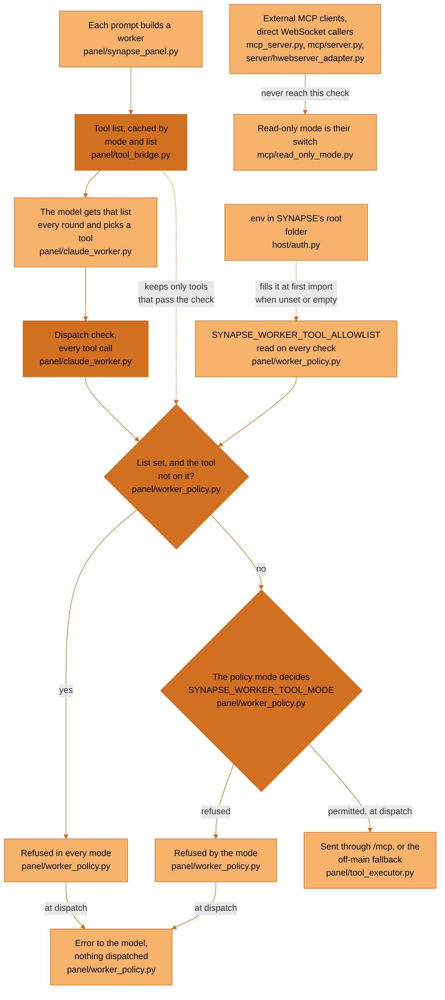

**The ceiling comes before every mode's own decision.** A tool that is not on a set list is refused in every policy mode: `strict`, `standard`, `unrestricted`, `demo` and `proposal`.

**It only removes tools.** A listed tool still gets its mode's decision, so listing `houdini_execute_python` does not make it callable in the default `standard` mode.

**Two places read it.** The tool list is built when the panel sends a prompt and is cached by policy mode and list, so the model sees only tools that pass. The dispatch check reads the variable again on every tool call; a refused tool is never dispatched, and the model gets the reason.

**It limits the panel's model worker, nothing else.** External MCP clients, such as Claude Code, and direct WebSocket callers never reach this check. Read-only mode is the switch that limits them.

Known limits:

- **A name that matches no tool is ignored without a warning.** A list with no usable name leaves the worker with no tools.

- **The list limits tool names, not what a listed tool can do.** With `houdini_create_node` and `houdini_set_parm` listed, the worker can still make a wrangle or Python node and write its code.

- **SYNAPSE's `.env` loader can set it.** When `python/synapse/host/auth.py` is first imported, it copies each entry of the `.env` file in SYNAPSE's root folder into the environment, unless that variable already has a non-empty value.

- **A change while the tool list is being built can cache the wrong list** until Houdini restarts. Dispatch still refuses a tool outside the list that is set. [5.101.1 limits](../releases/v5.101.1.md#limits).

Sources: [worker policy](../../python/synapse/panel/worker_policy.py), [tool list](../../python/synapse/panel/tool_bridge.py), [dispatch check](../../python/synapse/panel/claude_worker.py), [a worker per prompt](../../python/synapse/panel/synapse_panel.py), [`.env` loader](../../python/synapse/host/auth.py), [read-only mode](../../python/synapse/mcp/read_only_mode.py), [tests](../../tests/test_worker_tool_allowlist.py).

## JEV assistance

JEV is an optional adviser. A saved TypeSafe key, enabled preferences and the required permission are separate conditions. **Saving the key does not validate it or enable assistance.**

- **Rank selected-network actions** reorders available local suggestions. Selecting one appends editable prompt text; the artist decides when to send.
- **Measure routing** records shadow judgments. It does not switch the generation model or change its input.

Neither mode grants scene permission. If assistance is unavailable, its status must remain explicit.

[Key setup and flow diagram](../getting-started/jev-setup.md) · [action ranking](../../python/synapse/jev/selection_suggestions.py) · [routing measurement](../../python/synapse/jev/panel_routing.py) · [credentials](../../python/synapse/jev/credentials.py)

## Identify

Select nodes in a network editor, then click **Identify** or send `/identify`. The panel answers the command itself. It never reaches the model, and nothing leaves the machine.

The summary comes from the node's exact help page, found the way Houdini's own help finds it, never from a search result. A node the library does not cover says so. The overlay is its own see-through window above the editor, because Houdini draws the editor in one OpenGL surface; clicks and scrolls pass through it. Older versions wrote the note into the node comment below a `~ identify ~` line. When Identify finds such a block on a selected node it removes it in one undo group, and only when the block has the exact shape Identify wrote, so artist text is kept. The Selection Inspector shows the same text in a read-only column.

Sources: [overlay](../../python/synapse/identify/overlay.py), [bubble](../../python/synapse/identify/bubble.py), [placement](../../python/synapse/identify/layout.py), [old-note cleanup](../../python/synapse/identify/apply.py), [composer](../../python/synapse/identify/compose.py), [node facts](../../python/synapse/identify/facts.py), [library lookup](../../python/synapse/identify/library.py), [panel](../../python/synapse/panel/synapse_panel.py). Limits: [v5.85.0 release notes](../releases/v5.85.0.md#validation-and-limits).

## World Labs import

Open **World Labs** beside **Cloud relay**. It imports a finished World Labs **Atlas** splat scene, or a local Gaussian `.spz` or `.ply`. It never starts an Atlas task: every task costs credits, so tasks are run with the `worldlabs` CLI or the World Labs app. World Labs serves Atlas only; the Marble API path was removed (2026-11-22).

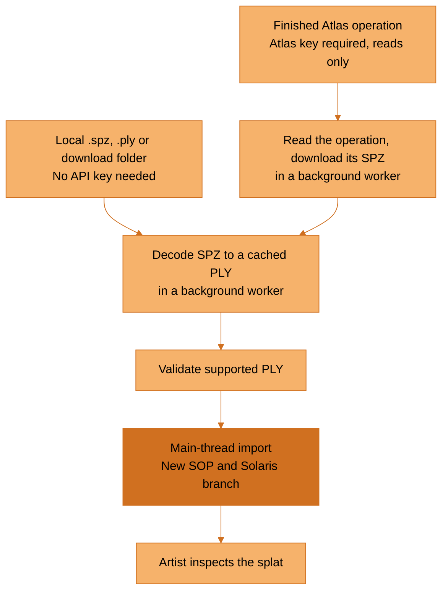

**The key.** A key typed in the masked field wins, then `$WLT_API_KEY`, then the key `worldlabs auth login` saved for the Atlas origin. The saved key is read in place and never shown or copied. The key needs `operations.read` and `assets.read`.

**Remote import.** Choose **Connect to Atlas** to list finished `posedImages2Splats` operations, or paste an operation ID. **Most splats** takes the largest refined output; **Fewest splats · layout** takes the smallest. Then **Import splats**. SYNAPSE calls only three read routes: list operations, get one operation, and create an asset read URL. Any other route, a task route above all, is refused before a request is built. The signed download carries no key.

**SPZ.** Houdini 22.0.400 cannot read SPZ (probe, 2026-11-22), so SYNAPSE decodes it with numpy into a standard Gaussian PLY, cached by the SPZ's SHA-256 under `~/.synapse/worldlabs/spz/`. SPZ versions 1-3 (gzip) decode everywhere. Version 4 (zstd) needs a zstd decoder, which Python 3.14 has and Houdini's Python 3.13 does not; such a file is refused with a plain message. Degree 1-2 view-dependent color is padded to degree 3, and degree 4 is reduced to degree 3.

The native route is File SOP → Bake GSplats → SOP Import LOP → a Transform LOP named after the import with `_ground` appended, which grounds it. It creates a separate branch and an undo group; it does not merge into existing stage wiring. On failure it attempts to remove its own new nodes and reports cleanup errors.

**Grounding (v5.89.0).** The ground node carries a uniform scale, an axis turn, and a lift that puts the floor at y = 0; the splat's points and the file are unchanged, and the display flag moves to the ground node. An SPZ is Y-up (RUB, Atlas's world frame), so it gets no turn. A local `.ply` keeps the historical Y-down default and gets a 180-degree turn about X. Atlas reports no metric scale, so the scale is unknown unless a `<world>.world.json` sidecar beside a local file gives `metric_scale_factor` and names its `scale_source`. The floor comes from a `<world>_collider.glb` beside the file when present (the area-weighted densest band of near-horizontal faces in the bottom quarter of its height), otherwise from the densest layer of splats at the floor end. The record (scale and source, offset and source, measured ground height, and the Atlas operation ID or SPZ hash) is stored as provenance user data under `synapse.worldlabs` on the new nodes.

**Format limits:** Gaussian PLY supports constant color (DC-only) or a complete degree-3 spherical-harmonic layout. Partial harmonic layouts, ordinary point PLY and mesh GLB are unsupported. The points keep the file's coordinates and units; the ground node holds the correction. Rendered appearance needs inspection.

Closing the dialog prevents a late scene import; it does not abort a download already running. A live read of the Atlas API (list, get, read URL; 2026-11-22) passed. No real Atlas splat has been imported yet: making one costs credits, so the SPZ version and axes Atlas writes are still unobserved. [v5.89.0](../releases/v5.89.0.md#validation-and-limits) rendered a Karma XPU frame of a grounded local import through the render workspace.

Sources: [dialog](../../python/synapse/panel/worldlabs_dialog.py), [Atlas client](../../python/synapse/worldlabs/client.py), [SPZ decoder](../../python/synapse/worldlabs/spz.py), [native importer](../../python/synapse/worldlabs/importer.py).

## Project and scene memory

Recording a decision retains context for later recall. It does not reconstruct a network or authorize a scene change.

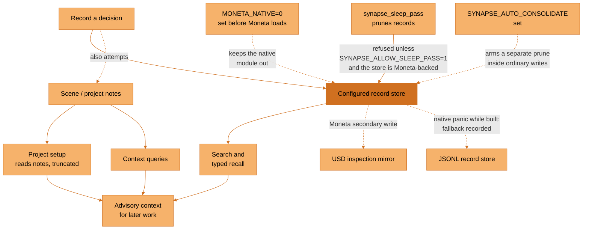

| Normal saved-project location | Role |
|---|---|
| `.synapse/memory.jsonl` | Default JSONL records; also a secondary copy with Moneta. |
| `.synapse/.moneta/snapshot.json` | Persistent source for the Moneta-backed record store. |
| `.synapse/.moneta/cortex_root.usda` | Inspectable USD mirror when Moneta and USD authoring are available. |
| `$HIP/claude/memory.md`, `$JOB/claude/project.md` | Human-readable scene and project notes. |

Unsaved scenes or unwritable projects can use fallback locations. `SYNAPSE_MEMORY_BACKEND=moneta` selects Moneta; initialization failure falls back to JSONL with the reason recorded. Since v5.97.3 that includes a native panic while the store is built, and `MONETA_NATIVE=0`, set before Moneta first loads, keeps the native module out of the process. `synapse_sleep_pass` prunes the record store and is refused unless `SYNAPSE_ALLOW_SLEEP_PASS=1` is set; it only prunes when the active store is Moneta-backed, so under the default JSONL store it is a no-op. A second, separate prune runs inside ordinary writes, armed only by `SYNAPSE_AUTO_CONSOLIDATE`, and is independent of the sleep pass. Closing the USD view does not control persistence.

`synapse_recall` retrieves typed records, defaulting to decisions. `synapse_memory_query` searches loaded scene/project content. `synapse_project_setup` loads starting context, including the scene's notes, truncated to 2,000 (project) and 3,000 (scene) characters.

**A fact that lives only in the notes is not found by search or recall.** A scene's landing record is one such fact. Since v5.94.0 the panel's prompt sends questions about what is remembered of a scene to `synapse_project_setup` first.

**Automatic rows are opt-in.** The session tracker writes "AI session started", "Executed: <command>" and a session summary only when `SYNAPSE_AUTO_MEMORY=1`. Decisions, explicit memory writes and error rows are always written. Since v5.97.4, a native panic while one of these automatic rows is written is logged and that row is skipped; the session, and the command's audit entry, go on.

**An error is reported as a failure.** When the store reports an error, search, add, decide and recall fail; they do not return the error as data inside a success.

**An ID alone does not prove durability.** Snapshot, mirror and note writes are independent. Reopen the project and retrieve the record before claiming cross-session persistence. Ordinary saved decisions do not require the optional LOOP.

Sources: [recording and recall](../../python/synapse/session/tracker.py), [store selection](../../python/synapse/memory/store.py), [Moneta persistence](../../python/synapse/memory/moneta_store.py), [scene notes](../../python/synapse/memory/scene_memory.py), [context queries](../../python/synapse/server/handlers_memory.py).

## Memory LOOP

The optional LOOP observes eligible operations. **It does not choose the scene action.**

| Substrate | Role |
|---|---|
| Moneta | Recall project records; retain settled feedback. |
| Octavius | Compose allowlisted context in a private USD stage. |
| Hanish | Retain a pre-action forecast and terminal evidence. |

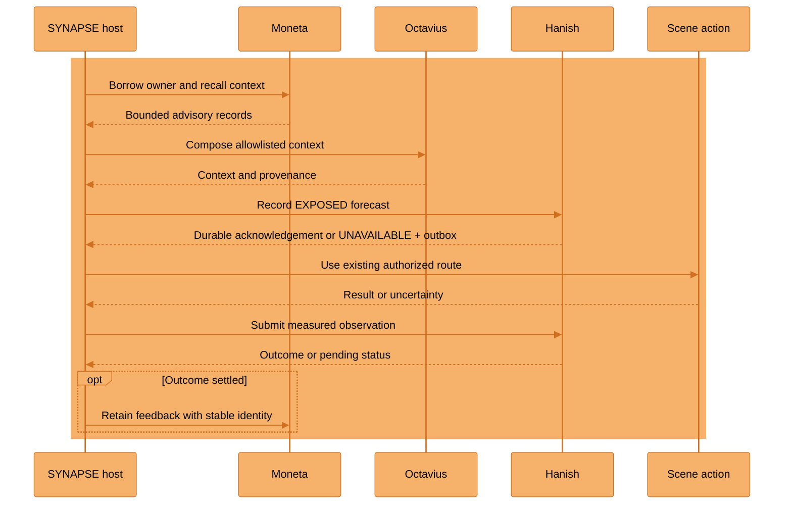

Enable with `SYNAPSE_LOOP_ENABLED=1`. The main-thread host borrows the existing memory owner; workers carry data, not handles. Octavius and Hanish run in bounded subprocesses.

The forecast concerns whether a synchronous handler returns without explicit failure. It does not predict an artist's next node or image quality.

- Missing Octavius can yield narrower local context, with the limit named.
- Missing Hanish retains an outbox and reports UNAVAILABLE. The observer does not gate the existing action route or claim settlement without an acknowledgement.
- Missing Moneta ownership can leave the action uninstrumented.
- Recovery cannot invent a pre-action forecast after dispatch.
- Unknown stays unknown. Recovery retries observations, never scene actions.

[Configuration and evidence](../MEMORY_LOOP_REPAIR.md) · [Host observer](../../python/synapse/host/memory_loop.py) · [Coordinator](../../python/synapse/loop/coordinator.py)

## Checked suggestions and future assistance

Stage 0 supports a fixed lookdev procedure with a developer-imported checked record and an existing Moneta owner. It is distinct from JEV's action ranking.

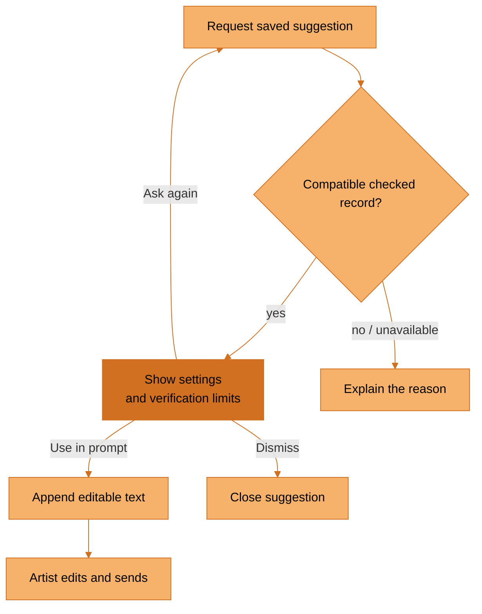

A record does not replay node paths or authorize a build. Compatibility includes the exact SYNAPSE version; upgrading requires a matching rehearsal/import. [Stage 0 guide](../development/rsi_stage0.md).

Predictive network generation, frontier-model Computer Use and recursive improvement remain later stages described in [INTENT.md](../../INTENT.md).

The [staged workflow guides](../../rag/corpus/guides) retain upstream provenance; that corpus is not yet served by the product. It is separate from the connected SideFX library.

## Release process

The owner's four gates are the stop points of the [v5.101.1 release card](../../harness/notes/release-5.101.1/RELEASE_v5.101.1.md): the VERSION commit, the Gate C push of master, the tag, and `gh release create`. The `TAGS.md` push after publication is asked on its own. Every step between the gates still waits for its own evidence.

```mermaid
flowchart TD
    accTitle: The owner's gates take a reviewed range to a published, read-back release
    accDescr: The gates are the owner's stop points in the v5.101.1 release card. A crux review covers the reviewed range; a failed review means a fix, a new tip and a new review. A passed review becomes a committed crux record. The release commit is staged and checked, then committed at gate 1 with the Gate C override that the pre-commit hook requires for VERSION. Setup is built from that commit and qualified. Gate 2 pushes master with the Gate C override that the pre-push hook requires. CI runs the six test jobs that .github/workflows/ci.yml defines on the pushed commit; a red job means a new commit on the pushed head, 6a again and gates 1 to 3 again, and a fix to a reviewed file needs a new crux review. When all six succeed, the hosted source archive is compared with the audited one. Gate 3 runs the tag script, which reads the crux record, creates the annotated tag on the commit it checked and never pushes. The release guard then judges the notes' claims; a false claim is a send-back. The CI gate reads CI for the tagged commit, and only on its exit 0 is the tag pushed. A refusal stops before the tag push and asks the owner. Gate 4 publishes with gh release create and --verify-tag, every asset is read back, and TAGS.md gets its own commit and Gate C push.
    CR["Crux review of the reviewed range<br/>harness/notes/release-5.101.1/<br/>RELEASE_v5.101.1.md"] -->|"PASS"| REC["Crux record, committed alone<br/>harness/notes/release-5.101.1/<br/>CRUX-RECORD.json"]
    CR -->|"FAIL: a fix, a new tip<br/>and a new review"| CR
    REC --> ST["Release commit staged and checked<br/>versions, stock suite, installer tests<br/>docs/RELEASE_CARD.md"]
    ST --> G1["GATE 1: the VERSION commit<br/>on the owner's go<br/>harness/githooks/pre-commit"]
    G1 --> Q6["6a: build Setup from that commit<br/>and qualify that executable<br/>docs/RELEASE_CARD.md"]
    Q6 --> G2["GATE 2: the Gate C push of master<br/>on the owner's go<br/>harness/githooks/pre-push"]
    G2 --> CI{"CI on the pushed commit:<br/>all six test jobs succeed?<br/>.github/workflows/ci.yml"}
    CI -->|"a red job"| RED["New commit on the pushed head<br/>6a again, gates 1 to 3 again<br/>harness/notes/release-5.101.1/<br/>RELEASE_v5.101.1.md"]
    RED -.->|"asked again"| G1
    RED -.->|"touches a reviewed file"| CR
    CI -->|"all six succeed"| HA["Hosted source archive matches<br/>the audited archive<br/>docs/RELEASE_CARD.md"]
    HA --> G3["GATE 3: the annotated tag<br/>on the commit it checked;<br/>the script never pushes<br/>scripts/tag_release.py"]
    REC -.->|"read by the tag gate"| G3
    G3 -->|"tag created,<br/>post-tag test passes"| GD{"Release guard: does any<br/>notes claim need a human read?<br/>harness/jev/jev_release.py"}
    G3 -->|"refused, or the<br/>post-tag test fails"| SA["Stop: no tag push,<br/>ask the owner<br/>harness/notes/release-5.101.1/<br/>RELEASE_v5.101.1.md"]
    GD -->|"none, or read and found true"| CG{"CI gate on the tagged commit:<br/>exit 0?<br/>scripts/release_ci_gate.py"}
    GD -->|"a claim is false"| RED
    CG -->|"exit 0"| TP["Push the tag<br/>docs/RELEASE_CARD.md"]
    CG -->|"exit 1 or 2"| SA
    TP --> G4["GATE 4: gh release create<br/>with --verify-tag, on the owner's go<br/>harness/notes/release-5.101.1/<br/>RELEASE_v5.101.1.md"]
    G4 --> RB["Read back every asset<br/>byte for byte, and the links<br/>harness/notes/release-5.101.1/<br/>RELEASE_v5.101.1.md"]
    RB --> TG["TAGS.md commit and its own<br/>Gate C push, on the owner's go<br/>harness/notes/release-5.101.1/<br/>RELEASE_v5.101.1.md"]
    classDef default fill:#F6B26B,stroke:#D07020,color:#000000
    classDef artist fill:#F6B26B,stroke:#D07020,color:#000000
    classDef synapse fill:#D07020,stroke:#D07020,color:#000000
    class G1,G2,G3,G4 synapse
    linkStyle default stroke:#D07020
```

[Version agreement](../../scripts/sync_version.py), [tag gate](../../scripts/tag_release.py) and [CI publication gate](../../scripts/release_ci_gate.py) support this workflow. Historical tags retain their original commits.

**What the shipped gates actually check.**

**Two hooks fence gates 1 and 2.** [`harness/githooks/pre-commit`](../../harness/githooks/pre-commit) refuses a commit that stages `VERSION` unless `SYNAPSE_GATE_C=1` is set for that command. [`harness/githooks/pre-push`](../../harness/githooks/pre-push) refuses a push to `master` without it, and checks every commit a push adds for protected paths. Both run only in a clone whose `core.hooksPath` points at `harness/githooks` ([harness README](../../harness/README.md)).

**The builder** stamps `HEAD` into the manifest without a clean-worktree check; the clean-commit requirement is enforced downstream, by the payload-versus-tag comparison.

**The tag gate** tags the `HEAD` it read when it started, and refuses if `HEAD` moves while it runs. It refuses a dirty tracked worktree, version drift, a missing or stale crux record and an existing tag, and it never pushes. It does not check that `HEAD` is the qualified revision, so it must be run with that `HEAD` equal to the commit 6a built. Existing tags are protected by the gate; published assets by operator practice only.

**The release guard** judges at most the first 20 claims of the release notes (`_claims` in [`harness/jev/jev_release.py`](../../harness/jev/jev_release.py)) against the diff stat, the names of added files and the commit subjects since the previous tag. It exits 1 when any claim needs a human read. A claim that names a path missing from the tagged tree is UNSUPPORTED, whatever the model scored.

**The CI gate** matches the **first** run whose `headSha` starts with the commit's 8-character prefix (`scripts/release_ci_gate.py`), with no workflow-name filter and no job inspection. The release card's own rule is the full 40-character SHA and all six expected jobs ([`docs/RELEASE_CARD.md`](../../docs/RELEASE_CARD.md), step 17), and that rule is the operator's, not the script's.

**What the published record contains.** The published CI block is operator-supplied: the publisher writes the run id and the conclusion it was given; the CI gate, `scripts/release_ci_gate.py`, reads CI for the tagged commit but writes no record. The shipped Setup's own embedded tree is never extracted on the host, so the qualification record is produced from a TestSetup twin and stands in for the production executable's bytes.

Stock-Python [CI](../../.github/workflows/ci.yml), native Houdini qualification and Windows installer checks prove different things. A source release does not imply a new Setup executable. Read the release's recorded limits.

[Repository metadata](../../.github/repository-metadata.json) records desired GitHub topics and description; a maintainer must apply them. The file does not configure GitHub automatically.
