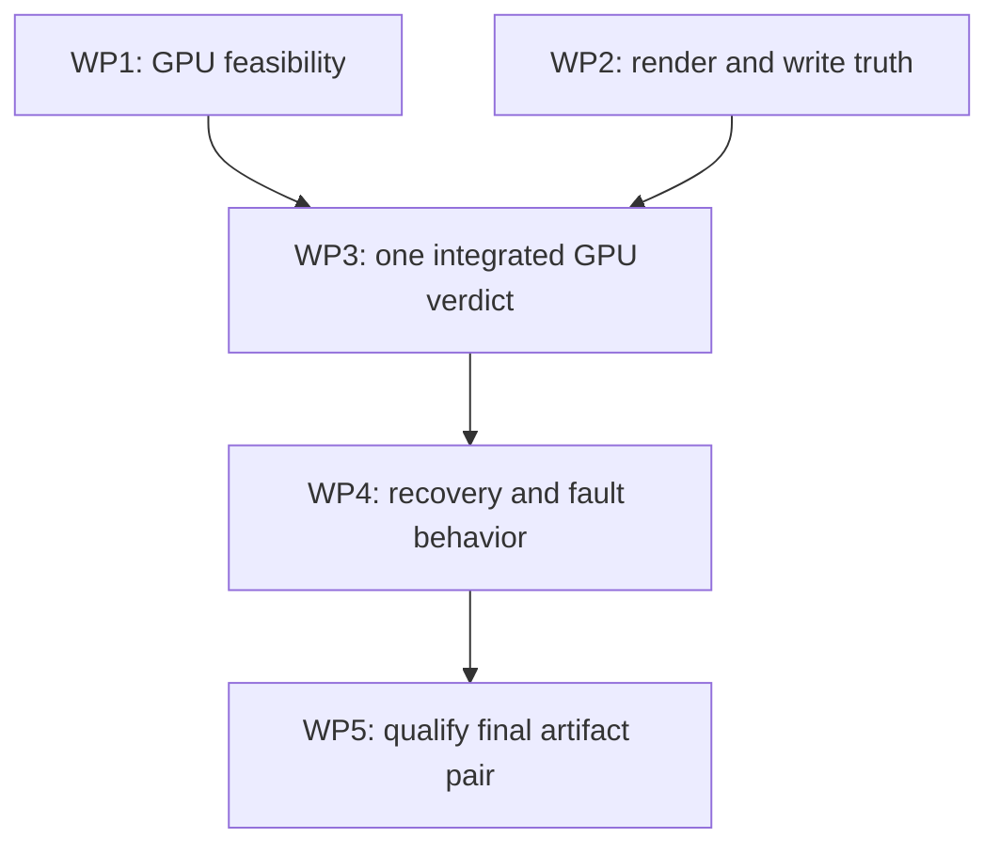

# SYNAPSE Next Release Engineering Blueprint
## Reliable execution and qualified GPU vision

**Prepared for:** Joe Ibrahim · Myth & Logic Studio  
**Revision:** 1.1 — five-round reviewed draft; end-of-window review pending  
**Evidence date:** 6 November 2026, America/New_York  
**Source baseline:** `eefa8a11ada9381f8015fd1ceaf85bb0bc85d31e`  
**Document status:** Proposed release plan. Source and remote CI evidence have been reviewed; no SYNAPSE implementation, installation, Houdini operation, render submission or GPU qualification was performed in this refinement.

> **Release recommendation:** deliver one trustworthy loop: identify the requested render products, preserve G101 completion truth, verify G25 authored writes, run a small useful OpenCV 5.1 GPU diagnostic chain, and return durable evidence with bounded recovery proposals.
>
> **Accepted requirement:** Joe's RTX 4090 profile is `gpu_required`. Every designated GPU vision operation must execute on its qualified GPU path. CPU decoding, file handling, orchestration and an independent CPU test reference are allowed; CPU vision cannot fulfill the required GPU work. General users may explicitly select a qualified CPU-capable profile.

## 1. The release decision

| Priority | Deliverable | Release condition |
|---|---|---|
| P0 | G101 render integrity and original-plan reconciliation | Missing, corrupt, stale or failed required products cannot disappear into an aggregate score or a retry |
| P0 | G25 authored-write contract and consumers | Unknown preflight refuses before mutation; authored/readback/recovery outcomes survive supported routes |
| P0 for Joe | Useful OpenCV 5.1 GPU vision | Exact Windows worker executes the named range-statistics and bright-outlier candidate operations on RTX 4090, with no CPU substitution |
| P0 | Supervised RETINA execution and evidence | Explicit subject, image domain, backend, required coverage and restart behavior; no success from absent checks |
| P0 | Qualified host/worker deployment pair | Final loaded bytes, compatible versions, installed paths, fault behavior and rollback procedure have matching receipts |
| Follow-on | Curated memory handoff and isolated SL0 pilot | Independent work after the release loop; neither blocks the core release |

**First useful demonstration:** provide an immutable OVOID render plan and completed EXRs; SYNAPSE identifies missing/failed/unreadable/stale products, performs the designated GPU measurements on eligible products, distinguishes delivery integrity from advisory visual findings, and proposes the exact missing/failed subset for retry.

**Start two tracks in parallel.** Track A closes G101/G25 contract gaps. Track B proves one useful Windows/OpenCV 5.1/4090 compute chain and selects its build. Join them at a single file-to-verdict slice. Do not leave the largest GPU build/binding uncertainty until packaging. Feasibility selects an implementation; final-artifact qualification proves what ships.

**Release cut:** all P0 gates below pass for Joe's declared support row. A correctness hotfix or CPU edition can ship separately, but cannot be labeled completion of this GPU vision release. Use the repository's next available release identifier; this plan reserves none.

## 2. Evidence baseline and material corrections

The weekly report stopped at G101 master `161f64d2`. The current pinned baseline adds G25 at `eefa8a11`. Published v5.97.7 still points to `d68a82bb463feb54d201471417dfb59e203e3bf0`; version text alone does not identify the newer loaded source. [S1–S3]

All six jobs of CI run `42301796914` passed. Their logs were inspected during refinement: the main suite reports **12,040–12,048 passed**, **515–523 skipped**, **50 deselected** and **10 expected failures** per job. Separate suites report 97, 47, 20, 36, 5 and 43 passes. Real RETINA OpenCV/OIIO tests are among the dependency-gated skips. The matrix is Windows/macOS/Ubuntu × Python 3.11/3.14; it does not establish live H22/Python 3.13 or GPU behavior. [S1]

| Finding from inspected source | Required refinement |
|---|---|
| RETINA has T0/T1, ingest, profiles, event modules and a designed process boundary; a supervised executable path was not established | Build and qualify the worker entrypoint and host adapter explicitly; do not describe them as already deployed |
| T0 skips unreadable headers while aggregate checks can remain true for readable siblings | Track required coverage per product, including full pixel decode where the claim needs it |
| The original plan is captured, but sparse retries, first-render-step selection and integer-keyed aggregation have seams | Preserve immutable work intent and separate attempt/result records; explicitly reject unsupported plan shapes |
| G25 readback exists, but inspection failures can look undriven, restoration is best effort and failed transports lose detail | Fail closed on unknown mutation preflight; return bounded receipts on both success and failure |
| Beauty ingest defaults to a subimage and returns all channels; T1 averages channels | Select named RGB explicitly; exclude alpha/data channels from luminance |
| Current RETINA setup is a CPU-wheel recipe with an older fallback | Create separate locked CPU/GPU artifacts; that fallback cannot satisfy Joe's profile |
| Installer payload uses an explicit allowlist and refuses ordinary downgrades | Package the worker deliberately and qualify a real compatible-pair rollback procedure |

These are source-derived failure scenarios and packaging observations, not reproduced production failures. Maintainer-reported H22 probes remain reported evidence. Proposed behavior in the rest of this document is work to implement and qualify. [S3–S10]

## 3. Freeze the supported slice

The release support manifest names **platform, host build/Python, worker Python/ABI, device/driver, operation IDs, accepted image domain and artifact digests**. Unlisted combinations are unqualified. Do not promise every operating system or GPU because stock CI is cross-platform.

| Support row | Host and worker | Required vision | Evidence needed |
|---|---|---|---|
| Joe / mandatory | Windows 11, H22.0.400 target; exact host Python recorded; separate worker runtime selected by feasibility | `gpu_required`, RTX 4090; named range-statistics and bright-outlier candidate chain | Installed-host and exact worker receipts, actual CUDA compute, analytic correctness, resource/fault checks |
| General CPU edition | Explicitly listed platform/runtime pairs only | `cpu_only`; equivalent supported measurement semantics | Executed real-dependency CPU lane and artifact receipt for each shipped row |
| General flexible GPU | Explicitly qualified device/runtime rows only | `gpu_preferred` or `gpu_required` by user choice | GPU capability receipts; disclosed CPU fallback only when that profile permits it |

Joe's support row and the CPU correctness/reference lane are mandatory. Building additional general-user editions is optional for this release; qualify each row only if actually distributed. Supporting selectable policy does not require shipping every platform/device combination now.

Host Python, Setup's maintenance Python and worker Python are **three separate compatibility subjects**. The current installer-maintenance Python is not the worker-runtime decision. Do not seed Joe's release worker from hython or rely on Houdini's private OIIO/DLLs. [S9]

**First image contract:** flat 2D EXR, full-resolution level 0, declared beauty part/view, explicitly mapped R/G/B channels with full sampling, half/float source decoded to FP32, declared ACEScg or linear Rec.709, explicit alpha handling, data/display windows and pixel aspect. Multipart is accepted only when the declared beauty selection is unambiguous; arbitrary multipart/AOV processing is not promised. Qualify both the ordinary full frame and any cropped form advertised in the support manifest.

For v1, measure stored premultiplied RGB without automatic unpremultiplication, alpha masking or compositing; preserve additive RGB at alpha zero. Other alpha-association forms require a separately listed qualified input row. ROI defaults to the full data window; explicit integer bounds use half-open global image-pixel coordinates `[x0,x1) × [y0,y1)`. A boolean mask must match the artifact/window identity and dimensions; no implicit broadcasting or origin reset.

Deep images, chroma-subsampled beauty, nonzero MIP levels, Cryptomatte decoding, arbitrary ID containment, optical flow, DNN semantic models and remote worker deployment are outside the first required slice. Report `unsupported_input` for affected checks; retain independently valid file observations. Existing numeric-ID paths must not interpret Cryptomatte float-bit hashes as integer object IDs. [S6, I1–I3]

## 4. What “complete” means

Keep these axes separate in the API, panel and stored result:

| Axis | Meaning | Effect |
|---|---|---|
| Execution | The executor's reconciled job outcome | Failed, cancelled or unknown execution cannot become successful because files look good |
| Deliverable integrity | Every required original product has valid identity and required file/header/pixel coverage | One missing or unreadable required product blocks integrity completion |
| Measurement coverage | Every required operation ran on compatible inputs through the required backend | Missing GPU attribution or a skipped required operation blocks qualification |
| Image findings | Descriptive statistics and advisory candidate measurements under a frozen profile | A suspected firefly or intentional bright iris is not an automatic creative rejection |
| Creative acceptance | Artist/task-specific acceptance of the image and motion | Recorded separately; never inferred from a generic average score |

**Roll-up rule:** a qualified-complete claim requires reconciled successful execution, complete verified products and complete required measurements. Advisory visual warnings may coexist with that claim; name them. A read-only analysis of files from a failed render remains useful but cannot change the job's execution outcome.

The selected profile freezes required versus advisory checks and their denominators before evaluation. Zero required checks executed is `unavailable`/`inconclusive`, never pass. A successful census means the computation completed; it does not establish that all counted pixels are defects or that image quality passed.

Freeze an expected **product × operation** coverage matrix from original intent. Unsupported input, failed decode or missing metadata leaves its required cell unavailable/failed; do not remove the cell from the denominator after inspection. Each result names the scope it actually covers.

QC refusal withholds qualification or automatic promotion. It does not independently cancel an authorized farm job. Retry, cancellation and scene repair remain explicit operations under existing delegation. A timeout means the observer stopped waiting, not that a remote job or an in-flight scene mutation stopped.

## 5. G101: preserve intent and reconcile products

### 5.1 Three record roles, one existing ownership chain

Extend RETINA manifests/events and the autonomy adapter instead of creating another verifier or scheduler:

1. **Original work manifest — immutable:** requested products, scene/render context, expected image contract and policy. Store its digest before execution. It does not contain mutable completion state.
2. **Attempt intent — immutable before dispatch:** reference the work digest; name the requested subset, settings, intended executor and prior attempt relationship. Append remote acceptance/job identity when it becomes known; an assigned job ID cannot be required before submission. Results append observations and explicit supersession.
3. **Current report — derived:** select accepted realizations and show every original product's disposition from those records. Rebuild it after restart; never rewrite the original plan to match returned files.

Use a stable product key such as `(work_id, render_step_id, camera_id, time, product_id)`. An attempt ID and artifact digest identify a realization of that product. Frame number alone is not a sufficient key.

**Bound the first implementation:** support one explicitly declared render step/camera per work item. Reject multi-render-step plans before dispatch until tested support exists. Multiple work items may represent multiple cameras. Do not silently select the first render step.

Normalize explicit sparse frames and ranges into the original product set. Reject malformed values, unexpected products and conflicting duplicates. An identical replay may deduplicate; different bytes or intent under one identity are a conflict. Preserve successful products across retries. A failed retry cannot silently replace a known-good selection. A settings/scene change starts a new work revision unless an explicit compatibility rule permits reuse.

**Retry selection:** compute missing products from the original set, then union failed returned products. A missing terminal frame with no evaluation row must still be a retry target. Preserve stable reason codes alongside readable text: `OUTPUT_MISSING`, `PRODUCT_UNREADABLE`, `FARM_FRAME_FAILED`, `PLAN_MISMATCH`, `EVIDENCE_STALE`, `EXECUTION_UNKNOWN`.

### 5.2 Per-product coverage and farm truth

For each required product record file availability, producer completion, header validity, selected-part/channel validity, full required pixel decode and digest binding separately. A readable sibling cannot satisfy an unreadable product's resolution, AOV or fingerprint checks. Valid headers do not prove valid pixel payloads.

Preserve farm `success:false`, cancellation, errors and totals independently of files. Missing or malformed failed-frame counts are unknown, not zero. Reconcile totals with per-frame rows; contradictory reports fail validation or remain execution-unknown. Compatible files may still receive scoped read-only measurements. [S4–S5]

### 5.3 Freshness is more than a path

Keep declaration digest, captured scene/render-state identity, attempt ID and artifact content digest distinct. Existing HIP-path-based declaration fingerprints do not observe unsaved edits or USD dependency contents. Capture enough authored/render state for the claimed association; if that cannot be established, label scene association unverified rather than inventing a full scene snapshot. [S7]

An owned immutable snapshot establishes byte consistency, not producer/attempt identity. Render-completion integrity additionally requires qualified association with the requested work/attempt, such as an attempt-bound producer receipt. If association is unavailable, retain useful historical file QC with `attempt_association=unverified`; those bytes cannot satisfy current-attempt completion. Parse `.done` identity/status when relying on it; marker presence alone is insufficient. Reject stale/truncated/mismatched markers. Publish new receipts atomically into owned directories without disturbing artist outputs.

Bind results to the exact bytes decoded. Prefer finalized immutable producer files; otherwise take an owned snapshot with a stated consistency method. Size/mtime or two stable-stat polls alone cannot prove identical bytes. The digest and decode must refer to the same snapshot. Cache keys include input, operation, profile, image interpretation and relevant worker identities; same filename is never enough.

## 6. G25: truthful authored writes through the installed routes

Keep the canonical registry and existing authored-write service. The panel already derives its definitions/dispatch from that registry; mode propagation requires qualification, not a second tool surface. Preserve supported `value`, `observed`, `mismatch` and mode fields while extending their semantics explicitly. [S3]

**Before the first mutation:**

- Distinguish absent, present and unknown animation/reference state. Inspection errors cannot mean zero keys or no source. Refuse when required state cannot be inspected or captured for a destructive mode.
- Resolve actual targets using HOM equality/stable identity and apply existing mutation policy to the **effective source**, not only the requested alias node. Refuse a disallowed or uninspectable source before setters. Reject conflicting values that alias one source parameter; identical requests may coalesce with an input-to-target mapping. This closes a scope-review seam, not a demonstrated authorization exploit.
- Capture the original authored state required by the mode: tuple components, keys, extrapolation and raw strings. Do not promise restoration from an incomplete snapshot.
- For queued/evidence-derived proposals, bind expected session/scene, target authored-state precondition, mode and frame. Revalidate on Houdini's main thread immediately before mutation. `key_at_frame` must use the declared frame context, not an accidentally moved playhead.

Precondition fields are optional only for documented immediate legacy calls. Queued/evidence-derived mutations require them; missing context cannot fall through to current-frame behavior. Carry them through the canonical schema/payload builder; an ignored field is no protection. If a route cannot carry them, refuse queued/proposed mutations on that route. Preserve documented immediate-call current-frame behavior and report the frame actually used. Initially qualify numeric key insertion only; explicitly refuse other unqualified mode/type combinations.

**After the write:** return the actual resolved target and comparison domain. Numeric values use a documented tolerance; authored strings compare unexpanded authored text, with evaluated text reported separately. `$HIP/render/$OS.$F4.exr` expanding under `eval()` is not a failed authored write. Key writes also identify the authored key/frame.

Keep legacy `observed` as the evaluated value and add a separate raw-authored observation. Freeze the corrected comparison-domain/`mismatch` meaning in the first packaged G25 contract and release notes; preserve field shapes and test consumers rather than silently changing `observed` into raw text.

A schema-versioned, bounded mutation receipt survives **success and failure** through the handler, stdio/HTTP MCP, panel fallback and any other advertised route:

| Receipt element | Required meaning |
|---|---|
| Request/context | Request ID, expected and observed session/target/frame context |
| Write | `not_attempted`, `applied`, `partial` or `unknown`; actual target mapping |
| Readback/comparison | `not_attempted`, `match`, `mismatch` or `unknown`, numeric/authored-text domain, requested/observed representation |
| Recovery | `not_needed`, `verified`, `failed` or `unknown`; attempted actions and evidence |
| Error | Stable code and original error; recovery failure must not replace the original cause |

Readback failure after a setter is applied-but-unverified unless a separate recovery result proves otherwise. Do not blindly restore after an ambiguous timeout. A true value mismatch reaches the common warning/dependency policy, rather than appearing as a clean panel “done.” Stop dependent steps that require the unestablished value; scope that hold to affected work/targets.

An error/unknown readback must not fabricate `observed` or `mismatch:false`. Preserve the failed transport envelope and original error plus its structured receipt. Target restoration proves only the captured target state, not reversal of arbitrary external callback/file side effects; a static undo-capability label is not a restoration receipt.

Preserve the existing no-resend-after-possible-mutation behavior. A lost response is not permission to repeat `write_source` or add a key at another frame. Reconcile the exact target/frame before another mutation. Review overly broad idempotent annotations; do not add a full mutation database to this release. [S3]

## 7. Image science and the evidence contract

### 7.1 One versioned envelope at the RETINA/autonomy seam

Reuse RETINA events/profile ownership. Add a tested compatibility adapter for supported older fields; do not replace Moneta or transport-error ownership wholesale.

| Group | Minimum information |
|---|---|
| Subject | Schema, request/work/step/attempt/product IDs, scene association, frame/time and camera |
| Artifact | Immutable reference and digest, selected part/view/RGB mapping, dimensions, windows and pixel aspect |
| Interpretation | Primaries/linear status, alpha/ROI policy, OCIO config and applied transform identities where used |
| Measurement | Operation/version, profile digest, units, required/advisory status, sample/coverage counts and limitations |
| Execution | Host/worker artifact identity, requested and actual backend per operation/stage, device and fallback/error |
| Result | Separate execution/integrity/measurement states, findings, freshness and durable evidence references |
| Cost | Queue/decode/upload/compute/sync/readback/return times and measured memory |

Unknown metadata blocks only measurements that need it. Missing an optional matte does not invalidate an otherwise valid source-channel non-finite census. Unknown profile matches may yield descriptive statistics but cannot inherit a qualified pass from illustrative defaults.

### 7.2 Color, channels and invalid values

- Select RGB by declared channel semantics, never by position, arbitrary first part or averaging all channels. Alpha, depth and ID data do not enter luminance.
- Preserve signed scene-linear HDR. Above-one values are range observations, not evidence of clipping. Derive Y coefficients from the declared RGB-to-XYZ transform; Rec.709 weights are not ACEScg weights. [I2]
- Define alpha per measurement. Stored-channel integrity scans include required emissive RGB even at alpha zero. Do not zero those pixels or blindly unpremultiply near zero. Display diagnostics declare background/composite/view separately. [I1]
- Count NaN/±Inf before dependent reductions. Report component-sample and affected-pixel counts explicitly. V1 refuses a dependent statistic when its declared support contains an invalid sample. A separately requested clean ROI may still be measured with its own identity/counts while full-image integrity retains the source-invalid result. Finite-subset whole-image statistics require a future explicit contract; v1 never silently discards invalid samples, replaces them with zero or serializes JSON NaN/Infinity.
- Empty/all-excluded regions are inconclusive, never zero-error. A non-finite value in an unrelated depth AOV does not automatically describe beauty corruption.
- Keep source-domain statistics separate from explicitly view-transformed display diagnostics. Record applied OCIO transforms; an `OCIO` environment variable alone does not identify the source image's primaries.
- Freeze renderer/denoiser/samples, ROI, windows and comparison conditions. `revision_same_time` and `temporal_adjacent` are different comparisons. Adjacent-frame change is advisory until motion, cadence and cuts are accounted for; low SSIM alone does not prove flicker.

Profiles and tolerances are versioned and fixed before held-out evaluation. An agent or optimizer cannot loosen them to get a pass. Existing unit-range clipping and illustrative default profiles require explicit calibration before production gating. [S6]

## 8. OpenCV 5.1 GPU implementation strategy

### 8.1 What is established, and what is not

OpenCV 5.1.0 was released on 6 November 2026. Its release/changelog documents new-engine DNN CUDA work; matching contrib sources also expose explicit CUDA arithmetic and filtering. These are distinct from universal acceleration of ordinary calls or transparent UMat allocation. Published opencv-python wheels remain a CPU-only route. [O1–O5]

The feasibility build should pin matching source revisions, not just version labels:

- OpenCV 5.1.0 candidate commit: `e4f78fbcf1a773fbed69e14500e8b734963eb585`.
- Matching contrib candidate commit: `b67a855188a3d683813731010f6d39ac614733a4`.

Source-supported, built, executed and release-qualified are four different states. No reviewed source establishes that Joe already has a working 5.1 Windows GPU artifact.

### 8.2 First useful compute contract

Freeze exact output fields and compute stages during the early spike. The required slice must remain useful GPU vision, not an upload/allocation demonstration or an unrelated DNN benchmark.

| Operation | Intended output | Required execution and limitation |
|---|---|---|
| Selected-channel validation | Required RGB sample/pixel non-finite census and valid-input state | CPU integrity support is permitted; dependent GPU work receives only the declared valid domain |
| `scene_linear_range_y_v1` | Weighted-Y min/max/mean/population standard deviation and frozen descriptive range counts, with units/support | Y arithmetic, reductions, comparisons and counts execute on GPU; CPU decode/integrity support is disclosed |
| `bright_outlier_global_sigma_y_v1` | Global `Y > mean + k × population_sigma` mask/count and optional diagnostic preview | GPU Y statistics, pixel comparison/mask/count are required; candidates remain advisory |
| Global median/percentiles/HDR histogram | Only if explicitly included in the capability manifest | Needs its own qualified GPU implementation or declared bounded approximation; never implied by a local median or 8-bit histogram |
| Temporal/revision comparison | Optional advisory observations with two bound subjects | Separate operation/profile; no general flicker or semantic diagnosis promise |

The earlier draft's ordinary NumPy/CPU code is not a GPU implementation. The Y-weighted census is a new versioned operation: it must not inherit the numerical identity of T1's current unweighted channel average. An EV recommendation based on a global median is excluded until its promised computation is qualified. [S8, O5]

**Recommended first algorithm:** freeze the global sigma census above, with k in the ratified profile. It preserves RETINA's existing census concept and avoids a new spatial-filter dependency in the first cut. It has known blind spots: broad/bright regions can dominate the statistic, and intentional emitters can be candidates. It is not a universal firefly detector. A spatial mean/median extension needs a separate operation/version, fixtures and memory/error qualification. It is not a replacement for a global exposure median.

**Concrete useful chain to prove:** CPU OIIO decode/channel selection/source-invalid census → GPU weighted RGB-to-Y (`split` + `addWeighted` candidate APIs) → masked FP32 range and `meanStdDev` → GPU range/candidate comparisons, masks and `countNonZero` → synchronization → compact scalar/mask result. CPU may assemble a scalar threshold from GPU-reduced values and format receipts; it cannot compute full-image Y/statistics/candidates as fulfillment. CPU source census is declared integrity support, not a GPU vision substitute. [O5]

Pin population-sigma semantics and test them analytically. Require finite positive k and finite ordered range bounds. N is the exact shared selected-Y support for moments, candidate comparisons and denominators. Record both threshold inputs and the actual FP32 threshold used for comparison; strict `>` excludes equality. Independently verify the expected threshold conversion before using the reported applied value for CPU/GPU parity. Zero samples return null/reason; one finite sample has sigma zero by contract. Finite inputs that overflow during Y/reduction/threshold arithmetic produce a distinct numerical failure, not a source-nonfinite fiction. Reject a nonfinite threshold before comparison; otherwise NaN comparisons could misleadingly produce zero candidates.

Freeze coefficient precision and staged FP32 RGB-to-Y rounding. Analytic FP64 expectations test the mathematics within declared error bounds; the backend reference tests the chosen FP32 stages. Test equality/adjacent values directly at the comparison primitive, and place full-chain exact-count fixtures away from uncertain numerical boundaries. Qualify the actual Python masked `meanStdDev` overload, output shape/precision, matching CV_8UC1 mask, empty/singleton behavior and population convention; C++ source support alone does not establish a working binding.

V1 refuses dependent metrics when their declared support contains source-invalid pixels. A separately declared clean ROI remains measurable even if other pixels are invalid: validate measurement intermediates over that ROI, keep global source-invalid evidence separate, and never require an unrelated invalid pixel to become a valid whole-image result.

### 8.3 Qualify compute, then attribute ordinary jobs

For every required operation/type path:

1. Build/pin the exact worker and native dependency inventory.
2. Execute analytic known-answer fixtures through the advertised useful chain.
3. Compare with an independent CPU reference under frozen, operation-specific tolerances.
4. Synchronize before declaring completion or measuring elapsed GPU work.
5. Retain a qualification profiler/backend witness tied to that artifact and dispatch path. Import success, device count, a preferred-backend flag or GPU utilization alone is insufficient.
6. At runtime record the executed dispatch branch, backend/device, operation/version, input/output identity and completion/error. Do not require heavyweight profiler traces on every normal frame.

A forced CPU branch cannot mint a CUDA-success receipt. An enqueue followed by error cannot mint a completed result. Unattributable compute leaves the required GPU coverage unmet. Requalify changed worker/native paths; record the driver range actually tested.

CPU/GPU agreement establishes backend conformance, not independent algorithm correctness. Use hand-computable fixtures too. A CPU/GPU OpenCV comparison is not an independent COP/OpenCV oracle comparison.

### 8.4 Preserve the RETINA and COP boundaries

Keep worker-owned `cv2`, OIIO and CUDA binaries outside Houdini's Python/DLL search path; do not replace the DCC's existing image-I/O libraries. Preserve the zero-host-`cv2` boundary. Use RETINA's existing modules behind a **new, qualified supervised entrypoint** and one thin host adapter. Initial transport: explicit subprocess + immutable request/result files in owned directories. Prefer this over introducing an HTTP service. The worker receives allowlisted operations and permitted file roots, not arbitrary Python; inputs are read-only.

Launch, hash, wait, decode and tear down the worker off Houdini's main thread; marshal only bounded host observations/authoring to it. The worker owns an explicit environment: exclude DCC-private DLL/search paths and provider credentials, while retaining qualified Windows/NVIDIA driver access and explicitly passed read-only OCIO resources. Isolation must not disable the backend or silently change image interpretation.

Document a small P6 design amendment: COPs retain production image-processing/authoring duties; GPU OpenCV performs independent diagnostics. Do not silently claim the existing COP/OpenCV architecture has already qualified the new chain or give the vision worker scene-mutation authority. Suggestions use G25 and existing policy later. [S10]

### 8.5 User policy and resources

| Profile | Behavior |
|---|---|
| `cpu_only` | Qualified supported operations run on CPU, with backend reported |
| `gpu_preferred` | Use a qualified GPU path when available; allowed CPU fallback is explicit and respects the job deadline |
| `gpu_required` | Designated vision compute must use its qualified GPU path; otherwise queue, report busy or unavailable |

Persist the profile across restart/upgrade/OOM. Joe's profile cannot invoke the old CPU-wheel/4.13 recovery recipe. A GPU kill switch makes his required capability visibly unavailable; it does not downgrade the profile.

Start with **one active CV job and no pending queue** (`queue_capacity=0`, return busy while occupied). This avoids introducing a scheduler for the first slice. If a bounded queue is later included, freeze count/bytes and expiry before release. Freeze input-size/channel limits, per-operation scratch estimates, retained-cache budget, deadline origin and cancellation/retry limits after feasibility measurements. One SYNAPSE coordinator owns its own admission; it cannot reserve memory against Karma XPU, Isaac, another model process or WDDM.

Aim to keep observed total device usage within Joe's approximately 20 GB operating target, with measured CV headroom. That is a target, not an enforceable global cap or proof of available capacity. Do not evict artist work. Insufficient headroom returns busy in the initial no-queue profile; an allocation race/OOM yields an explicit failed/unknown result without CPU fulfillment. If a queue is subsequently shipped, expired/cancelled queued jobs never start later.

Measure representative 2K/4K jobs cold/warm and idle/concurrent: **queue + decode + upload + compute + sync + readback + serialization**, median/p95 where sample size supports it, throughput and peak/retained CPU/GPU memory. Distinguish kernel timing from useful end-to-end latency. No performance target here is a measured SYNAPSE result. Freeze concrete operational budgets before release evaluation.

## 9. Minimal supervision and restart recovery

One supervisor owns admission/state and one writer publishes authoritative per-request results. Enforce request-publication ownership across processes. The CUDA worker itself must hold the shared-root device-admission lock before CUDA initialization until exit, or use an equivalently qualified process-ownership mechanism; a parent-only lock can disappear while an orphan worker still runs. This lock coordinates SYNAPSE workers, not external GPU applications. Extend RETINA sidecar ownership and reuse the repository's pattern of exclusive temporary creation, flush/fsync and atomic publication rather than unrelated forecasting semantics. State the filesystem/crash guarantees actually tested; do not promise universal power-loss durability. [S11]

**QC request lifecycle:** validate → durably accept request identity/digest → admit/dispatch → compute → validate/publish candidate result → commit terminal selection → acknowledge. Large result files may publish first, but remain unselected until one immutable terminal-selection receipt atomically binds request/generation, terminal outcome and selected result digest. **That receipt is the promotion commit point.** Journals, indexes and acknowledgements are projections. A result file alone, including an orphan after a crash, is not success; a committed terminal receipt survives a lost acknowledgement. Temporary/partial files are never terminal success.

Same request ID + identical immutable intent returns the committed result or known in-progress state; changed payload under that ID is a conflict. A late response from a superseded request can be retained as evidence but cannot replace the selected result. Rebuild current state from committed receipts; quarantine torn/unpublished tails without discarding older valid observations. Corruption in a committed result fails visibly rather than becoming an empty history.

Freeze semantic request-digest fields: requested work/product/attempt association, input artifacts, operation/profile/image interpretation, backend policy and relevant build compatibility. Dispatch generation, worker PID and attempt timestamps are execution metadata. Changed semantic requirements receive a new request ID. A historical cache hit describes that completed subject; it cannot reopen expired execution or inherit a new render attempt's identity. Reusing pixel computations across identical bytes does not supply a new attempt's missing producer association.

Serialize success selection and cancellation/expiry through the same terminal-commit ownership rule. If terminal cancellation/expiry wins, later output for that dispatch generation is historical evidence only. If success selection wins first, cancellation reports already completed. Preserve this ordering after restart. Any permitted recomputation gets a new execution generation and current admission/deadline validation; it never rewrites a cancelled generation.

**Recovery scope:** reconcile jobs/products read-only and propose bounded recovery. Replaying a pure QC calculation may be permitted under a new execution attempt with the same subject, while accepting only one selected result. Remote render submission and scene mutation have different side effects: an absent/lost receipt never authorizes automatic replay. Reconcile executor identity first; if submission is ambiguous, leave `execution_unknown`. No exact-once remote rendering claim is made.

Keep cancellation of the QC process distinct from cancellation of an external render. Enforce an end-to-end deadline that includes any queue time. Release admission only after confirmed process exit or a qualified successful-job completion path; a protocol cancellation acknowledgement is not proof of exit. If termination cannot be confirmed, quarantine that worker/slot and report unavailable. Retain owned scratch while an active worker may write it. Active GPU calls may require bounded process termination rather than cooperative mid-kernel cancellation; qualify the behavior.

## 10. Packaging, identity and rollback

Ship an independently versioned worker artifact with explicit interpreter, OIIO/OpenCV(+contrib) and allowed native runtime libraries. Do not install dependencies at artist-job time, discover arbitrary system `cv2` or share Houdini's private runtime. No DNN model/cuDNN dependency belongs in the first classical-QC slice without a required operation. [S9]

Update the host's payload allowlist for the adapter/configuration; adding source files alone does not ship them. Record source revisions/patches, module/CMake flags, compiler/toolset, worker Python ABI, CUDA build/runtime inputs, target architecture, OIIO/numpy versions, final native-file digests, build log and notices for the distributed components. Call this traceable/rebuildable until identical binary rebuilds are demonstrated.

Publish an external **release lock** after final component bytes exist: host/worker digests, protocol/envelope/profile versions and support/capability manifest. Qualification receipts cite that lock's digest; the final publication index references both. Do not embed an artifact's full digest inside itself or make lock/receipt digests circular. The handshake rejects incompatible pairs before useful dispatch. Runtime identity reports actual imported host path and configured worker executable/native identities; same-version source checkout shadowing is not accepted as installed qualification.

**Rollback is a procedure to qualify.** Current Setup refuses a normal downgrade and refuses maintenance while Houdini is running. Use a tested data-preserving uninstall/reinstall path or implement a separately qualified selection mechanism. Independently revert a component only when the resulting combination is listed as compatible; otherwise restore the previous qualified pair. Preserve renders, memory, settings and GPU mode. Do not close/reload the active artist session automatically. [S9]

## 11. Five reviewable work packages

Owner roles describe accountability; one maintainer may fill several roles. Each package produces focused PRs/diffs and a machine-readable acceptance receipt; WP2 may split render and authored-write changes for review. Proposed new file locations must follow repository conventions; names below describe surfaces, not files falsely claimed to exist.

| ID / owner | Work and existing surfaces | Dependency | Exit receipt |
|---|---|---|---|
| WP1 · vision/build maintainer | Isolated Windows GPU feasibility; exact compute/output contract; new worker build lock alongside RETINA packaging | Starts immediately, parallel to WP2 | Useful 4090 chain, analytic/backend evidence, selected build and measured costs, or named blocker |
| WP2 · core maintainer | G101 driver/planner/RETINA T0 and G25 authored-write/transport/result-policy fixes | Starts immediately | Sparse/missing/corrupt/unknown-state and authored-write fault fixtures; compatibility behavior |
| WP3 · integration maintainer | Image/evidence contract, supervised entrypoint and host adapter; canonical registry and payload allowlist | WP1 contract + WP2 subject/receipt semantics | One immutable OVOID EXR through installed adapter → useful GPU computation → bound, visible scoped verdict |
| WP4 · runtime maintainer | Durable request/result publication, restart/duplicate/deadline/OOM/profile behavior; compatible-pair handshake | WP3 | Crash/replay/late-reply and incompatible-pair fixtures; frozen resource limits |
| WP5 · release maintainer | Required CI lanes, H22 route qualification, final host/worker artifacts, data-preserving rollback and release notes | WP1–WP4; exact final bytes | No unexplained supported-path regression; all Joe support-row gates executed; loaded-artifact receipts |

**First small checkpoint:** WP1 attempts one generated flat RGB EXR through the useful GPU chain and returns its exact build/API result. In parallel, WP2 prepares the sparse `[1,3]`/missing-terminal-product fixture and one unknown-preflight refusal fixture against an isolated checkout. Then implement/review those narrow fixes before the integrated milestone. No launch date is defensible before WP1 resolves the native build/API unknowns.

**Hold the cut line:** support the narrow image/operation/plan shape above. Defer multi-camera-in-one-plan orchestration, arbitrary image formats, deep/Cryptomatte, semantic DNN, optical flow, autonomous scene correction, Moneta/Rust redesign, SDK 2.x migration and general recursive improvement. Keep existing SDK ceiling and report the SDK path/version actually imported by each relevant lane. [S12]

## 12. Acceptance evidence

### 12.1 Separate lanes

| Lane | Required evidence | Does not establish |
|---|---|---|
| Stock CI / changed contracts | New required suites explicitly collected/executed; failure/skip lists audited; supported Windows ABI path covered | HOM/native GPU behavior |
| Real worker CPU | Exact dependencies, generated EXRs, analytic outputs, schema/profile compatibility | GPU execution |
| Trusted worker GPU | Reviewed candidate/artifact on isolated 4090 environment; useful backend witness, parity, resource/fault cases | Every GPU/driver combination |
| H22 installed routes | Supported host build/Python; actual G25/refusal/recovery and file-QC adapter via every advertised route | Every artist scene |
| Paired artifacts | Final loaded bytes, fresh install/upgrade, missing/corrupt worker, incompatible pair and qualified rollback | Untested installer/GUI behavior |

A PR runner may report GPU unavailable. That cannot satisfy Joe's release gate. GPU/H22 qualification consumes a reviewed candidate and frozen fixtures in a controlled environment with redirected preferences/temp/project; do not attach arbitrary PR execution to the active production workstation. Reuse the existing isolated host-probe pattern. [S9]

An inherited failure needs an owner, exact scope and explanation. No unexplained regression on supported paths; no blanket known-failure waiver for changed code or required GPU coverage. SL0 self-tests must be invoked explicitly if that draft's code is ever included; its existing green workflow does not establish a real pilot. [S12]

### 12.2 Required adversarial cases

| Case | Required outcome |
|---|---|
| Good returned images, original terminal product absent | Integrity incomplete; explicit retry target despite no evaluation row |
| Original sparse `[1,3]`, retry `[3]` | Keep accepted 1; never invent 2 or rewrite original intent |
| Two render steps/cameras in unsupported work shape | Refuse before dispatch; never silently evaluate only the first |
| Valid EXR + nonempty corrupt sibling, both with `.done` | Required per-product coverage prevents pass |
| Valid header with corrupt pixel payload | Header evidence remains distinct; pixel claim fails/unavailable |
| Same output path, changed bytes or attempt; stale marker | Old verdict/producer receipt rejected |
| Old valid EXR snapshotted after a new submission without new association evidence | Historical file QC is allowed; current-attempt integrity remains unverified |
| Unknown/contradictory farm count; `success:false` without text | Preserve execution uncertainty/failure independently of files |
| RGB part/channel permutation; extra alpha/Z/ID channels | Declared RGB metrics unchanged; missing mapped channels refuse |
| ACEScg signed HDR, additive RGB at alpha zero | Preserve source values and declared alpha semantics; above-one is not clipping |
| One NaN/Inf, all-invalid input, empty ROI | Exact invalid counts; finite serialized metrics or null/reason; no poisoned “zero defects” result |
| Forced CPU path, missing CUDA module, OOM, GPU kill switch | No CUDA-success receipt; Joe profile persists and required coverage stays unmet |
| Busy no-queue worker, oversize input; queue expiry/cancellation only if a queue ships | Bounded busy/refusal; conditional queue cases cannot execute late or allocate unboundedly |
| Crash before/after result publication; torn tail; late reply | Only committed matching result accepted; earlier valid evidence retained |
| Result published without terminal receipt; parent dies while child owns CUDA | No inferred success; surviving worker retains admission ownership and prevents replacement overlap |
| Result-before-cancel and cancel-before-result, replayed after restart | Preserve one terminal ordering; no late success revives a cancelled generation |
| Lost farm acceptance or mutation reply | No automatic side-effect replay; read-only reconciliation/unknown state |
| G25 unknown key/reference/snapshot inspection | Zero setters across the tuple; explicit preflight refusal |
| Queued G25 context dropped by a route or effective source outside existing policy | Refuse before mutation; immediate-call legacy semantics remain separately qualified |
| G25 partial setter + failed restore; setter + failed readback | Same machine-readable recovery receipt on supported routes; no plain success |
| Raw `$HIP/$OS/$F4` string, numeric clamp, aliased write sources | Correct comparison domains; clamp warning; conflicting alias requests make zero writes |
| Wrong worker pair or source checkout shadowing install | Reject incompatible/unqualified identity before promotion |
| Disabled hard gate or omitted required operation | Frozen negative fixture fails; skip/empty-check success cannot satisfy gate |

### 12.3 Independent metric fixtures

Hand-computable constant, ramp and impulse images establish correctness before CPU/GPU parity. Freeze tolerances and threshold equality conventions before evaluating the GPU build. Expected answers must not all be generated by the same CPU implementation under test. The following are mathematical fixture expectations, not executed SYNAPSE results:

| Fixture | Independent expected outcome |
|---|---|
| Neutral RGB `[0, 1/4, 1, 4]`, full support, descriptive interval `[0,1]` | Y min=0, max=4, mean=21/16; below=0, within=3, above=1; value4 is preserved |
| Neutral RGB `[0,0,0,4]`, population sigma, calibration k=1 | Mean=1, sigma=√3; exactly one strict candidate; k=1 is a fixture setting, not the production threshold |
| 11×11 neutral RGB: 120 zeros and one121; fixture k=10 | Mean=1, population sigma=√120, threshold≈110.5445; one candidate, even if the bright pixel represents an intentional emitter |
| Constant RGB1/2, alpha values0/1; then permuted named channels with extra Z | Mean=1/2, sigma=0, no strict candidates; alpha/depth/channel order cannot change RGB statistics |
| Declared ACEScg red/green/blue unit primaries | Y equals an independently derived AP1-to-XYZ Y row; arithmetic RGB averaging and Rec.709 coefficients fail |
| One NaN, +Inf and −Inf on distinct RGB component/pixel positions; empty ROI variant | Exact component/pixel counts; dependent metrics null with invalid/no-samples reason; no JSON nonfinite literals |
| Values equal to and adjacent to the applied FP32 threshold | Equality excluded; next representable value above included; compare the declared applied threshold, not rounded display text |

Define descriptive interval semantics explicitly: below `Y<L`, within `L≤Y≤H`, above `Y>H`, finite ordered bounds and counts summing to eligible support. A normal signed-HDR interval is not a validity/clipping limit. Add finite negative, large-offset/small-variance and singleton inputs to reduction qualification, and offset-window/part-permutation fixtures to input selection.

For OVOID calibration include emissive iris, speculars, dark background and raw/denoised pairs. Candidate masks/counts establish the declared algorithm's execution; detector precision/recall claims require independently labeled held-out fixtures. Temporal cases include intentional blink, moving highlight, cut, missing cadence and planted gain alternation. Those remain advisory in this release.

## 13. Follow-on learning without scope expansion

After the core release, existing Moneta ownership may store a compact task/domain/outcome record pointing to durable evidence. Keep facts separate from hypotheses; a warning alone is not an artist preference. Recall revalidates build/profile/scene compatibility. Evidence retention must not depend on selective memory pruning.

Keep #116's SL0 pilot separate: isolated target, real worker, fixed metric/baseline, downstream import proof, stop budget and reviewed diff. Lint reduction proves a lint result, not better memory or creative judgment. PG-DRM remains held without a production caller. Model-weight training and recursive improvement can use this release's cleaner evidence later.

## 14. Refinement record

The refinement uses parallel specialist reviews followed by one reconciled revision. Reviewer count is not an implementation-test count. Duplicate findings are merged; speculative additions are labeled or removed.

| Round | Focus | Material result |
|---|---|---|
| 1 | Six concurrent reviews: release architecture, GPU feasibility, render contracts, G25, image science and delivery | Moved feasibility forward; corrected worker/deployment overclaims; found per-product, color/channel and mutation-receipt seams |
| 2 | Targeted counterexamples and concrete implementation contracts | Defined useful GPU chain, independent analytic fixtures, restart ordering, mutation receipt and five-package work plan |
| 3 | Concurrent cross-review of the integrated revision | Tightened snapshot versus attempt provenance, cancellation/result ordering, effective mutation scope, worker threading and acyclic artifact publication; selected global-Y census for the first GPU slice |
| 4 | Protocol, compatibility, GPU-API, image-contract, packaging and editorial stress review | Defined terminal commit and orphan ownership; preserved legacy evaluated reads; tightened required preconditions, threshold rounding and shared coverage; removed avoidable first-release machinery |
| 5 | Six concurrent release-candidate reviews | All six returned a document-consistency PASS; no further blocking contradiction was identified. This is not an implementation, HOM, GPU or installer PASS |

**Review accounting:** 29 specialist reviews across five rounds: six initial reviews, five targeted contract reviews, six integrated cross-reviews, six stress reviews and six release-candidate reviews. Findings were reconciled into this single document. The one-hour refinement window began at **5:44:51 PM Eastern on 6 November 2026**; an end-of-window fresh-source/convergence review is pending. No claim of continuous computation or completed hour is made by this draft.

**Refinement scope:** document/source/remote-evidence review. All acceptance cases remain implementation work unless an evidence row explicitly says otherwise. No GPU speedup, native correctness, production recovery or installed release is claimed by this document.

## 15. Source ledger

Repository sources below are pinned to the inspected SYNAPSE baseline. Upstream release/source capabilities were checked on 6 November 2026; mutable documentation does not establish local execution.

- **S1 — Baseline and CI:** [candidate](https://github.com/JosephOIbrahim/Synapse/tree/eefa8a11ada9381f8015fd1ceaf85bb0bc85d31e), [six-job run and logs](https://github.com/JosephOIbrahim/Synapse/actions/runs/42301796914), [workflow commands](https://github.com/JosephOIbrahim/Synapse/blob/eefa8a11ada9381f8015fd1ceaf85bb0bc85d31e/.github/workflows/ci.yml).
- **S2 — Published release:** [v5.97.7](https://github.com/JosephOIbrahim/Synapse/releases/tag/v5.97.7).
- **S3 — G25 and consumers:** [authored writes](https://github.com/JosephOIbrahim/Synapse/blob/eefa8a11ada9381f8015fd1ceaf85bb0bc85d31e/python/synapse/server/parm_authored.py), [handlers](https://github.com/JosephOIbrahim/Synapse/blob/eefa8a11ada9381f8015fd1ceaf85bb0bc85d31e/python/synapse/server/handlers.py), [registry](https://github.com/JosephOIbrahim/Synapse/blob/eefa8a11ada9381f8015fd1ceaf85bb0bc85d31e/python/synapse/mcp/_tool_registry.py), [MCP result conversion](https://github.com/JosephOIbrahim/Synapse/blob/eefa8a11ada9381f8015fd1ceaf85bb0bc85d31e/python/synapse/mcp/tools.py), [panel executor](https://github.com/JosephOIbrahim/Synapse/blob/eefa8a11ada9381f8015fd1ceaf85bb0bc85d31e/python/synapse/panel/tool_executor.py), [common result policy](https://github.com/JosephOIbrahim/Synapse/blob/eefa8a11ada9381f8015fd1ceaf85bb0bc85d31e/python/synapse/core/tool_results.py).
- **S4 — G101:** [driver](https://github.com/JosephOIbrahim/Synapse/blob/eefa8a11ada9381f8015fd1ceaf85bb0bc85d31e/python/synapse/autonomy/driver.py), [planner](https://github.com/JosephOIbrahim/Synapse/blob/eefa8a11ada9381f8015fd1ceaf85bb0bc85d31e/python/synapse/autonomy/planner.py), [evaluator](https://github.com/JosephOIbrahim/Synapse/blob/eefa8a11ada9381f8015fd1ceaf85bb0bc85d31e/python/synapse/autonomy/evaluator.py).
- **S5 — File truth:** [T0](https://github.com/JosephOIbrahim/Synapse/blob/eefa8a11ada9381f8015fd1ceaf85bb0bc85d31e/retina/t0.py), [shared events](https://github.com/JosephOIbrahim/Synapse/blob/eefa8a11ada9381f8015fd1ceaf85bb0bc85d31e/retina/events.py), [farm report](https://github.com/JosephOIbrahim/Synapse/blob/eefa8a11ada9381f8015fd1ceaf85bb0bc85d31e/python/synapse/server/render_notify.py).
- **S6 — Pixel semantics:** [ingest](https://github.com/JosephOIbrahim/Synapse/blob/eefa8a11ada9381f8015fd1ceaf85bb0bc85d31e/retina/ingest.py), [T1](https://github.com/JosephOIbrahim/Synapse/blob/eefa8a11ada9381f8015fd1ceaf85bb0bc85d31e/retina/t1.py), [profiles](https://github.com/JosephOIbrahim/Synapse/blob/eefa8a11ada9381f8015fd1ceaf85bb0bc85d31e/retina/qc_profiles.toml).
- **S7 — Declaration/producer evidence:** [manifest](https://github.com/JosephOIbrahim/Synapse/blob/eefa8a11ada9381f8015fd1ceaf85bb0bc85d31e/python/synapse/host/retina_manifest.py), [sentinel](https://github.com/JosephOIbrahim/Synapse/blob/eefa8a11ada9381f8015fd1ceaf85bb0bc85d31e/python/synapse/host/retina_sentinel_postframe.py).
- **S8 — OpenCV draft:** [PR #112](https://github.com/JosephOIbrahim/Synapse/pull/112), [pinned exposure code](https://github.com/JosephOIbrahim/Synapse/blob/5ebc436ff156999351111e30a8e7102bafb46204/python/synapse/cv/exposure_stats.py).
- **S9 — Distribution:** [payload builder](https://github.com/JosephOIbrahim/Synapse/blob/eefa8a11ada9381f8015fd1ceaf85bb0bc85d31e/installer/build_payload.py), [Setup engine](https://github.com/JosephOIbrahim/Synapse/blob/eefa8a11ada9381f8015fd1ceaf85bb0bc85d31e/installer/synapse_setup/engine.py), [toolchain lock](https://github.com/JosephOIbrahim/Synapse/blob/eefa8a11ada9381f8015fd1ceaf85bb0bc85d31e/installer/toolchain.lock.json), [isolated H22 probe](https://github.com/JosephOIbrahim/Synapse/blob/eefa8a11ada9381f8015fd1ceaf85bb0bc85d31e/installer/run_houdini_probe.py), [old RETINA requirements](https://github.com/JosephOIbrahim/Synapse/blob/eefa8a11ada9381f8015fd1ceaf85bb0bc85d31e/retina/requirements.txt), [old Windows setup](https://github.com/JosephOIbrahim/Synapse/blob/eefa8a11ada9381f8015fd1ceaf85bb0bc85d31e/retina/setup_venv.ps1).
- **S10 — Boundary/design:** [RETINA blueprint](https://github.com/JosephOIbrahim/Synapse/blob/eefa8a11ada9381f8015fd1ceaf85bb0bc85d31e/docs/SYNAPSE_RETINA_BLUEPRINT.md), [boundary test](https://github.com/JosephOIbrahim/Synapse/blob/eefa8a11ada9381f8015fd1ceaf85bb0bc85d31e/tests/test_retina_boundary.py).
- **S11 — Reusable publication pattern:** [loop coordinator](https://github.com/JosephOIbrahim/Synapse/blob/eefa8a11ada9381f8015fd1ceaf85bb0bc85d31e/python/synapse/loop/coordinator.py), [memory-loop repair semantics](https://github.com/JosephOIbrahim/Synapse/blob/eefa8a11ada9381f8015fd1ceaf85bb0bc85d31e/docs/MEMORY_LOOP_REPAIR.md).
- **S12 — Separate follow-ons:** [SL0 draft #116](https://github.com/JosephOIbrahim/Synapse/pull/116), [SDK migration](https://github.com/JosephOIbrahim/Synapse/blob/eefa8a11ada9381f8015fd1ceaf85bb0bc85d31e/docs/tickets/ANTHROPIC_SDK_2X_MIGRATION.md).
- **O1 — Release:** [OpenCV 5.1.0](https://github.com/opencv/opencv/releases/tag/5.1.0), [official changelog](https://github.com/opencv/opencv/wiki/OpenCV-Change-Logs#version510).
- **O2 — Source identity:** [OpenCV candidate](https://github.com/opencv/opencv/tree/e4f78fbcf1a773fbed69e14500e8b734963eb585), [contrib candidate](https://github.com/opencv/opencv_contrib/tree/b67a855188a3d683813731010f6d39ac614733a4).
- **O3 — Python packaging:** [official opencv-python README](https://github.com/opencv/opencv-python#opencv-on-wheels).
- **O4 — Transparent backend limits:** [dynamic CUDA issue #29318](https://github.com/opencv/opencv/issues/29318), [OpenCL documentation](https://github.com/opencv/opencv/wiki/OpenCL-optimizations).
- **O5 — Explicit CUDA arithmetic:** [tagged module/bindings](https://github.com/opencv/opencv_contrib/blob/5.1.0/modules/cudaarithm/CMakeLists.txt), [arithmetic API](https://github.com/opencv/opencv_contrib/blob/5.1.0/modules/cudaarithm/include/opencv2/cudaarithm.hpp), [masked mean/std implementation](https://github.com/opencv/opencv_contrib/blob/5.1.0/modules/cudaarithm/src/reductions.cpp), [scalar comparison rounding](https://github.com/opencv/opencv_contrib/blob/5.1.0/modules/cudaarithm/src/cuda/cmp_scalar.cu), [GpuMat/stream API](https://github.com/opencv/opencv/blob/5.1.0/modules/core/include/opencv2/core/cuda.hpp).
- **I1 — EXR:** [OpenEXR technical introduction](https://openexr.com/en/latest/TechnicalIntroduction.html), including windows, channels, deep data and emissive alpha conventions.
- **I2 — Color:** [ACEScg specification](https://docs.acescentral.com/encodings/acescg/).
- **I3 — I/O selection:** [OpenImageIO ImageInput documentation](https://openimageio.readthedocs.io/en/latest/imageinput.html).

