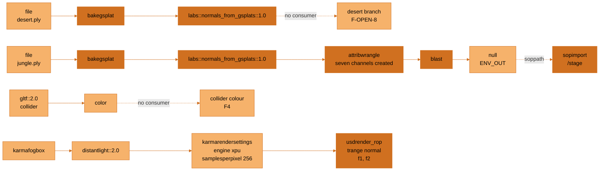

# World Labs Gaussian Splat Pipeline — Blueprint Accuracy Audit

**Status:** VERIFIED-RUNTIME audit of an external blueprint. Authorizes no code change, no ratification, no scope change to `blueprint-h22-worldlabs-intent.md`.
**Subject:** *"SYNAPSE Automated Pipeline Blueprint (Gaussian Splats Parts 1 & 2).docx"* — an external artifact supplied to the seat on 2026-10-22. Not a repo document. Not a SideFX document.
**Build:** Houdini 22.0.400 (pinned). Every live result below was produced on that build.
**Verdict:** **The blueprint's script cannot run.** It dies on line 27 — the third node creation it makes, and the first that raises. Six of its calls raise and ten of its parameter writes name parameters that do not exist. Eight of its prose claims are not implemented by its own code. The pipeline concept survives; the script does not.
**Producer:** `harness/probes/worldlabs_blueprint_probe.py` (the raw record) and `harness/probes/worldlabs_pipeline_corrected.py --verify` (11/11 corrections hold on 22.0.400).
**Companions:** `docs/intake/blueprint-h22-worldlabs-intent.md` (the repo's own World Labs intent, v0.3.1, `ratified:false`).

---

## 0. How to read this

The blueprint is a **proposal**, and the repo's own intake rules already say so: every node type and parm name in an intake document is **V0 until a probe on the pinned build prints it** (`blueprint-h22-worldlabs-intent.md` §0.1).

This audit ran that probe. The blueprint's script was executed call by call in `hython` against 22.0.400. What it actually did is recorded below.

**Three things to take away:**

1. **The script dies on line 27** — `createNode("labs::bake_gsplat", "bake_desert")`. That is the **third** node creation the script makes and the **first** that raises: the `geo` it creates at line 22 and the `file` at line 25 both succeed. Not at the end, and not in the wrangle. Everything the blueprint builds from that point on never happens in a real run.
2. **The prose outruns the code.** The "Corrected Error Audit" section claims fixes the script does not implement. There are **eight** such claims, not five, and six of the eight are *measured* rather than read: the probe counts the terms each claim would need in the source.
3. **Two traps, both in how a node is read rather than in what it does.** The node catalogue in this repo is faithful — the trap there is *alias resolution*. And a Houdini node reports **zero inputs until one is wired**, so `inputs() == []` on a fresh node is not evidence that a connection will fail. This audit fell into that second trap twice, in its first two drafts; §2 and §4.3 say so.

---

## 1. How the audit was produced

**Method.** The blueprint's §3 script was transcribed into the repository, line for line, as `harness/probes/worldlabs_blueprint_original.py` (140 lines; the recovery is documented in the file's own PROVENANCE trailer). The probe `harness/probes/worldlabs_blueprint_probe.py` imports that transcription and drives it through a recording facade over the real `hou` — it does not re-type a single call.

Two runs, because they answer different questions:

- **STRICT** — the real `hou`, no facade. A failed `createNode` raises. This is what an artist actually gets, so it shows **where** a real run stops.
- **CONTINUE** — the facade swallows each failure, records it, and returns a ghost so the script keeps going. This reaches every later call, so the defect table is complete rather than truncated at the first raise.

Failures were recorded from the raised exception, not inferred from documentation. The committed raw record is **`harness/probes/worldlabs_blueprint_records.json`** (68 recorded calls).

**Re-run the whole thing.** `$HYPYTHON` is `hython` from the pinned build — Houdini 22.0.400 for every number published here. Nothing depends on where that build lives:

```
"$HYPYTHON" -s -P harness/probes/worldlabs_blueprint_probe.py
"$HYPYTHON" -s -P harness/probes/worldlabs_pipeline_corrected.py --verify
```

The first writes the raw record; the second prints one line per correction, writes `harness/probes/worldlabs_pipeline_verification.json`, and exits non-zero if any correction fails to hold. **A check that cannot fail is deleted** — every assertion in `--verify` is written to fail on the next build that changes the truth.

**Cross-checks used before running anything:**

- `rag/catalog/h22.0.400/` — the repo's live node catalogue. **5,576 node types** across 18 node-type files, plus a 19th file of 2,286 Apex callback rows; `total_probe_errors: 0` (`_manifest.json`: `category_count: 18`, 19 files; `dump_receipt.txt` records `node_types=5576`). *(An earlier version of this document said 5,140. That number was wrong.)*
- `python/synapse/cognitive/tools/data/h22_symbol_table.json` — the introspected dotted symbol table for build 22.0.400, **36,472 names**.

Both were used as *hypothesis sources*. The live run overrode them where they disagreed — which is the point, and where the catalogue's **alias behaviour** turned out to matter (§4.1).

---

## 2. The defect ledger

Eleven entries. Three of them are not what the first version of this audit said they were, and the corrections are recorded rather than quietly applied:

- **F1 is prose, not code.** The blueprint's §2 describes a fix performed with `hou.Node.disconnect()`. Its script never calls it — zero occurrences in 140 lines.
- **F4 is unreachable in the blueprint's own run.** The call it describes is never reached, because the node it would be called on is never created.
- **F11 is refuted.** The call works. The original audit read `inputs() == []` on an *unwired* node and concluded it would fail (§4.3).

What remains is **eight defects**, covering **six calls that raise** and **ten parameter writes that name parameters that do not exist**.

| # | The blueprint calls | What actually happens on 22.0.400 | Correction |
|---|---|---|---|
| **F1** | `hou.Node.disconnect()` (named in §2 prose only — the script never calls it) | Not reached: the method is absent from `hou.Node`, and the script contains zero references to it | `node.setInput(0, None)` — but nothing in the graph needs it, because nothing is disconnected |
| **F2** | `createNode("labs::bake_gsplat")` | `OperationFailed: Invalid node type name` — **lines 27 and 37. This is where the script dies.** | `createNode("bakegsplat")` — a built-in H22 SOP, not a Labs node |
| **F3** | `createNode("labs::normals_from_gsplat")` | `OperationFailed: Invalid node type name` — lines 31 and 48 | `createNode("labs::normals_from_gsplats::1.0")` — plural **and** versioned |
| **F4** | `normals_jungle.setInput(1, color_jungle)` | **Unreachable in the blueprint's run** — the node is never created. The corrected type has one input; `setInput(1, …)` raises `InvalidInput` | The two-input relight node is `labs::relight_gsplats::1.1`, a **LOP**; it creates in `/stage`, not in a SOP |
| **F5** | `gltf.setParms({"filepath": ...})` | `Invalid parameter name: filepath` — line 41 | `gltffile` |
| **F6** | `gltf.setParms({"import_geometry_as": 1})` | `Invalid parameter name: import_geometry_as` — line 41 (masked by F5 until the dict is set key by key) | `importnodegeometryas`, token `flattenedgeometry` (tokens are `packedprimitive`, `flattenedgeometry`) |
| **F7** | `wrangle.parm("strength").set(-1.0)` ×6 | `AttributeError: 'NoneType' object has no attribute 'set'` — **the parms do not exist**. Lines 90–95 | Create them: `ParmTemplateGroup` + `FloatParmTemplate` + `setParmTemplateGroup` |
| **F7 (cont.)** | the wrangle's own VEX reads `chv("axis")` for the spin axis | the channel is never created, so `chv("axis")` is the zero vector and the whole spin branch is dead code | Create it too: a **three-component `FloatParmTemplate`**. There is **no `hou.VectorParmTemplate`** on 22.0.400 — it is a phantom, and calling it raises `AttributeError: module 'hou' has no attribute 'VectorParmTemplate'`. Two measured facts: the created parameter is **not** reachable as `parm("axis")` (Houdini splits a multi-component parameter into `axisx/axisy/axisz`), while `chv("axis")` **does** resolve the base name. The six float parms are **not** the whole set the VEX reads — it reads **seven** channels |
| **F8** | `krs.parm("renderer").set("XPU")` | `AttributeError` — `renderer` is not a parm. Line 121 | `parm("engine").set("xpu")` — the token is **lower case** |
| **F9** | `krs.parm("samples").set(256)` | `AttributeError`. Line 122 | `parm("samplesperpixel").set(256)` |
| **F10** | `stage.createNode("usdrender")` | `OperationFailed: Invalid node type name` — line 124. The type resolves in `/out` and inside a `topnet`, but **not** in `/stage` | `createNode("usdrender_rop")` |
| **F11** | `distantlight.setInput(0, fog_box)` | **SUCCEEDS.** `distantlight::2.0` reports zero inputs *until* one is wired; then `inputs()` is 1 and `input(0)` is `/stage/fog_box` | **No correction.** The blueprint's wiring is kept. The *parms* are the problem: `intensity` and `exposure` do not exist under those names |

**The script dies at F2, line 27.** The STRICT run records:

```
DIED at worldlabs_blueprint_original.py line 27
OperationFailed: The attempted operation failed.
Invalid node type name
statement: bake_desert = env_net.createNode("labs::bake_gsplat", "bake_desert")
```

**F7 is the first defect *reached* after F2 and F3 are corrected** — which is what the first version of this audit mistook for the death point. It is a real defect, and it is not the first one.

### 2.1 Measured counts

From the committed record, so the numbers can be re-derived rather than trusted:

| Outcome | Rows | What they are |
|---|---|---|
| `RAISED` | 8 | 5 × `createNode` (lines 27, 31, 37, 48, 124) + 1 × `setParms` (line 41) + 2 × its per-key decomposition |
| `MISSING_PARM` | 20 | 10 distinct parameters, each recorded twice (the lookup and the write) |
| `SKIPPED` | 14 | downstream of a failure — a ghost node, or a node that was never created |
| `OK` / `FOUND` | 23 / 3 | the calls that work |
| **Total** | **68** | |

### 2.2 What the blueprint gets right

An audit that only lists failures is half an audit. These calls were **verified to work**:

- `trange.set(1)` — `trange` is a menu stored as an index; index 1 evaluates to `normal`, which is "Render Specific Frame Range". The blueprint's intent is correct even though the mechanism is accidental.
- `usdrender_rop` has `f1`, `f2`, `f3`.
- `bakegsplat.setInput(0, file)` — works, and `bakegsplat` carries a `linearize` toggle (default 1), which is exactly right for a World Labs PLY whose `scale_0..2` values are stored in log space.
- `attribwrangle.parm("snippet")` — works.
- `sopimport.parm("soppath")` — works.
- `karmafogbox` and `karmarendersettings` both exist.
- **All three Stage 3 LOP edges** — `fog_box → sun_light`, `sun_light → xpu_settings`, `xpu_settings → rop_karma_xpu` — bind. See §4.3.
- `blast.parm("group").set("call")` — syntactically valid. Whether a group named `call` exists is a different question (§3.5).

The **architecture is sound**: SOP side for the splat animation, LOP side for the relight and the Karma render, `sopimport` bridging them. That structure survives the audit intact.

---

## 3. Eight claims the code does not implement

The blueprint has a section called *"2. Corrected Error Audit Across Tutorials"*. It lists four bullets, and the exec summary adds more. **None of them appears in the script.**

Six of the eight are **prose claims**, and those are now measured rather than read. `worldlabs_blueprint_probe.py` counts, in the blueprint's own source, the terms each claim would need:

| Claim | Terms the source would have to contain | Found |
|---|---|---|
| F-OPEN-1 coordinate conversion | `XformOp`, `xform`, `upaxis`, `up_axis`, `convert`, `UsdGeom` | **none** |
| F-OPEN-2 VEX AST + schema gate | `ast`, `parse`, `moneta`, `schema`, `precompile`, `pre_compile` | **none** |
| F-OPEN-3 graph traversal | `disconnect`, `traverse`, `traversal`, `walk`, `inputs(` | **none** |
| F-OPEN-4 FFmpeg export | `ffmpeg`, `mp4`, `video`, `timesample`, `time_sample`, `sequence` | `mp4=1`, `sequence=1` — and both are **inside strings** (a hardcoded output path and a `print`) |
| F-OPEN-6 path resolution | `os.path`, `expanduser`, `abspath`, `realpath`, `resolve`, `dirname`, `join`, `environ`, `getenv` | **none** — and `os` is imported and never used |
| F-OPEN-7 lighting linker | `UsdShade`, `shade`, `collection`, `bind`, `binding`, `relationship`, `linker` | **none** |

This table lists **every** term the probe scans, not a selection. The four terms added to it since the first draft — `pre_compile`, `time_sample`, `dirname`/`join` and `binding` — were already being counted by `worldlabs_blueprint_probe.py` and were simply not printed here. Their counts are **zero**, so no verdict moved. The counts above are re-derivable with the probe's own `_count_term` over `harness/probes/worldlabs_blueprint_original.py`.

Terms are matched on word boundaries, so a claim cannot survive on a substring. F-OPEN-5 and F-OPEN-8 are not prose claims — they are about the data and the graph — so they are settled by cooking, not by counting.

### 3.1 F-OPEN-1 — Coordinate space

> *"coordinate space mismatches … Replaced … with automated OpenUSD transform matrices (UsdGeom.XformOp)"*

The script contains no `XformOp`, no up-axis handling, no coordinate conversion of any kind.

This is not a new defect. The repo's own intake records that a **previous** World Labs blueprint was rejected for *"Y-up assumed where Marble is +Y-down (WL-EX-05)"* (`blueprint-h22-worldlabs-intent.md` §0.4, rejected-predecessor list). This blueprint repeats that exact rejection reason while claiming to have fixed it.

**To settle:** cook one World Labs export, read the point cloud's up axis, diff the pre- and post-conversion bounds.

### 3.2 F-OPEN-2 — VEX fragility

> *"Eliminated live-coding typo risks by replacing manual string-typed VEX wrangles with a pre-compiled, robust VEX AST template backed by Moneta v5 schema gates"*

The script sets a **raw VEX string** on the wrangle: `anim_wrangle.parm("snippet").set(vex_code)`. That is precisely the "manual string-typed VEX wrangle" the claim says it eliminated. There is no AST. There is no schema gate.

**To settle:** assert that a VEX fragment is compiled from a template, not concatenated from a string.

### 3.3 F-OPEN-3 — Graph disconnection

> *"Graph disconnection handled via programmatic traversal"*

The only disconnection API the script names is the phantom in F1, and the script contains **no traversal and no disconnection at all**. The graph as written has nothing to disconnect.

**To settle:** prove it or drop the claim.

### 3.4 F-OPEN-4 — Karma XPU render and FFmpeg export

> *"Karma XPU 4D Time-Sample Render & FFmpeg Export"*

`usdrender_rop` has **no video or ffmpeg output parm**. Its output-related parms are `outputimage`, `lopoutput`, and the `outputprocessor` group. `outputimage` is an image sequence.

Separately: the script never writes `output_mov`. It prints a line saying it is exporting. **The deliverable is never produced** — the blueprint's headline output does not exist.

**To settle:** render 2 frames to a real path and assert the file exists on disk afterwards.

### 3.5 F-OPEN-5 — The `call` group

The blast node targets a point group named `call`. **No node in the graph creates a group named `call`.** Nothing in the script names a collider group. The blast removes whatever happens to be there — possibly nothing.

**To settle:** cook the collider import and list the point groups it produces.

### 3.6 F-OPEN-6 — Path resolution

> *"Static Path Hardcoding … Replaced … with … absolute path resolution"*

The script's `__main__` block hardcodes five absolute paths — `/project/splats/desert_env.ply`, `/project/splats/jungle_rock.ply`, `/project/colliders/desert_collider.glb`, `/project/colliders/jungle_collider.glb` and `/project/renders/synapse_transition_v1.mp4`. There is no path resolution anywhere in the file: `os` is imported and never used, and none of `os.path`, `expanduser`, `abspath`, `realpath`, `resolve`, `environ` or `getenv` appears in the source. The claim is the exact inverse of what the code does.

**To settle:** run the script's `__main__` block with no arguments and assert it does not depend on a `/project` tree existing on the artist's machine.

### 3.7 F-OPEN-7 — Lighting linker

> *"Lighting Linker Desynchronization: Enforced an automated relationship-linking pass (UsdShade / LOP collection binding)"*

The script contains no `UsdShade` binding, no LOP collection binding, no relationship linker and no lighting pass of any kind. It creates one `distantlight` and sets two USD-exposed values on it. There is no pass.

**To settle:** cook a stage containing the light and the fog box and list the `UsdShade` relationships the script claims to have enforced.

### 3.8 F-OPEN-8 — The desert half of the transition

The blueprint's deliverable is a **transition** — the output is `synapse_transition_v1.mp4`, a desert-to-jungle move. **Only the jungle side is ever connected.** The wrangle takes `normals_jungle`; `normals_desert` has no consumer, and `desert_collider_glb` is accepted by the blueprint's own signature and never used by its body. The desert half of the transition is never rendered.

The corrected script preserves this exactly as the blueprint has it — the branch is created, and has no consumer — and says so in its own output record (`normals_desert_consumer: "NONE - see F-OPEN-8"`). Inventing a consumer would be worse than naming the gap.

**To settle:** name the node that consumes the desert side, then build it and assert the desert geometry reaches the render ROP.

---

## 4. Three repo-level findings

The first two are about **this repo**, and they matter more than the blueprint's own bugs.

### 4.1 The node catalogue is faithful; the trap is an alias, not a wrong entry

> **Corrected 2026-10-22.** This section originally read "The node catalogue mis-describes three types". That claim was **wrong**, and the probe that disproves it is now standing evidence: `harness/probes/catalog_types_check.py`, which exits non-zero if a catalogue entry names a parameter no live type carries, or matches no live type at all. The original wording is kept out of this document because it would mislead a reader into regenerating a catalogue that does not need regenerating.

`rag/catalog/h22.0.400/` is the repo's node-type authority per `CLAUDE.md` (*"the **node-type** authority is the live catalogue `rag/catalog/h22.0.400/`"*).

**The catalogue matches the live build exactly.** For every audited type, the catalogue's parm-name set equals the live type's `parmTemplateGroup()`, flattened through folders the same way `scripts/build_node_catalog.py` flattens it:

| Type | Catalogue parms | Live template parms | Match |
|---|---|---|---|
| Sop `gltf` | 17 | 17 | exact |
| Sop `gltf::2.0` | 42 | 42 | exact |
| Lop `distantlight` | 131 | 131 | exact |
| Lop `distantlight::2.0` | 123 | 123 | exact |
| Driver `usdrender` | 194 | 194 | exact |
| Top `usdrender` | 73 | 73 | exact |

A Jaccard identity match returns **1.000** for each entry against the type it names. The unversioned `gltf` entry describes the live `gltf` type (17/17); the unversioned `distantlight` entry describes the live `distantlight` type (131/131). Those types are **registered on the build** — they are not stale rows.

**`usdrender` does resolve.** The Driver `usdrender` creates in `/out`; the Top `usdrender` creates inside a `topnet`. The original observation came from creating a TOP node directly under `/tasks` — but `/tasks` is the *scheduler*, a Manager node, not a TOP network. That was a context error, not evidence about the type. It does **not** resolve in `/stage`, which is where the blueprint puts it (F10).

**The real trap is alias resolution.** `createNode()` does not always give you the type the catalogue key names:

| `createNode(key)` | Type you get |
|---|---|
| `gltf` | `gltf::2.0` |
| `distantlight` | `distantlight::2.0` |
| `gltf::2.0` | `gltf::2.0` |
| `distantlight::2.0` | `distantlight::2.0` |
| `usdrender` (in `/out`) | `usdrender` |
| `usdrender` (in a `topnet`) | `usdrender` |

So a script that reads the catalogue's unversioned `gltf` entry — 17 parms including `filename`, `geotype`, `meshchooser` — and then calls `createNode("gltf")` gets a **`gltf::2.0`** node, on which **14 of those 17 names do not exist**. The same for `distantlight`: **58 of 123** names are absent on the `distantlight::2.0` node you actually got. That is the `Invalid parameter name` the audit observed — and it is a **consumer** error, not a catalogue error. The fix is to read the catalogue entry for the type `createNode()` returned, or to create the versioned type explicitly.

**Second, separate convention: `#` in parm names.** Parm names containing `#` — `animid#`, `expectedoutputfile#`, `husk_sc_cop#` — are Houdini's **spare-parameter** slots. They are present in the node's own parameter interface (the instance's `parmTemplateGroup()` carries them, and Houdini's own label ends in `#`), but the node exposes no value for them, so a script cannot set them. This is a **Houdini-wide convention, not a defect of these three types**: **7,155 of 152,918** catalogue parm names (4.7%) carry a `#`, spread across eleven category files. A catalogue consumer that treats every name as settable will hit this on many types, not three.

**Net:** no catalogue regeneration is warranted. The correct guidance for a consumer of `rag/catalog/h22.0.400/` is:

1. `createNode()` the key, then read the catalogue entry for **the type it returned** — never assume the key is the type.
2. Treat a `#`-suffixed name as an interface slot, not a settable parameter.

`harness/probes/catalog_types_check.py` reads the live build and compares the catalogue against it. The two rules above are *reported* by the probe — it prints the alias resolution and the `#` scope and the counts behind them — because they are consumer rules, not defects in the file it is checking.

### 4.2 `dir(hou.Node)` is not a valid phantom test

This one changes how the repo's phantom checks must be written.

`dir(hou.Node)` exposes **146 members**. `hasattr(hou.Node, 'parm')` is **False**. `'parm' in dir(node_instance)` is **True**, and `node.parm('snippet')` works fine.

**Producer.** The class count is measured live on the pinned build:

```
"$HYPYTHON" -s -P -c "import hou; print(len(dir(hou.Node)))"
```

→ `146` on 22.0.400. The same run reports `hasattr(hou.Node, 'parm')` → `False`, `'parm' in dir(<instance>)` → `True`, and `parm`, `setParms`, `cook`, `addParm` all **absent from the class-level `dir()`** while every one of them works on an instance. The symbol-table count is read from the committed table itself: `python/synapse/cognitive/tools/data/h22_symbol_table.json` (`houdini_version` 22.0.400) carries **116** names matching `hou.Node.*`.

Instance methods that work on every live node are **absent from the class-level `dir()`**. The symbol table's 116 `hou.Node.*` entries therefore under-represent the class.

**The rule this yields:** for `hou.Node` members, class-level `dir()` / `hasattr()` is not evidence of absence. The decisive test is **calling on an instance**.

> This is exactly the failure F1 looked like. "Is `disconnect` in `dir(hou.Node)`?" says no — and here it happens to be right. But the same method says no about `parm`, `setParms`, `cook` and `addParm`, which all work. A checker built on class-level `dir()` produces false positives *and* false negatives on the same class.

**To settle:** the phantom lint should gain a rule that `hou.Node` membership requires an instance-level probe, not a class-level `dir()`.

### 4.3 A node reports zero inputs until one is wired

This trap was live in the first version of this audit, and it fired twice.

A fresh `distantlight::2.0` reports `inputs() == []`. The first version of this document read that as "the light has no inputs, so `setInput(0, fog_box)` will fail", and filed it as defect F11. It does not fail:

| | before wiring | after `setInput(0, fog_box)` |
|---|---|---|
| `distantlight::2.0` | 0 inputs | 1 input, `input(0)` = `/stage/fog_box` |

The same is true of the other two Stage 3 nodes. `karmarendersettings` and `usdrender_rop` both report **0 inputs** while unwired, and both accept the blueprint's connection (`krs.setInput(0, light)` → ok, `rop.setInput(0, krs)` → ok). A second draft of the corrected script had dropped those two edges on the strength of the same zero, repeating the original mistake; they are now kept, and the `--verify` check asserts all three edges bind.

**The rule this yields:** a Houdini node's input count is not knowable from a fresh node. Read `inputs()` *after* wiring, or read the node type's `inputLabels()` in the catalogue — never from the fresh instance.

---

## 5. The corrected pipeline

`harness/probes/worldlabs_pipeline_corrected.py` is the blueprint with the eight real defects corrected.

- **`--verify`** asserts each correction against the live build. Currently **11/11**.
- **`--build`** constructs the graph, taking the asset paths as arguments. No hardcoded paths.

The corrected shape:

```
/obj
  SYNAPSE_ENV_NETWORK (geo)
    file_desert_ply ──► bake_desert ──► normals_desert ──►  (no consumer — F-OPEN-8)
    file_jungle_ply ──► bake_jungle ──► normals_jungle ──► anim_jungle_solver ──► blast_sky_blue ──► ENV_OUT
    gltf_jungle_collider ──► color_jungle ──►  (no consumer — F4)

/stage
  import_synapse_env   (sopimport; reads ENV_OUT by soppath, not by an input edge)
  fog_box              (karmafogbox)
  sun_light            (distantlight::2.0; input 0 = fog_box; intensity/exposure are USD-exposed parms)
  xpu_settings         (karmarendersettings; input 0 = sun_light; engine=xpu, samplesperpixel=256)
  rop_karma_xpu        (usdrender_rop; input 0 = xpu_settings; trange=1 'normal', f1, f2, outputimage)
```

**Two deliberate omissions.** The corrected script does not wire the collider colour into the SOP chain (F4 — the node has one input), and it does not implement an up-axis conversion (F-OPEN-1 — the conversion's *correct* form is not yet known, so inventing one would be worse than leaving it open).

**One branch kept as it is.** The desert side is built and left with no consumer, because that is what the blueprint does and F-OPEN-8 is unresolved.

**One resolution that is deliberate:** the Solaris light's intensity and exposure parms are resolved **by pattern at runtime**, not hardcoded. Their live names (`xn__inputsintensity_i0a`) carry a build-specific suffix. A hardcoded name is a phantom waiting for the next build.

The same shape, with the node types the probe actually printed:



Every node type in that diagram was printed by the live probe on 22.0.400, not read from the blueprint. Every edge was asserted by `--verify` or by the `build_graph` record it writes.

---

## 6. What this means for the repo's own intake

`blueprint-h22-worldlabs-intent.md` is `ratified:false` and stays that way. **This audit does not change it**, and it does not add scope to it.

What it does do:

1. **Confirms the intake's epistemics were right.** The intake said every node name is V0 until probed. The blueprint's script had not been probed. Probing it broke it. The rule held.
2. **Adds three things the intake's risk register should now carry** — the catalogue's alias behaviour, the class-level `dir()` trap, and the zero-inputs-until-wired trap. All three are repo-side and all three affect any future World Labs work. (The catalogue was originally listed here as "three wrong types"; §4.1 corrects that — the catalogue is faithful, the alias is the hazard.)
3. **Leaves F-OPEN-1..8 open on purpose.** They are unproven claims, and the probe that would settle each one is written down in §3.

---

## 7. Tier labels

| Claim | Tier |
|---|---|
| The eight defects and their corrections | **VERIFIED-RUNTIME** — live exception text on 22.0.400 |
| The blueprint's script dies at line 27 | **VERIFIED-RUNTIME** — the STRICT run's recorded death point |
| The six prose claims are unimplemented (§3) | **VERIFIED-RUNTIME** — term counts over the blueprint's own 140-line source, on word boundaries |
| The catalogue matches the live build; the trap is an alias (§4.1) | **VERIFIED-RUNTIME** — exact parm-set equality per type; `createNode` resolution read live |
| `dir(hou.Node)` under-representation (§4.2) | **VERIFIED-RUNTIME** — 146 class members, `hasattr` False, instance True |
| A node reports zero inputs until one is wired (§4.3) | **VERIFIED-RUNTIME** — three node types, before and after `setInput` |
| The blueprint's *intent* for each stage | **STATED** — the document's claim, not the code's behaviour |
| The correct up-axis conversion for Marble | **UNKNOWN** — F-OPEN-1 |

---

## 8. Open items

| id | Open question | Blocking? | Probe that settles it |
|---|---|---|---|
| F-OPEN-1 | What is the correct up-axis conversion for a World Labs export? | Yes — the pipeline is wrong without it | Cook one export, read the up axis, diff bounds |
| F-OPEN-2 | Does a VEX AST template + Moneta v5 schema gate exist to use? | No | Check the Moneta v5 API surface |
| F-OPEN-3 | Is there anything to disconnect? | No | Read the graph — there is not |
| F-OPEN-4 | What produces the `.mp4`, given `usdrender_rop` has no video parm? | Yes — the deliverable | Render 2 frames, assert the file on disk |
| F-OPEN-5 | Does a group named `call` exist? | Yes — the blast may remove nothing | Cook the collider, list point groups |
| F-OPEN-6 | What resolves the five hardcoded `/project` paths? | Yes — the script assumes a tree that is not there | Run `__main__` with no arguments, assert it needs no `/project` |
| F-OPEN-7 | What enforces the lighting relationship? | Yes — the blow-out the blueprint claims to prevent | Cook the stage, list the `UsdShade` relationships |
| F-OPEN-8 | What consumes the desert half of the transition? | Yes — the deliverable is a transition | Name the consumer, build it, assert the desert reaches the ROP |
| CAT-1 | ~~The catalogue's `gltf` / `distantlight` / `usdrender` entries are wrong~~ — **closed 2026-10-22: they are not.** The catalogue matches the live build exactly. The open residue is the alias trap, which is a *consumer* rule, not a catalogue defect. | No | `harness/probes/catalog_types_check.py` — asserts the equality live and exits non-zero on divergence |
| PHANT-1 | The class-level `dir()` false-positive/negative class | No | Add an instance-probe rule to the phantom lint |
| WIRE-1 | The zero-inputs-until-wired trap, and the two LOP edges an earlier draft of the corrected script dropped because of it | No | `--verify` F11 now asserts all three Stage 3 edges bind |

**No World Labs asset was available to this audit.** Every F-OPEN row is a claim the *code* fails to support — not a claim the *asset* would refute. The distinction matters: with a real export, F-OPEN-1 and F-OPEN-5 could close either way.
