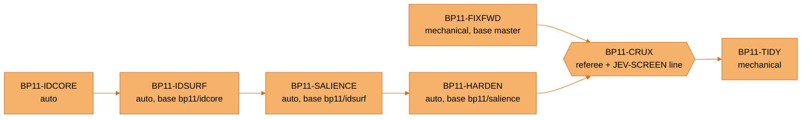

# BP11 - CTO plan: Identify plus production hardening

Status: v1.0 - 2026-09-28 - CTO seat on Joe's word. Decisions taken with Joe on 2026-09-28: Identify goes
after BP10, Jev sits in the product only as Identify salience in shadow, the effort fits under 100M tokens,
and code is built by harness legs with computer use reserved for the live-Houdini gates.
Contract for the feature: `harness/battleplan/notes/IDENTIFY_BLUEPRINT.md`.

**Update v1.1, 2026-09-28 18:57.** Shipped as v5.85.0. Section 8 records how the wave went and section 9
is the BP12 queue.

**Update v1.2, 2026-09-28 19:15.** The Claude model rows landed locally (914f995e, not pushed). BP12 item 10
holds the default switch.

**Update v1.3, 2026-09-28 21:00.** v5.85.1 shipped: Claude Code now connects to SYNAPSE over MCP, and
the Claude model rows are public. Section 10 records it, and BP12 gains items 11 to 14.

**Update v1.4, 2026-09-29 06:45.** BP12 items 13 and 14 are fixed and verified live in Houdini
(`ce825a26`, local, not pushed). Section 11 records it, and BP12 gains items 15 and 16.

**Update v1.5, 2026-09-29 07:26.** v5.85.2 shipped those fixes. Section 12 records it.

**Update v1.6, 2026-09-29 08:40.** BP12 items 15 and 16 are fixed and verified live (`a773969f`, local,
not pushed). Section 13 records it.

**Update v1.7, 2026-09-29 09:05.** v5.85.3 shipped items 15 and 16 and restyled the mermaid diagrams in two
orange tones with black type. Section 14 records it, and BP12 gains item 17.

**Update v1.8, 2026-09-29 09:45.** BP12 item 1, the save freeze, is fixed and timed in hython (`4904709e` and
`d3f82193`, local, not pushed). Section 15 records it, and BP12 gains item 18.

**Update v1.9, 2026-09-29 10:02.** BP12 item 9 is fixed (`8201e7b6`, local, not pushed). Section 16 records
it, and BP12 gains items 20 and 21.

**Update v1.10, 2026-09-29 11:10.** v5.85.4 shipped items 1 and 9 (`f3da32b8`, CI green, published). Section 17
records it, and corrects the embedder wording in section 15.

**Update v1.11, 2026-09-29 11:35.** Item 20 turned out to sit on a panel Houdini does not load, so I corrected
the v5.85.4 notes (`5bb0f9c0`, local, not pushed) and re-scoped the item. BP12 gains item 22.

**Update v1.12, 2026-09-29 11:30.** Joe said to retire the older panel. `036724b2` (local, not pushed) removes it,
which resolves items 20 and 22. Section 18 records it.

**Update v1.13, 2026-09-29 11:50.** v5.85.5 shipped the retirement and the notes correction (`894ddb41`, CI green,
published). The v5.85.4 release page now carries the corrected text. Section 19 records it.

**Update v1.14, 2026-09-29 12:05.** Items 11 and 17 are fixed in two local commits, `9d11dd0f` and `9dbdf106`
(not pushed). Sections 20 and 21 record them. Found on the way: README line 129 still lists the first-save freeze
as a known issue, which v5.85.4 fixed.

**Update v1.15, 2026-09-29 13:10.** Item 21 is fixed (`c8242139`). A full bare run then caught a mistake in item 11:
`9d11dd0f` renamed the helper to `bp_mission_schema.py`, which `tests/test_bp2_meter_tier.py` already registers in
`sys.modules`, so four jev modules failed at collection. `2951f96e` renames it to `jev_bp_schema_pin.py`. Section 20
is corrected and section 22 records item 21. Four commits are local and unpushed.

**Update v1.16, 2026-09-29 14:00.** Items 18 and 19 are fixed in two local commits, `5311b2f9` and `daf51459`. Section 23
records item 18 and section 24 records item 19. Six commits are local and unpushed.

**Update v1.17, 2026-09-29 17:35.** v5.85.6 shipped: the six local commits plus the release commit `640c2c8f`, CI green, release Latest. README line 129 (the first-save row) is removed. Section 25 records it. Nothing is unpushed.

**Update v1.18, 2026-09-29 20:40.** BP12 items 2 to 8 and 12 are closed in seven local commits, not pushed:
`5d25069a`, `11a92166`, `daaa1410`, `a1bcb9d9`, `392490ca`, `dd154d0e` and `f0ac7a19`. Sections 26 to 32 record them. BP12 gains
items 23 to 25. Item 10 stays on hold. Houdini needs a restart before Identify and the new `/mcp` behaviour can be checked live.

**Update v1.19, 2026-09-29 18:34.** v5.86.0 shipped: the seven BP12 commits, two read-only-mode fixes found during the release, and the first Windows Setup since v5.75.2 (release commit `0e67a740`, tag `v5.86.0`, CI run 36638956262 green on all six jobs, release Latest, record commit `3610b63c`). Section 33 records it and corrects section 32. Section 34 records Joe's studio-readiness list, its order and the Level 1 blueprint, which is being built now. BP12 gains items 26 to 28.

**Update v1.20, 2026-09-29 20:17.** v5.87.0 shipped Level 1 M0 and M1 as a source release (release commit `fd225f6b`, tag `v5.87.0`, CI run 36648579497 green on all six jobs, release Latest). Section 35 records it and the live checks, which close BP12 item 25. R-5 to R-7 in the Level 1 blueprint v1.1 wait for Joe.

**Update v1.21, 2026-09-29 21:50.** Joe's "Continue" adopted R-5 and R-6, with R-7 later as its own milestone. Level 1 M1b
(`3496737c`) and M2 (`86faa156`) are committed locally, not pushed. Section 36 records them. Their live checks wait for a
Houdini restart on the new code.

**Update v1.22, 2026-09-30 09:05.** v5.88.0 shipped Level 1 M1b, M2 and a farm follow-up (`90246aea`) as a source
release (release commit `507153d4`, tag `v5.88.0`, CI run 36717537891 green on all six jobs, release Latest). Section 37
records it. The live checks have not run: the Houdini session still runs v5.87.0's code.

## 1. Where we are

- **master is v5.84.2** at `312ed2cf`. The test suite collects cleanly on system Python: 10,670 tests, exit 0,
  19.45 s (`python -m pytest --collect-only -q -p no:cacheprovider`, 2026-09-28).
- **BP10 already ran** on 2026-09-21 and 22. Five of six leg branches are 0 commits ahead of master
  (`git rev-list --count master..bp10/<leg>`). `bp10/crux` is 2 commits ahead and unmerged: the verdicts, the
  mutation record and the CRUX receipt. The BP10 mission files on disk are untracked authoring leftovers.
- **BP10's fix-forward list, checked on master today.** The mojibake in `guards.screen` is gone (0 occurrences
  of U+00E2 U+20AC in `harness/jev/questions.json`). The README overclaim is gone after `312ed2cf`. ADR-0001 still
  lists 4 of the 8 refusals. `NOTICE.md` still publishes the CRLF working-tree hashes, which CRUX showed match
  upstream 0 of 31 times. The last two are open.
- **Jev's product door is live.** `python/synapse/jev/adapter.py` has two callers,
  `jev/selection_suggestions.py:195` and `jev/panel_routing.py:106`, and the boundary is pinned by
  `tests/test_jev_product_boundary.py`.
- **Worktree sprawl.** At least 45 worktree directories sit under `.claude/worktrees` (one `rails_exec.json` copy
  found in each, 2026-09-28).

## 2. Scouting report

Three read-only scouts ran in parallel on the Sonnet tier: A (artist surface), B (Jev and harness), and
C (production readiness). Together they used about 524k tokens (subagent usage lines, 2026-09-28). The CTO
seat re-checked every claim below before it entered the plan. Four claims were corrected or demoted.

| # | Finding | Seat's check | Verdict |
|---|---|---|---|
| A1 | Identify should reuse the Inspector's `inspect_selection` pipeline | `panel/selection_inspection.py:68-80` | Adopted (rule 7) |
| A2 | The Selection Inspector is read-only by contract | `panel/selection_inspector.py:1-4` | Adopted: Identify is a separate writer (rule 8) |
| A3 | New widgets must use `designsystem.components` and tokens | `tests/panel/test_token_authority.py` | Adopted (rule 9) |
| A4 | `/identify` goes through one registry | `panel/command_palette.py` (PANEL_ANSWERED_COMMANDS), `panel/tool_palette.py:141` | Adopted, plus panel-answered so it never reaches the model (rule 1) |
| B1 | `adapter.judge` has a 0.8 s timeout, fails closed and refuses the main thread | `jev/adapter.py:26, 200, 225` | Adopted: salience runs on a worker |
| B2 | "`test_jev_product_boundary.py` does not exist" | It exists in `tests/` | Corrected |
| B3 | A leg can declare the ref its worktree is cut from | `harness/orchestrate.ps1:559-566` | Adopted: the Identify legs are chained |
| C1 | CI runs on Ubuntu and macOS only | `.github/workflows/ci.yml` matrix | Adopted: BP11-HARDEN |
| C2 | `run_on_main` has a self-deadlock gap | Fast path 2 runs main-thread callers inline (`server/main_thread.py:441`); the "NOT claimed" line in `server/api_adapter.py:136` is about justification, not a gap | Corrected. The real residual, an inline hold that freezes the GUI, became Identify rule 5 |
| C3 | Vendored-SDK ABI fallback | The warning fires for system Python 3.14 (tests). Houdini 22.0.400 runs Python 3.13 (title bar during the M0 probe), where cp313 wheels ship | Demoted to test-environment hygiene |
| C4 | Test collection exits 1 | Re-run exits 0 | Corrected |
| C5 | 1,338 `except Exception` sites in 419 files, 123 in `synapse_panel.py` | Scout C's Select-String command | Adopted as a ratchet, not a rewrite |
| C6 | The Anthropic key sits in plaintext `.env` via `set_anthropic_key.bat` | Scout C; `.env` is gitignored | Ruling R-3 |
| C7 | No installer story for 22.0.417 (`TESTED_BUILD = "22.0.400"`) | `installer/synapse_setup/discovery.py:10` | Ruling R-4 |
| C8 | The "Updates" path was not found by grep | The panel renders "Updates (1)" in the M0 screenshot | UNKNOWN; checked at the GUI gate, no leg |
| C9 | `harness/solaris_v3/runs` holds a large artifact tree | Scout C | TIDY census |

## 3. CTO recommendations (the high-level changes)

1. **One fact pipeline for the artist surface.** Identify, the Selection Inspector and Jev suggestions all read
   `inspect_selection`. Nothing walks the selection twice, so every feature sees the same identities and the
   same staleness checks.
2. **Readers and writers stay separate.** Every writer owns exactly one undo group per click and never loses
   artist data. Identify is the first writer to carry that as a written contract, and the pattern should
   become the house rule for every future scene writer.
3. **Exact code first, Jev in the grey band, models last.** The bubble is exact code. Jev only ranks among
   parameters the code has already filtered, in shadow, graded against a measured answer key. A model call is
   reserved for work that is truly generative, like the parked chain summary.
4. **Ratchets over rewrites for hardening debt.** The 1,338 broad excepts are not rewritten. They stop growing,
   and every file can only go down. Token authority already works this way.
5. **CI runs where artists run.** Artists run Windows, so CI gets a Windows leg. The hython gate stays local
   because it needs a licence, and it stays part of the release ritual.
6. **Provenance claims get closed before new work.** A published hash table that does not match its source is
   a false claim, so the BP10 fix-forward rides in this wave.

## 4. The BP11 graph

JEV-SHAPE chose `build-screen-crux` at 1.00 for this objective (`harness/jev/ledger/bp11.shape.jsonl`,
2026-09-28T10:37:45; cause_known 0.92, deterministic 0.05, breadth 1.93). The template makes every builder
parallel. The seat added real edges, because each Identify leg needs the code of the one before it. Each
chained leg is cut from the previous leg's branch through `base`, so only one Opus-class leg is live at a time.

`bp11/harden` carries the whole Identify chain plus hardening, so one merge word lands all four product legs.
`bp11/fixfwd` merges on its own.

## 5. Budget (token-saver + token-budget-advisor pass, 2026-09-28)

**Measured basis.** BP10 cost 35.0M cost-weighted for six legs: 9.85M, 8.53M and 7.00M for its three Opus
builders, 5.55M for CRUX, and 2.48M and 1.55M for its two Haiku legs
(`harness/battleplan/runs/2026-09-21/ledger_orch_20260921-121433.json`). The rails weight usage fields, not
models: output 5.0, cache creation 1.25, fresh input 1.0, cache reads 0.1 (`harness/rails_exec.json`
`cost_weights`). Cache reads were 42 to 57% of each Opus builder's weighted spend, on contexts that peaked at
330k to 397k tokens.

**Projection.** Four Opus builders at BP10's 8.46M mean, plus FIXFWD, CRUX and TIDY at their BP10 analogs,
come to about 45M. This replaces the seat's first estimate of 94M, which was anchored on BP5's pre-weighting
plan figure and was wrong.

**Cap.** The wave arms with `-Budget '9turns,60000000tokens'`. At 45M projected that is 75%, the budget
advisor's caution band, so the HALT is a real guard rather than a formality. Joe's ceiling stays 100M, and
raising the cap is his word.

**Token-saver levers in this wave.**

1. Context packets. Every leg starts from `.token-saver/bp11/<LEG>.packet.md`, the exact windows the seat
   already located (`harness/battleplan/build_packets_bp11.py`; 3.8 KB to 30.3 KB per leg). Legs report
   `packet_gaps` in their receipts, which tune the next wave's packets.
2. Tool-output discipline in every brief: `pytest -q` on touched files and named pins, tailed output, no
   whole logs.
3. HARDEN carries its complete design, so it builds rather than designs.

**Jev coordination.**

- JEV-SHAPE chose the graph at 1.00. JEV-ROUTE kept all four builders on reasoning. Writing HARDEN's design
  into its note halved its novelty score (1.42 to 0.73) and lowered confidence to 0.84, still reasoning
  (`harness/jev/ledger/bp11.route.jsonl`). The rails meter counts tokens, not models, so pinning HARDEN to
  Haiku would save subscription allowance, not rails budget. That is Joe's call.
- JEV-PACKET (`harness/jev/jev_packet.py`, new) screened every packet per target. One repair moved CRUX and
  TIDY. IDSURF and SALIENCE did not move, and a target that creates a brand-new file scored 0.08 although the
  question excuses new files. That is calibration evidence against the question, so the guard stays a
  ledgered prediction, never a gate, graded later against the legs' `packet_gaps`. IDCORE's call hit a
  TypeSafe 520 service error and failed closed.
- JEV-SCREEN still writes one line per leg into the CRUX brief.
- Jev spend for this effort: 33 calls and 123,181 input tokens across shape, route, team and packet
  (`harness/jev/ledger/bp11.*.jsonl`), about half a cent at the published $0.042 per million.

**Joe's words, 2026-09-28.** Armed at the 60M cap (orchestrator run `orch_20260928-110852`, dispatch 11:08:53).
HARDEN is pinned to mechanical (Haiku 4.5) over JEV-ROUTE's reasoning at 0.84; the dissent stays in the route
ledger. The whole wave runs at effort `xhigh` as the R-7 trial; BP10 ran at `max`, so the two run ledgers are
the comparison.

## 6. Rulings for Joe (decisions, not legs)

- **R-1.** Merge `bp10/crux` (2 commits: verdicts, mutation record, receipt). BP11-FIXFWD cites it.
- **R-2.** The salience promotion bar in IDENTIFY_BLUEPRINT.md section 5.
- **R-3.** Move the Anthropic and TypeSafe keys into Windows Credential Manager. This is a BP12 candidate, and
  it can be done through ctypes with no new dependency.
- **R-4.** A support policy for 22.0.417: warn, block, or support.
- **R-5.** BP10 left 12 rulings in its digest. They need a ratification pass.
- **R-6.** A prune policy for `.claude/worktrees`. TIDY lists candidates, and deleting any of them needs Joe's word.
- **R-7.** Wave-wide effort. Ratified 2026-09-28: BP11 runs at `xhigh` as the trial. Output (thinking included)
  was 29 to 45% of each BP10 Opus leg's weighted spend at `max`; the BP11 ledger measures what the change buys.

## 7. After the wave

1. The seat runs GUI gates G1 to G6 by computer use on the live 22.0.400 GUI.
2. Merge words per branch, then push words.
3. Release v5.85.0 through the triple-check ritual.

## 8. How the wave went (seat record, 2026-09-28)

**Outcome.** Every Identify leg merged and the release is v5.85.0 (tag `v5.85.0` on `8a90e5e5`, all six CI jobs green in run 36494157653, published at 18:56 and marked Latest: https://github.com/JosephOIbrahim/Synapse/releases/tag/v5.85.0). Legs settled at
56,242,429 cost-weighted of the 60M cap over five orchestrator runs
(`harness/battleplan/runs/2026-09-28/ledger_orch_20260928-*.json`). TIDY stayed held; the seat ran its census
locally at no token cost.

| Leg | Model | Weighted | Verdict |
|---|---|---|---|
| FIXFWD | Haiku 4.5 | 1.97M | BROKEN (CRLF hashes); superseded, never merges (R-B) |
| FIXFWD2 | Opus 4.8 | 2.56M | SOUND-WITH-NITS |
| IDCORE | Opus 4.8 | 5.89M | SOUND-WITH-NITS |
| IDSURF | Opus 4.8 | 7.35M | SOUND-WITH-NITS |
| SALIENCE | Opus 4.8 | 6.51M | SOUND-WITH-NITS |
| HARDEN | Haiku 4.5 | 2.65M | BROKEN; lands only as fixed forward (R-A) |
| CRUX | Fable 5.1 | 9.91M | referee: 23 mutations, 20 caught |
| HARDFIX | Opus 4.8 | 7.25M | SOUND-WITH-NITS (CRUX2) |
| IDFIX | Opus 4.8 | 3.94M | SOUND-WITH-NITS (CRUX2) |
| CRUX2 | Fable 5.1 | 5.06M | referee: 16 mutations, 14 caught |
| IDFIX2 | Opus 4.8 | 3.13M | seat-verified (Joe, 17:12): fresh clone, corpus sweep, live G2 |

**Live gates, Houdini 22.0.400.** G1-G6 pass. G2, G5 and G6 were re-run on the final code: PolyExtrude reads
its real summary; 60 of 200 notes in 1.2 s cold (about 40 s before IDFIX); a save with 67 notes leaves 0 in
the file and restores all 67.

**What the CTO got wrong.**

1. Pinned HARDEN to Haiku against JEV-ROUTE's Opus at 0.84. HARDEN settled green on a broken tip; the repair
   (HARDFIX + CRUX2) cost 12.3M, more than the pin could have saved.
2. Trusted a headless save proof whose probe installed the save hooks itself. Live G6 caught that the panel
   never did.
3. Accepted IDFIX's BOM fix on a synthetic page. Real pages put the directive after the title; the seat caught
   it while drawing the bubble mockup. The full-corpus sweep is now the proof for summary work.

**Harness incidents.** Claude Code TUI prompts ignore clicks, so Joe pressed Enter three times (shell rule,
`Edit(.scratch/**)` and additionalDirectories fixed the causes). The MCP-server dialog stalled legs until
`disabledMcpjsonServers` went into both settings files. The desktop-app restart at 15:12 killed the
orchestrator; later runs launch through explorer. A leftover worktree made the orchestrator dispatch CRUX2
before its dependency existed. `device_commit_files` delivered a stale copy when a staged filename was reused
within seconds.

**Found during the release, not caused by BP11.** The first save of an untitled scene froze Houdini for about
7 minutes: `memory_lifecycle` copies the shared untitled root (1,458 records) into the new folder and Moneta
rewrites its whole snapshot once per record. The code ships in v5.84.2 too. One Windows test
(`test_session_lifecycle`) failed 4 of 25 runs on the 15.6 ms clock; the seat made it wait on the clock
(ac26d127). The new Windows CI jobs then caught two more on GitHub's runners: three harness self-tests could
not format a path across drives (bc7522d3), and `MemoryStore.save()` left queued writes behind so the
flusher wrote them twice (8a90e5e5, with two regression tests). The unpublished tag moved to each fix; the
release gate refused both red runs as designed.

## 9. BP12 queue, in priority order

1. **Resolved 2026-09-29 (`4904709e`, `d3f82193`), see section 15.** **Save freeze.** Batch the memory copy with
   one snapshot, and stop the shared untitled root growing without bound.
2. **Resolved 2026-09-29 (`5d25069a`), see section 26.** **SYNAPSE bubble overlay** (Joe approved option 1): a Qt overlay on the network editor with the panel's
   tokens. Canvas: `Identify Bubbles` artifact.
3. **Resolved 2026-09-29 (`a1bcb9d9`), see section 29.** **Summary formatting leftovers:** 39 node pages (`= Title =` headings, `:warning:` tags, `[Image:]` links,
   inline `**`). The Name SOP has prose after two headings.
4. **Resolved 2026-09-29 (`11a92166`), see section 27.** **F4:** a standalone `~ identify ~` line in artist text.
5. **Resolved 2026-09-29 (`392490ca`), see section 30.** **Windows root causes:** the 15.6 ms clock tests (3 xfails) and prst persistence (2 xfails).
6. **Resolved 2026-09-29 (`dd154d0e`), see section 31.** **Orchestrator:** check dependencies before an existing worktree reads as ready; launch outside the app
   tree by default; commit the MCP-dialog answer into both settings files.
7. **Resolved 2026-09-29 (`11a92166`), see section 27.** **Pins CRUX2 asked for:** the save-event wiring (N5), the memo caching an outage (N1), the CI OS matrix,
   IDSURF's three silent excepts, and the F7 NOTICE.md CRLF rewrite.
8. **Resolved 2026-09-29 (`daaa1410`), see section 28.** **R-D hygiene rule** and **JEV-SCREEN calibration** (it over-flagged rows and saved no CRUX reading).
9. **Resolved 2026-09-29 (`8201e7b6`), see section 16.** **Found at release:** `tests/test_scout.py` merges the machine's configured SideFX library into its results
   (2 failures in the main checkout, 37 of 37 in a clean clone), and `MemoryStore.clear()` calls `save()` while
   holding the store's non-reentrant write lock.
10. **Claude default to Sonnet 5.5.** Fable 5.1, Opus 5.5 and Sonnet 5.5 are in the model picker (914f995e).
   Move the default off Sonnet 4.6 after one live completion passes
   (`.token-saver/bp11/smoke_models_0928_v2.py --key panel`). On 2026-09-28 the API refused that smoke for low
   credit on the only key SYNAPSE sees (`.env`; `hou.secure` is empty), before any tokens were billed. Joe will
   not fund API credit, so the default stays Sonnet 4.6 unless a funded key appears.
11. **Resolved 2026-09-29 (`9d11dd0f`), see section 20.** **Test isolation.** A bare `pytest` collects `tests/` and `harness/jev/tests` into one process, and
   `test_jev_edge::test_repair_mission_is_scoped_to_flagged_rows_and_valid` then fails from a cross-suite
   leak. It passes alone and in CI's separate step.
12. **Resolved 2026-09-29 (`f0ac7a19`), see section 32.** **MCP polish.** `/mcp` answers notifications with 204 plus chunked encoding, which hangs Python's
   `http.client` (Node ignores it). External clients skip the panel's worker policy, so the Claude Code
   folder leans on Claude Code's own rules; a SYNAPSE-side read-only mode for external clients would be
   sturdier.
13. **Resolved 2026-09-29 (`ce825a26`), see section 11.** **Karma Render Settings writes (high).** SYNAPSE cannot set parameters on H22's Karma Render Settings LOP.
   `houdini_set_parm engine=xpu` on `preview_settings` is refused as a USD Composition violation on its
   internal `pythonscript1`, and the rollback then reports the scene hash still differs. The panel (Deepseek)
   and Claude Code both hit it on 2026-09-28, and the seat set engine and output by hand. A new Karma settings
   node has the same script, so the fallback fails too. This blocks the core lookdev request.
14. **Resolved 2026-09-29 (`ce825a26`), see section 11.** **Ramp parameters crash inspection.**
   `houdini_network_explain` and `synapse_inspect_node` fail with "Type is not JSON serializable: Ramp" on
   `/stage/lookdev_xpu`.
15. **Resolved 2026-09-29 (`a773969f`), see section 13.** **Raw values in reads.** `houdini_get_parm` and `synapse_inspect_node` return only evaluated values. An
   agent that writes `$HIP/render/$HIPNAME.$OS.$F4.exr` reads back the expanded path, so it cannot tell the
   write took. On 2026-09-29 Claude Code reported the picture write as failed while the parameter pane showed
   it set. Return the unexpanded string next to the value when the two differ.
16. **Resolved 2026-09-29 (`a773969f`), see section 13.** **Hash drift between writes (observation).** Two back-to-back same-value writes on `preview_settings`,
   with only reads between them, saw different scene hashes (`8c4c2a52...`, then `10d5872d...`), so the
   second write reported `external_change_detected: true`. This may be the same drift behind item 13's
   "rollback reports the scene hash still differs". Not investigated.
17. **Resolved 2026-09-29 (`9dbdf106`), see section 21.** **Stale README receipt.** `harness/notes/readme_check.py` still expects the v5.74.0 palette (grey fill,
   white ink), does not resolve `classDef default`, and requires every release-tagged version on the page to
   equal VERSION, although the README rightly names v5.75.2 (the installer) and v5.85.0 (Identify). It fails
   on all three and nothing runs it. Either update it to the two-orange palette and a narrower version rule
   and wire it into CI, or retire it.
18. **Resolved 2026-09-29 (`5311b2f9`), see section 23.** **Untitled notes and store in different folders.** Since item 1, each untitled launch keeps its memory
   store in `$HOUDINI_TEMP_DIR/untitled/sessions/<id>`, as File > New sessions already did, while
   `scene_memory` still writes an untitled scene's `claude/` notes to the shared `untitled` root. Decide
   whether the notes follow the session or stay shared, and pin whichever is chosen.
19. **Resolved 2026-09-29 (`daf51459`), see section 24.** **Embedder id without the model.** In Houdini's Python on the seat's machine, `SemanticEmbedder` has no
   ONNX session and silently falls back to the hash embedder (0.2 ms per embed), yet stores record the id
   `minilm-l6-v2-d384`. If the model is installed later, new and old vectors will differ in kind under the
   same id, and the swap check keyed on that id cannot see it.
20. **Resolved 2026-09-29 (`036724b2`), see section 18.** **Re-scoped: the Clear All button was on an unregistered panel.** The only caller of
   `store.clear()` is the Clear All button in the older `synapse.ui` panel (`python/synapse/ui/panel.py`). The
   pane Houdini registers, `houdini/python_panels/synapse_panel.pypanel`, loads `synapse.panel.synapse_panel`, and
   nothing tracked in the repo builds the older one, so no shipped surface reaches the button. What it does on
   Moneta is still true there: `MonetaBackedStore.clear()` refuses with `MonetaUpdateNotSupported`, and the
   button logs that and skips its refresh. I first wrote this item, and told Joe, as if he could click it; he
   cannot, unless a personal shelf tool calls `synapse.create_panel()`, which I could not check. No fix made.
21. **Resolved 2026-09-29 (`c8242139`), see section 22.** **Flusher append after a save (observation).** `MemoryStore._flush_writes()` takes the buffered lines
   under `_write_lock` and appends them to `memory.jsonl` after releasing it. If `save()` replaces the file
   in that gap, the append lands on the new file: a duplicate line after an ordinary save, or a cleared
   record coming back after `clear()`. The window is narrow, and no failure has been traced to it.
   Appending under the writer lock would close it.
22. **Resolved 2026-09-29 (`036724b2`), see section 18.** **The older `synapse.ui` panel (decision: retire).** It is exported as `synapse.SynapsePanel` and
   `synapse.create_panel`, shares its class name with the registered v9 panel, and nothing shipped builds it.
   Retire it, or keep it and give its Clear All button an honest message on stores that cannot clear. Making
   Moneta clear at all is a separate design: three durable surfaces (`snapshot.json`, `cortex_root.usda`, the
   JSONL mirror) must empty together or the mirror brings records back, and the engine marks clear unsupported.
23. **Deprecated nodes on the bubble.** Since item 3, a deprecated node's What line no longer carries its warning
   box. The right source is `hou.NodeType.deprecated()`, true for 314 types on the seat's Houdini 22.0.400, shown on the
   state line beside `bypassed`. It needs a fact in `identify/facts.py`, a state-line rule and a GUI check.
24. **"No summary line" wording.** Twelve reached library pages have no summary line (Cloth Solver 2.0, FEM Solver, Draw
   Guides, Edit Context Options, Geometry Clip Sequence, Load Layer for Editing, Value Clip and five network managers).
   Their bubbles say `Not in the local SideFX library.`, which is not accurate for them. A distinct line needs a bubble
   field and a GUI check.
25. **Resolved 2026-09-29, see section 35.** **Live checks after the next Houdini restart.** Identify through the panel button (G1, G5); `/mcp` answering a
   notification with 202 and taking a second request on the same kept-alive connection; `SYNAPSE_MCP_READ_ONLY` refusing
   a scene-changing tool over both `/mcp` and the stdio bridge. The running session loaded the older code at 08:27.
26. **Panel exemption from read-only mode.** `SYNAPSE_MCP_READ_ONLY` fences the panel's own agent too, because the
   panel sends its tool calls to `/mcp` (section 33). A process-local token that the panel client sends and the
   gate checks would exempt it. It changes the panel's request path, so it needs a live check.
27. **Installer builder docs.** `installer/README.md` still names 5.68.0 as the reviewed version and in its
   example file names. Parked from the v5.86.0 release.
28. **Upgrade from a real earlier Setup.** The qualification's upgrade step uses the synthetic 0.0.1 fixture. An
   upgrade from v5.75.2's Setup to v5.86.0's has not been run.

## 10. v5.85.1 (seat record, 2026-09-28)

Joe asked to use his Claude plan with SYNAPSE. The plan's sign-in cannot be reused by SYNAPSE's panel
(Anthropic's Claude Code legal page), so the seat set up the supported direction instead: Claude Code on
his plan drives SYNAPSE's MCP server.

- **Folder.** `C:\Users\User\SYNAPSE-Claude` holds a local-scope `synapse` HTTP server, so harness
  worktrees never reach the live scene.
- **Permissions, code first and Jev second.** SYNAPSE's code marks 41 of 137 tools read-only. Jev, shown
  only names, descriptions and parameters, agreed on 39 and held back 2. That makes 39 `allow` rules and
  98 `ask` rules (137 Jev calls, 87,711 input tokens, 0 fallbacks,
  `harness/jev/ledger/mcp0928.allow.jsonl`). Jev alone at 0.80 would have allowed 3 mutating tools. The
  ask rules matter because Joe's Claude Code starts in auto mode.
- **Bug found and fixed.** `/mcp` read headers case-sensitively, and Claude Code sends them lowercase, so
  it loaded no tools. The same lookup let a lowercase `origin` skip the web-origin check. Fixed in
  `4e04daba` with `tests/test_mcp_header_case.py`, which fails on the old code.
- **Live proof.** After Joe restarted Houdini and signed Claude Code back in, Claude Code 2.1.284 loaded
  137 tools and answered version, scene and selection from allowlisted reads, matching the screen.
- **Release.** v5.85.1 is `0df2da2b` (tag `3f9b5baa`). CI run 36504723448 was green on all six jobs in
  10m45s. It is published as Latest: https://github.com/JosephOIbrahim/Synapse/releases/tag/v5.85.1.
  The triple check matched, and v5.85.0 is unchanged.

## 11. BP12 items 13 and 14 fixed (seat record, 2026-09-29)

Joe asked the seat to execute the fix plan with computer use, Jev where it fits, and token saver.

- **Root cause of 13.** Houdini 22.0.400's pxr dropped `GetAddedOrExplicitItems` from `Usd.References` and
  `Usd.Payloads` (hython probe). The composition anchor called it unguarded, so every stage with an authored
  reference raised, and the outer except failed the op closed as a "USD Composition violation". The anchor
  also sat on the wrong stage. A LOP's `dependents()` include the HDA internals that channel-reference its
  parameters, so a write on Karma Render Settings was validated and hashed on its internal `pythonscript1`.
- **Root cause of 14.** orjson has no fallback for host objects, so a `hou.Ramp` in a tool result raised.
- **Fix, `ce825a26` (shipped in v5.85.2, section 12).** The anchor reads the authored list ops from the prim stack
  (`SdfPrimSpec.referenceList` and `payloadList`) and anchors relative asset paths to the layer that
  introduced them. Self-cycles, unresolvable references and a prim with no list-op API at all still fail
  closed, and payload self-cycles are checked again. A LOP target is its own blast radius, and the SOP trace
  skips a node's own internals. Tool results encode a ramp as its basis, keys and values.
- **Tightened before commit.** The first version skipped the reference checks when no list-op API existed.
  References are the strict arc, so that path fails closed again, and a test pins it.
- **Proof.** Nine new tests, six of which fail on the old code. Real pxr in hython 22.0.400 passed, with
  negative controls. The full suite passed: 10,111 passed and 0 failed. Live, after Joe restarted Houdini,
  Claude Code (Sonnet 5.5 on his plan, synapse tools only, 9 turns in 21 s) wrote engine and picture on
  `preview_settings`. Both writes returned `composition: true`, `anchors_hold: true` and fidelity 1.0, and
  the parameter pane shows the values. `houdini_network_explain` returned all 13 nodes with the 31-key
  `tonemapcurve` ramp encoded, and `synapse_inspect_node` returned the ramp too.
- **Jev.** Not used. Every check in this fix had an exact answer that code could compute, so a model call
  would have added cost without adding certainty.
- **Found on the way.** Items 15 and 16 above.

## 12. v5.85.2 (seat record, 2026-09-29)

Joe's word was "go". v5.85.2 ships `ce825a26`, the fix in section 11, as release commit `bbee2ce5` (tag
object `89474207`). CI run 36560304400 passed all six jobs in 11m41s, and the release is published as
Latest: https://github.com/JosephOIbrahim/Synapse/releases/tag/v5.85.2. The triple check matched. Remote
master and the tag both resolve to `bbee2ce5`, VERSION at the tag reads 5.85.2, every claimed path is
present, and v5.85.1 is unchanged.

## 13. BP12 items 15 and 16 fixed (seat record, 2026-09-29)

Joe's word was "Go forward with 15 & 16".

- **Root cause of 16.** The R1 scene hash mixed cook counts into a LOP target's hash, the node's and its
  HDA internals'. It read them before `node.stage()` cooked the pending change, so after any write the
  next read of an unchanged scene came out different. A hython probe on Houdini 22.0.400 showed the stage
  signature steady while the counts moved. A stage restored to its original content still hashed
  differently, which also explains item 13's "rollback reports the scene hash still differs".
- **Fix for 16.** With a complete stage signature (full or structural), the hash is topology plus content,
  without cook counts. The reduced signature reads no attribute values, so that path keeps its old inputs
  and its blocks keep recording reduced fidelity.
- **Fix for 15.** `houdini_get_parm` (both surfaces) returns `raw`, the string as written, when it differs
  from the evaluated value, and `expression` for a keyframed parameter. `synapse_inspect_node` returns
  `raw` per parameter. Only the errors Houdini 22.0.400 raises for parameters without those values are
  swallowed (hython probe).
- **Proof.** Twelve new tests. Against the old code, the get_parm handler test fails and 3 of the 5 hash
  tests fail. The same hython probe on the fixed bridge showed no drift after a same-value or a real write,
  a real write still changing the hash, and the restored stage hashing like the original. The full suite
  passed: 10,123 passed and 0 failed.
- **Live.** Houdini restarted with an empty session, so the seat opened Joe's saved
  `Desktop/untitled.hiplc` through File > Open Recent. Claude Code (Sonnet 5.5, synapse tools only) wrote
  picture, read back `raw` = `$HIP/render/$HIPNAME.$OS.$F4.exr`, and reported the write as taken. It then
  wrote engine twice in a row. All three writes returned `external_change_detected: false` and
  `composition: true`, with the scene hash steady at `8bbe5db65e31b742`. The values matched what the scene
  held, so the scene did not change.
- **Jev.** Not used. Both fixes had exact, computable checks.

## 14. v5.85.3 and the orange diagrams (seat record, 2026-09-29)

Joe's word was "git push, git release & update mermaid diagrams to two tones orange and black type".

- **Diagrams, `fd8c7d82`.** All 19 mermaid blocks in the 10 living docs now use two orange tones with black
  type. Deep orange `#D07020` is the panel's HOU_ORANGE token and marks SYNAPSE's own steps. Light orange
  `#F6B26B`, with a deep outline, marks artist steps and every other node. Black type is 6.0:1 on the deep
  tone and 11.5:1 on the light one. Edges are deep orange. Subgraph frames lose their fill and take a deep
  outline, while frame titles and edge labels keep the host theme so they read in both modes. The sequence
  diagram sets its messages on a light-orange band. mermaid-cli 12.0.0 rendered 38 of 38 on the default and
  dark themes, checked by eye; GitHub's own render was not checked. CHANGELOG entries and past release
  notes keep their colors as records. This plan's own diagram in section 4 takes the same palette.
- **Release.** v5.85.3 is `a0ad330d` (tag object `db5556f6`) on top of `a773969f` and `fd8c7d82`. CI run
  36570491103 passed all six jobs in 11m32s, and the release is published as Latest:
  https://github.com/JosephOIbrahim/Synapse/releases/tag/v5.85.3. The triple check matched. Remote master
  and the tag both resolve to `a0ad330d`, VERSION at the tag reads 5.85.3, every claimed path is present,
  and v5.85.2 is unchanged.
- **Limits named in the notes.** The reduced stage-hash path and the undo/redo history probe still count
  cooks.

## 15. BP12 item 1, the save freeze (seat record, 2026-09-29)

Joe's word was "continue with save freeze and use fable as an advisor". Fable 5.1 reviewed the approach
before any change and again before commit.

- **The cause, measured.** The first save of an untitled scene carries every unsaved record into the new
  scene's store on the main thread. Each record paid a strict scan, a full Moneta snapshot and a full
  `cortex_root.usda` save; on JSONL, a full rewrite. With HashEmbedder locally, 100, 200 and 400 records took
  1.24, 3.87 and 14.11 s. At 30 records the old code wrote 34 snapshots, 35 scans and 34 cortex saves.
- **Part 1, `4904709e`.** `add_durable_many_if_absent()` on both backends checks the batch, deposits,
  checkpoints once, and mirrors with one cortex save and one JSONL flush. The cortex gained
  `deferred_save()`. The lifecycle uses the batch; the verified reopen still guards publication. 400 records
  now take 0.47 s with 5 snapshots and 6 scans at every size.
- **Part 2, `d3f82193`.** Each untitled launch gets its own `sessions/<id>` store, as File > New already did. The
  shared root had been inherited by every launch and carried whole into every first save. Its 1,458 records
  stay on disk and no longer travel. Four assertions in three address tests pinned the exact shared root;
  they now assert the sessions location, and the notes/store split became item 18.
- **Receipt.** In hython on Houdini 22.0.400 with Moneta, the default embedder (hashing on this machine, item 19), real pxr and
  1,458 records: the v5.85.3 code took 309 s to save; the fixed code took 3.2 s with a session holding all
  1,458, and 0.09 s with the 1,458 left in the shared root and one new record, which alone travelled.
- **Tests.** Ten new tests. Against the old code, 9 fail; the retry test pins behavior both versions keep.
  Full suite: 10,133 passed and 0 failed.
- **Jev.** Not used. Which folder a session binds to and how many checkpoints a carry writes are exact.
- **Not done.** The carry still re-embeds each record. On this machine the embedder falls back to hashing
  (item 19), so that costs about a second at 1,458; with the ONNX model it would cost roughly 5 to 15 ms per
  record, and copying embeddings from the source rows would then be worth doing. The retry test injects its
  failure before a deposit; a failure inside `deposit()` takes the failed-strict path, which the verified
  reopen still guards but no test drives. The GUI first save was not repeated; the hython save
  exercises the same callback path.

## 16. BP12 item 9, the clear() deadlock and the scout leak (seat record, 2026-09-29)

Joe's word was "Yes" to taking item 9. Fable 5.1 reviewed the approach before any change and again before
it was reported.

- **The deadlock.** `MemoryStore.clear()` held the store's writer lock and called `save()`, which takes the
  same lock. That lock is not reentrant, so every `clear()` on a JSONL store blocked forever. Its only caller is
  the Clear All button of the older `synapse.ui` panel (item 20), which the registered pane does not load, so
  the hang was reachable only by code that built that panel. `clear()` now drops the pending appends inside
  the lock, along with the records, and saves after releasing it, as `add_durable_if_absent()` already did.
- **The scout leak.** Scout also merges a configured SideFX help library, and this checkout has one
  (`.synapse/sidefx_library.json`). Its pages leaked into the fixture results of `tests/test_scout.py`, so 2
  of 37 failed here while a clean clone passed all 37. An autouse fixture now unconfigures the library for
  that module, and `tests/test_scout_sidefx_library.py` still covers the merge. Nothing in CI or the release
  scripts skipped the file; only the seat's own suite command did, and it no longer does.
- **Tests.** One new test: `clear()` must return within 10 s, leave the store empty, bring nothing back on a
  flush, and leave nothing on disk. On the old code it fails on the 10 s wait and on nothing else. The old
  `test_scout.py` still fails 2 here, and the new one passes all 37. Full suite with `test_scout.py` back
  in: 10,171 passed and 0 failed. Ratchet unchanged.
- **Jev.** Not used. A lock order and a test fixture are exact questions.
- **On Joe's machine.** Joe runs Moneta, where `clear()` refuses a live handle, as before. I first wrote that
  the button there "still does nothing visible". That overstated it: the button is on the older panel, which
  the registered pane does not load (item 20).
- **Not done.** The background flusher appends its lines after releasing the buffer lock. A flush that took
  its lines before `clear()` began can still append them after `save()` replaces `memory.jsonl`, and the
  record then returns on reopen. The fix narrows that window without closing it. That is item 21.

## 17. v5.85.4 (seat record, 2026-09-29)

Joe's word was "Yes", to pushing the three local commits and releasing v5.85.4.

- **What shipped.** `4904709e` and `d3f82193` (the save freeze, item 1) and `8201e7b6` (the `clear()` deadlock and
  the scout leak, item 9), under the release commit `f3da32b8`.
- **Checks.** The suite passed before the release commit (10,171 passed, 0 failed). Ten docs-reading test files
  passed after it (188 passed). `tag_release.py` passed, CI concluded success on the tagged commit in 11 m 36 s,
  and the triple check found the release Latest, the tag peeling to `f3da32b8`, `VERSION` 5.85.4 and every
  claimed path present.
- **A stale delivery.** The first run of the prep script used an older copy of the file than the one I had fixed,
  so the seat record briefly carried a wrong line. I caught it by reading the files back and corrected the line
  before the commit. Each delivered script is now hash-checked against its source before it runs.
- **Embedder wording.** The `d3f82193` message and the receipt bullet in section 15 called the embedder "the
  production minilm embedder". On this machine it fell back to hashing (item 19). The release notes and the seat
  record say so; the pushed commit message stays as it is.
- **Open.** Items 2 to 8, 11, 12 and 17 to 21. Item 10 stays on hold.
- **A correction after release.** I told Joe the Clear All Memories button would have hung Houdini and still did
  nothing on Moneta. Before building item 20 I found the button is on the older `synapse.ui` panel, which the
  registered Houdini pane does not load. `5bb0f9c0` (local, not pushed) corrects the release notes, the
  CHANGELOG line and the seat record. The published GitHub release body still carries the old sentence until
  Joe says to edit it.

## 18. BP12 items 20 and 22, the older panel retired (seat record, 2026-09-29)

Joe's word was "Retire th older panel", after I told him the Clear All button sat on a panel Houdini does not load.

- **What went.** `python/synapse/ui` (8 files, about 1,400 lines). `synapse.SynapsePanel`, `NexusPanel`,
  `create_panel` and `UI_AVAILABLE` now raise an `AttributeError` that names `synapse.panel.synapse_panel`, and are
  out of `__all__`. The `synapse.ui.*` mypy override, five ratchet baseline lines, three pins in
  `tests/test_v5_features.py` and three stale comments went with it. Nothing in the repo used the exports.
- **What did not change.** The registered pane, `houdini/python_panels/synapse_panel.pypanel`, and everything under
  `python/synapse/panel`.
- **Checks.** In hython on Houdini 22.0.400 the v9 panel module imports, `onCreateInterface` is present,
  `synapse.ui` is not loaded and `create_panel` raises the pointer. `tests/test_retired_ui_panel.py` has 6 tests;
  against the previous tree 5 fail. Full suite: 10,177 passed, 0 failed. Ratchet: broad 1379 to 1366, silent 995 to
  987. The commit is local; it is a removal from the public surface, so the next release notes should name it.
- **What this leaves.** Nothing in SYNAPSE can clear a Moneta store. Nothing asks to: the button that would have was
  the only caller of `clear()`. If a clear is ever wanted, it is a design across `snapshot.json`,
  `cortex_root.usda` and the JSONL mirror, which must empty together.
- **Jev.** Not used.

## 19. v5.85.5 (seat record, 2026-09-29)

Joe's word was "You are CTO use recommended", after I recommended pushing the three local commits, fixing the
v5.85.4 release page and cutting 5.85.5.

- **What shipped.** `5bb0f9c0` (the notes correction), `036724b2` (the retirement) and `74d1a211` (a comment), under
  the release commit `894ddb41`. I chose 5.85.5 over 5.86.0; the notes say the four names left the public surface.
- **Checks.** Docs-reading tests passed after the release commit (194). `tag_release.py` passed. CI concluded
  success on the tagged commit in 11 m 51 s. The triple check found the release Latest, the tag peeling to
  `894ddb41`, `VERSION` 5.85.5, every claimed path present and the retired `ui/` files absent at the tag.
- **The v5.85.4 release page.** Replaced from `docs/releases/v5.85.4.md` with `gh release edit`; the corrected
  heading is on the page and the old sentence is gone. The v5.85.4 tag itself still holds the old file.
- **Open.** Items 2 to 8, 11, 12, 17 to 19 and 21. Item 10 stays on hold. Nothing is unpushed.

## 20. BP12 item 11, test isolation (seat record, 2026-09-29)

Joe's word was "Take 11 then 17".

- **Cause.** Six harness packages (apexforge, autoresearch, autorevise, bastion, battleplan, loop) each ship a
  `mission_schema.py` and import it by the bare name. In one pytest process `tests/test_apex_truth_wa1.py` and
  `test_apex_wire_wa1.py` cache the apexforge copy in `sys.modules["mission_schema"]`, and `jev_edge.py` imports
  it again inside a function, so the jev test validated against the wrong schema.
- **Fix (`9d11dd0f`).** `harness/jev/tests/bp_mission_schema.py` loads the battleplan copy by path and holds an
  autouse fixture that pins it for one test; the three modules that reach `mission_schema` import it. A
  `test_jev_schema_pin.py` pins the two facts. The apex files plus `test_jev_edge` fail on `894ddb41` (1 failed,
  33 passed) and pass after (36 passed).
- **Two false starts, kept for the record.** A `conftest.py` under `harness/jev/tests` collided with
  `tests/conftest.py` (both are the bare module name `conftest`) and broke 13 modules at collection in a combined
  run. The helper's first name began with an underscore, and `.gitignore:75` (`_*.py`) refused it at `git add`.
- **Checks.** Bare `pytest -m "not needs_houdini"` over both testpaths: 10,256 passed, 457 skipped, 0 failed in
  343 s, on the helper's first name. **Correction (2026-09-29 13:10):** I said the 107-test subset run after the
  gitignore-forced rename was the receipt for the new name. It was not: the subset left out `tests/test_bp2_meter_tier.py`,
  which registers `sys.modules["bp_mission_schema"]`, and the next full bare run failed at collection in four jev
  modules. `2951f96e` renames the helper to `jev_bp_schema_pin.py`; the full bare run after it passed (10,268, 0
  failed). The lesson: only a full bare run is a receipt for anything that touches module names.
  `harness/jev/tests` alone: 79 passed. Ratchet unchanged. Jev was not used: module caching is an exact
  question.

## 21. BP12 item 17, the README receipt (seat record, 2026-09-29)

I updated the receipt rather than retiring it; it had already caught real drift, and the README states its palette.

- **Fix (`9dbdf106`).** `harness/notes/readme_check.py` now checks fills `#F6B26B` or `#D07020`, ink `#000000`,
  stroke `#D07020` and the `linkStyle default` line, and resolves unclassed nodes through `classDef default`. The
  version rule is: VERSION is named, nothing named is newer, every linked release page exists, and the three
  current-release pointers equal VERSION. Older tags are history. It fails five bad controls and passes a good
  one. `tests/test_readme_receipt.py` (9 tests) runs it in the normal suite and mutates the README text in memory.
- **Before.** It failed 10 ways on the tree it guarded.
- **Found, not fixed.** README line 129 still says the first save of a new scene can take several minutes and
  links the v5.85.0 known issue. v5.85.4 fixed that. Edit it in the next release's README pass, or make it a
  queue item.
- **Open.** Items 2 to 8, 12, 18, 19 and 21. Item 10 stays on hold. Two commits are unpushed.

## 22. BP12 item 21, the flusher append race (seat record, 2026-09-29)

Joe's word was "Continue with open items". I took 21 because it is concrete and provable; 18 and 19 need a decision.

- **Fix (`c8242139`).** `MemoryStore._append_lock` is held across the flusher's take-and-append and across the whole of
  `save()` (now `_save_unlocked`), so an append cannot land on a file that `save()` has replaced. Order: `_append_lock`,
  then `_lock`, then `_write_lock`; `add()` never takes it. I used a separate lock instead of the plan's suggestion (append
  under the RW writer lock) so readers do not wait on file I/O. Every file replace goes through `save()`.
- **Tests.** `tests/test_memory_store_flush_race.py` pauses the flusher inside its append, runs `save()` or `clear()` on
  another thread and releases the append. On `HEAD`'s `store.py` the two race tests fail on the wait assertion and the
  round-trip test passes. The duplicate line and the resurrected record are the outcome assertions behind that wait; on the
  old code the wait assertion trips first, so I have not shown the outcome itself failing.
- **Checks.** Full bare run 10,268 passed, 457 skipped, 0 failed (352 s). Ratchet unchanged (1366 / 987). Jev not used: lock
  order is an exact question.
- **Open.** Items 2 to 8, 12, 18 and 19. Item 10 stays on hold. Four commits are unpushed: `9d11dd0f`, `9dbdf106`,
  `2951f96e`, `c8242139`.

## 23. BP12 item 18, untitled notes follow the session (seat record, 2026-09-29)

Joe's word was "Yes to both", so notes follow the launch session's folder, beside its store.

- **Fix (`5311b2f9`).** `memory_lifecycle.ensure_unsaved_base()` binds the launch session folder eagerly and
  `scene_memory.unsaved_memory_base()` returns it, falling back to the shared untitled root only when the lifecycle module
  cannot be imported or its folder is outside that root. `current_binding` uses the same function, so notes and store share
  one address.
- **First attempt failed, and why.** The v1 design read the lifecycle pointer lazily. A session bound between a notes write
  and the next read, so the notes were stranded at the old address. The eager bind removes that gap.
  `tests/test_untitled_notes_follow_session.py` has a regression for it (five tests).
- **Test changed.** `test_unexpanded_houdini_temp_dir_is_rejected` pinned the shared root; it now asserts the base sits under
  it. `test_unsaved_base_matches_store` asserts the store path equals the notes path and that both sit under `sessions/`.
- **Folder creation.** `ensure_unsaved_base()` does not create the folder. The notes writer does, through
  `_makedirs_or_relocate`, and a reader that finds no folder finds no notes.
- **Checks.** Full bare run 10,273 passed, 0 failed. Ratchet unchanged (1366 / 987).
- **Cost.** Notes written by earlier versions sit in the shared untitled root and are no longer read for a new launch.

## 24. BP12 item 19, the embedder backend (seat record, 2026-09-29)

Joe's word was "Yes to both". The id stays `minilm-l6-v2-d384`, because changing it would touch stored Moneta data.

- **Fix (`daf51459`).** `SemanticEmbedder.backend` reports `onnx`, `hash` or `unloaded`, and `backend_health` carries it as
  `embedder_backend`. The class docstring no longer claims the id lets a caller detect a needed re-embed; it says the id
  cannot. `HashEmbedder.backend` is always `hash`, so a pure-hash store says so.
- **Decision recorded.** The property is a pure read of state. My first version loaded the model to find out, which is a
  side effect inside a function that calls itself non-mutating, and it could raise something my catch tuple did not
  cover. The cost is that a fresh embedder reports `unloaded` until its first embed. The advisor caught this before I
  committed.
- **Tests.** `tests/test_embedder_backend_report.py` (5 tests): a fresh embedder is `unloaded` and reading it loads nothing;
  a missing model reports `hash` after an embed with the id unchanged; a loaded session reports `onnx`; the health dict
  carries the key.
- **Checks.** Full bare run 10,278 passed, 0 failed. Ratchet unchanged (1366 / 987). No new `except Exception`.
- **Not done.** Re-embedding old vectors that came from the fallback. Nothing marks them, so it needs a separate decision.
- **Open.** Items 2 to 8 and 12. Item 10 stays on hold. Six commits are unpushed: `9d11dd0f`, `9dbdf106`, `2951f96e`,
  `c8242139`, `5311b2f9`, `daf51459`. Push, v5.85.6 and whether README line 129 rides in it wait for Joe.

## 25. v5.85.6 (seat record, 2026-09-29)

Joe's word was "Push plus v5.85.6. Six commits are unpushed" and "Yes to ReADMe".

- **What shipped.** `9d11dd0f`, `9dbdf106`, `2951f96e`, `c8242139`, `5311b2f9` and `daf51459`, under the release commit
  `640c2c8f`. The README's first-save row is gone, since v5.85.4 fixed that freeze.
- **Checks.** Full bare run 10,278 passed, 0 failed, before the release commit; eight docs, version and README test files
  passed after it (94 passed, 90 skipped). `tag_release.py` passed. CI concluded success on the tagged commit. The release
  is Latest, `VERSION` at the tag is 5.85.6, and the README at the tag no longer has the first-save row.
- **Gate C.** The release commit and the master push each tripped the VERSION guard. I set `SYNAPSE_GATE_C=1` for those two
  single commands only, taking "Push plus v5.85.6" as the word for them, and removed it after each.
- **Open.** Items 2 to 8 and 12. Item 10 stays on hold. Nothing is unpushed.

## 26. BP12 item 2, the bubble overlay (seat record, 2026-09-29)

Joe's words were "Close the remaining open items" and, on the plan, "Yes. Continue".

- **Fix (`5d25069a`).** Identify no longer writes node comments. It draws its bubbles in a frameless, see-through,
  click-through Qt window owned by the network editor's window and placed over its drawing area. The layout and the
  bubble text are pure modules (`identify/layout.py`, `identify/bubble.py`); the Qt part is `identify/overlay.py`. Colours
  and type come from the panel's design tokens, scaled to Houdini's UI font. On the first draw, blocks an older Identify
  left in node comments are removed, by exact match only and in one undo group. The save hooks are gone with the comment
  carrier.
- **Live check** (Houdini 22.0.400, UI scale 2.25, `/stage/lookdev_xpu`): G2, G3, G4, G6 and G7 pass. G1 and G5 are
  UNKNOWN because the session had the older panel code loaded; tests pin the button path. The scene hash did not change.
  The check changed two things: a bubble takes the side with room and narrows to 200 px, and in a crowded column it takes
  the side where it drifts least, with a leader line drawn under every bubble.
- **Known limits** are in `IDENTIFY_BLUEPRINT.md` section 10.
- **Checks.** Full bare run 10,332 passed, 0 failed. Ratchet: `synapse_panel.py` silent handlers 121 to 116.
- **Before it can be used.** The running Houdini loaded the older code at 08:27, so Identify needs a restart first.

## 27. BP12 items 4 and 7, F4 and the CRUX2 pins (seat record, 2026-09-29)

- **Fix (`11a92166`).** F4: the legacy cleaner removes a `~ identify ~` block only when its first line is a What line
  Identify could have written for that node, so artist text that mentions the sentinel is never touched. N5 closed with the
  save hooks in item 2. N1: the summary memo is keyed on the help URL, the HDA help and the library's root and generation
  (`sidefx_library.corpus_identity()`), and it never remembers a lookup that raised or a miss while the library could not
  be read. F7: `verify_vendor_notice.py --notice` checks a copy, and its test asserts the tracked `NOTICE.md` bytes are
  unchanged. `tests/test_ci_matrix.py` requires Linux, macOS and Windows runners and at least two Python versions. IDSURF's
  three silent excepts went with the panel rewrite in item 2.
- **Checks.** Full bare run 10,342 passed, 0 failed.

## 28. BP12 item 8, R-D hygiene and JEV-SCREEN calibration (seat record, 2026-09-29)

- **Fix (`daaa1410`).** Ruling R-D is enforced. `tests/conftest.py` snapshots every tracked file when a session starts and
  fails the run naming any tracked file whose bytes changed. It compares against `git cat-file --filters`, so a CRLF
  rewrite that `git diff` hides under `core.autocrlf=true` is caught; a live README CRLF rewrite proved it, and was
  restored. The builder prompt template carries the rule.
- **JEV-SCREEN.** `harness/jev/calibrate_screen.py` replays the ledgered screen answers against CRUX's verdicts: 20 legs, 5
  of them BROKEN. The recorded decisions cleared none of the 15 sound legs. The new policy (weak unless Jev gives at least
  even odds of support, self-contradiction at most 0.25, CRUX need at most 0.9, rows the receipt marks UNKNOWN neutral)
  clears 6 of 15 sound legs and none of the BROKEN ones. The answer key is a fixture, and `--record-crux` extends it.
- **Checks.** Full bare run 10,359 passed, 0 failed, with the guard on and silent.

## 29. BP12 item 3, help paths and clean What lines (seat record, 2026-09-29)

The corpus sweep found more than the 39 pages the queue named, so I told Joe before building and folded two fixes in.

- **Fix (`a1bcb9d9`).** `derive_help_keys` now builds help paths the way Houdini's help does
  (`houdinihelp.api.components_to_path`): `Object` pages under `nodes/obj`, ROPs under `nodes/out`, VOP networks under
  `nodes/vex`, a `<namespace>--` prefix and a `-<version>` suffix for namespaced types, and `nodes/manager/<name>` last.
  Every Object node, ROP, Labs node and network manager used to miss. A summary is the triple-quoted tooltip when there is
  one, else the first prose paragraph before any section, with markup rendered as plain words. `library.RESIDUE` defines
  markup for the sweep and the tests alike.
- **Measured** on library generation `6b2fc2d5` and the live type list: What lines with markup 617 to 0 of 4,606 pages;
  node types with a page 3,864 to 4,625 of 5,661; reached pages with markup 119 to 0 of 4,322, with 12 reached pages
  honestly unknown; HDA help with markup 53 to 0 of 55.
- **Jev** (a seat check; Identify makes no model call) judged the 257 changed or emptied lines: 217 new lines describe
  their node against 97 old ones. Of 29 flags, one was a real miss (a directive without its colon, fixed and pinned). The
  run took 9 seconds and about 261,000 input and 33,000 output tokens.
- **Parked** as items 23 and 24. Details are in `IDENTIFY_BLUEPRINT.md` section 11, and `scripts/sweep_identify_summaries.py`
  re-runs the check.
- **Checks.** Full bare run 10,394 passed, 0 failed. The corpus-gated tests passed against `G:/HOUDINI22/_CORPUS`.

## 30. BP12 item 5, Windows clocks and the prst tests (seat record, 2026-09-29)

- **Fix (`392490ca`).** The router timed routes and the session manager stamped activity with `time.monotonic()`, which
  ticks every 15.6 ms on Windows before Python 3.13 (Python 3.12.10 reports 0.015625 s; `perf_counter` 1e-07 s). Both now
  read `time.perf_counter()`. The three xfails are gone, two pins fake the clock so a revert fails on any platform, and on
  3.12 2,000 touch and expiry rounds and 12 runs of the old xfails all pass.
- **prst.** The two Windows xfails were stale: with Moneta installed both pass on Windows (CI run 36604138727, XPASS on
  3.11 and 3.14; locally on 3.14 with Moneta 1.2.0rc1). On the seat's Python 3.12 Moneta is not installed, so they now skip
  with the import error, as the other Moneta-gated tests do. No Moneta change was needed.
- **Checks.** Full bare run 10,398 passed, 0 failed, 0 xpassed.

## 31. BP12 item 6, orchestrator fixes (seat record, 2026-09-29)

- **Fix (`dd154d0e`).** `Get-LegState` checks a leg's deps before a leftover worktree may read `ready`, which is how CRUX2
  dispatched early on 2026-09-28. `arm_template.ps1` starts the orchestrator and the steward with `Start-Detached`
  (`harness/lib/detached.ps1`, `Win32_Process.Create`), outside the arming app's process tree, handing in the two survival
  variables because such a process does not inherit the shell's `$env:` edits; `-InAppTree` keeps the old children. The
  agent, relay and read-only leg profiles list the `synapse` server in `disabledMcpjsonServers`, so a leg never waits on
  Claude Code's MCP approval dialog; the 2026-09-28 edit had never been committed.
- **Tests.** Deps gate (three cases), detached launch (outside the caller's tree, same desktop session, variable handed in,
  pid is the child), a parse check of the template, and the profiles against `.mcp.json`. Each fails when its fix is
  reverted.
- **Checks.** Full bare run 10,408 passed, 0 failed.

## 32. BP12 item 12, MCP polish (seat record, 2026-09-29)

- **Fix (`f0ac7a19`).** `POST /mcp` answers a notification with 202 and no body. The old 204 came with
  `Transfer-Encoding: chunked` and no chunk, which hung Python's `http.client` on a kept-alive connection; that reproduced
  on the live server and on a private hwebserver under hython, where 202 works with or without `Content-Length`.
  `SYNAPSE_MCP_READ_ONLY=1` fences external clients to tools that are read-only under both gating sets, on `/mcp` (JSON-RPC
  `-32005`) and on the `/synapse` WebSocket the stdio bridge uses, which is how every SYNAPSE `.mcp.json` on the machine
  connects. Protocol commands pass, `tools/list` stays complete, and the panel's agent is not gated. `docs/mcp/SETUP.md`
  documents it.
- **Tests.** `tests/test_mcp_read_only_mode.py`; five reverts each fail it. The first full run failed 15 tests: three
  rigs that exec transport functions with hand-built globals (farm, loop hweb dispatch, loop MCP observation) lacked the
  new names, and the env-conformance test wanted a `docs/studio/DEPLOYMENT.md` row for the variable. Both are fixed.
- **Checks.** Full bare run 10,416 passed, 0 failed. Ratchet unchanged (1360 / 983) across all seven commits.
- **Model connection dialog.** Joe asked to stop the "Allow this model connection?" prompt. The lasting answer already
  exists: Project rules (`.synapse/model_access.json`). My attempt to save the permission for him was blocked as a
  standing grant made on his behalf, which is right, so he got the four clicks instead.
- **Open.** Items 23 to 25; item 10 stays on hold. Seven commits are unpushed, and the push waits for Joe.

## 33. v5.86.0 (seat record, 2026-09-29)

Joe's words were "Commit, git push, git release, update mermaid diagrams, update installer", with Jev coordinating.

- **What shipped.** The seven BP12 commits (`5d25069a` to `f0ac7a19`), two read-only-mode fixes (`fe5ef30a`,
  `b7461c33`), the release commit `0e67a740` and the record commit `3610b63c`. It carries the first Windows Setup
  since v5.75.2: https://github.com/JosephOIbrahim/Synapse/releases/tag/v5.86.0.
- **Correction to section 32.** "The panel's agent is not gated" was wrong. The panel posts `tools/call` to `/mcp`
  (`panel/tool_executor.py`), and the gate has no caller check, so read-only mode fences the panel too. Jev's claim
  check and a direct read found it; `fe5ef30a` corrects the docs, and the exemption is item 26.
- **Stop controls.** A probe then showed read-only mode also refused `tops_cancel_cook`, `synapse_emergency_halt` and
  `synapse_farm_cancel`, so the panel's Cancel cook and Emergency halt stopped working while it was on. `b7461c33`
  lets the five stop controls through for every caller; 41 of the 137 tools remain read-only under both checks.
- **Diagrams.** The read-only fence on both execution paths (every caller; stops pass), Identify's exact help page
  found Houdini's way with the HDA fallback, the SideFX library's What line, and a Windows Setup branch in the
  release process. Same two-orange palette with black type; `readme_check.py` PASS.
- **Installer.** Setup and TestSetup rebuilt after the stop fix, from the tree that became the release commit.
  19 of 19 qualification checks against Houdini 22.0.400 in a new isolated root; installer unit tests 37 of 37;
  0 of 41 maintenance files differ from v5.75.2's Setup; the same Moneta archive (`81a3...`). The payload audit
  against the tag: 1,789 files identical, 34 identical after CRLF to LF, 0 different, 100 generated by the builder.
  `harness/notes/release-5.86.0/compose_assets.py` is the composer, with the product delta against v5.85.6 and the
  installer comparison against v5.75.2.
- **Jev.** 20 claims from the notes and diagrams, one Choice each (supports, contradicts, says nothing), with state
  carrying the code that could contradict the claim (`harness/jev/ledger/v5.86.0.release.notes.jsonl`, tracked).
  15 stood at 0.8 or above. Five went to a direct read: two stood, and three were tightened (the What line wording,
  the HDA fallback, the stop-control labels).
- **Checks.** Full bare run 10,449 passed, 426 skipped, 0 failed; ratchet 1,360 / 983; `tag_release.py` passed; CI
  run 36638956262 green on all six jobs; the release is Latest with four assets; `VERSION` and the README at the tag
  read 5.86.0; both README download links answer HEAD 200; the published assets are byte-identical to the record
  commit.
- **Gate C.** Set for three single commands on Joe's word: the release commit, the master push and the record push.
- **A near miss.** PowerShell read `v5.86.0^{commit}` as `v5.86.0^` plus a script block, which named the parent
  commit. The composer stopped on its argument error before writing anything. Tags are now resolved with
  `git rev-list -n 1 <tag>`.

## 34. Studio readiness and Level 1 (seat record, 2026-09-29)

Joe listed fourteen gaps between SYNAPSE and studio adoption, in three tiers, and asked for a priority order, then a
designed sheet, then a blueprint for the first two items, then to implement it with computer use.

- **The order** is dependency first. Jev scored each item on adoption, harm if left, leverage and effort (ledgered
  as `studio.prioritize`), and the seat set the order. Level 1: session preflight and error taxonomy, cache guard.
  Level 2: read-back verification, ensure-state idempotency, mark and roll back, asset-resolution check. Level 3:
  shot and deliverable context, audit trail, colour management. Level 4: farm scheduler (Deadline first), render
  accounting and alerts, version-up and review handoff. Level 5: FX helpers, cooked Copernicus. One honesty fix
  belongs now: stop listing the two placeholder Copernicus kernels as working tools. The canvas
  `Studio Readiness Priorities` shows it.
- **The blueprint** is `claude/LEVEL1_BLUEPRINT.md` (mirror `harness/battleplan/notes/LEVEL1_BLUEPRINT.md`). Reading
  the code for it found three bugs: the panel checks `-32003` for an expired session instead of `-32004`;
  `POST /mcp` answers an unknown session with 200 instead of the 404 the transport specifies; and the stdio bridge
  re-sends a command after the connection drops once it was sent.
- **Decisions.** Joe's "implement the blueprint" is taken as a yes to its four proposed defaults: a 25 GB budget and
  10 unknown frames, the guard on by default, approval on a panel card, and one retry for calls that did not run.
- **Status.** M0, the three bugs, is next. Commits stay local until Joe says push.

## 35. Level 1 M0 and M1, and v5.87.0 (seat record, 2026-09-29)

Joe's words were "use computer use to implement the blueprint", then "Git push, git release, bump release version".

- **M0 (`cff77508`).** The three bugs from section 34. The panel checks `SESSION_INVALID` and starts a new session
  once; `POST /mcp` answers 400 for a missing session and 404 for an unknown one, with the JSON-RPC body kept; the
  stdio bridge sends a command again only if it never left, or if it is a protocol command, a stop control or a
  tool read-only under both gating sets (`mcp/resend_policy.py`). 14 tests; six mutants caught.
- **M1 (`429cfec6`).** `core/outcomes.py` holds seven outcomes, each with a code, a message, a next step and a
  dispatch state. They ride in JSON-RPC error `data` on `/mcp` and in `data` on the WebSocket, and the stdio bridge
  and the panel add the next step to their messages. The rate limiter, the breaker and the stall gate answer
  `-32006` with the wait; `-32007` is defined for the cache guard and not sent yet. 20 tests; seven mutants caught.
- **Live, Houdini 22.0.400.** Joe restarted it at 19:04 on the M1 tree, and its Python 3.13 bytecode matches the
  sources. `/mcp` gave 400 and 404 with outcomes, 202 on a notification and 137 tools. The panel client recovered a
  session the server had never issued; a spy saw the 404. Read-only mode, on behind a 150 s dead-man timer, refused a
  change on `/mcp` and through `mcp_server.send_command`, passed `tops_cancel_cook` on both, and was off again
  after. Identify through the panel button drew four bubbles and cleared them; with 200 selected nodes the longest
  main-thread pause was 81 ms against 11 ms idle. That closes BP12 item 25 and three v5.86.0 limits.
- **Blueprint v1.1.** A second seat rewrote `claude/LEVEL1_BLUEPRINT.md` while M1 was being built and proposed
  R-5 to R-7. M1 shipped as built, on v1.0's wire, and the rulings are still Joe's. Adopting R-6 now changes a
  published contract.
- **Release.** Source only: Joe did not ask for an installer, so the v5.86.0 Setup stays the download, and the
  README, installation and status pages say it lacks these changes. Release commit `fd225f6b`, tag `v5.87.0`, CI
  run 36648579497 green on all six jobs, release Latest: https://github.com/JosephOIbrahim/Synapse/releases/tag/v5.87.0. Full bare run on the release tree:
  10,483 passed, 0 failed. Ratchet 1,360 / 983. `readme_check.py` PASS. `tag_release.py` passed.
- **Jev.** 12 claims from the notes, one Choice each. Seven stood at 0.8 or above; five went to a direct read, two
  stood and three were tightened (`harness/jev/ledger/v5.87.0.release.notes.jsonl`, tracked).
- **Gate C.** Set for two single commands on Joe's word: the release commit and the master push.
- **Incidents.** Computer use's app launcher started a second Houdini; it was stopped at its splash screen within a
  minute. Houdini 22's Python shell runs off the main thread, so Qt probes go through `hdefereval`. The bridge
  dropped once mid-check, and the grant was renewed.
- **Next.** M2 to M5 wait on R-5 to R-7.

## 36. Level 1 M1b and M2 (seat record, 2026-09-29)

Joe's word was "Continue", after the v5.87.0 report recommended adopting R-5 and R-6 now and R-7 later. I stated that
reading to him and built two local commits.

- **M1b (`3496737c`), R-6 and M0+.** A failed tool call is a result flagged `isError` on `/mcp` and on the stdio
  bridge, as MCP specifies. Its first line is `<outcome>: <message> Next: <next>`, and the outcome object rides in
  `_meta["synapse/outcome"]`. JSON-RPC errors stay for protocol failures: a missing or unknown tool name, sessions,
  and read-only mode (`-32005`, its message now the outcome line). `-32006` and `-32007`, published in v5.87.0, are
  withdrawn; the next release notes must say so. The panel raises the outcome line for a flagged result and never
  re-sends it. Every stdio error path returns `CallToolResult` with the flag, on the legacy and the ported path.
  34 tests; fourteen mutants caught; full bare run 10,518 passed, 0 failed; ratchet 1,360 / 983.
- **Found while building M1b.** The panel would have shown read-only mode's refusal as "refused: refused: ...",
  because the JSON-RPC message already was the outcome line. `outcome_line` no longer prefixes a line twice, and
  two tests pin it.
- **M2 (`86faa156`), R-5.** The preflight is the readiness section of `synapse_health`, so the count stays at 137.
  Before a session's first change, and again after a retryable or unrecoverable outcome, one 250 ms hop checks that
  Houdini's main thread answers, that no scene is loading and that undo is on, and the stdio bridge's SYNAPSE version
  is compared with Houdini's, naming the side on the older release. A refused change is never sent, reads and stop
  controls always pass, and a refusal feeds neither the breaker nor the stall detector. The gate is on `/mcp` and on
  both WebSocket servers. `synapse_health` reports ready, degraded or blocked, every check, and free disk and RAM. 38
  tests; twenty-one mutants caught; full bare run 10,556 passed, 0 failed; ratchet 1,360 / 983.
- **Verified in hython 22.0.400 before building.** `hou.hipFile.isLoadingHipFile()` and `hou.undos.areEnabled()`
  exist, `undoctrl off` and `undoctrl on` flip the latter, and psutil 5.8.0 ships with Houdini's Python.
- **A trap avoided.** `tests/conftest.py` plants a stand-in `hou` for the whole suite. A gate that took any
  importable `hou` for Houdini would have refused changes across the suite; the mutant that drops the check fails
  the read-only tests too. The gate looks for a `hou` module with a `__file__`.
- **One pin rewritten on purpose.** `tests/test_write_plane_health.py` allowed `write_plane` as the only new health
  key; it now allows `readiness` too, and the three original keys keep their meanings.
- **Advisor.** Consulted before M2: cache only a ready answer, keep the seam in one place and check it before
  reading any session state, stamp `synapse.__version__` rather than trust a VERSION file beside the bridge, pin
  rule 9 by structure rather than a clock, and expect the hand-built test rigs to need the new names. I
  followed each; the rigs did need them (three of them).
- **Not built.** The scene check (R-7), the panel worker's own run at the start of a turn (the session gate covers
  the panel), and the preflight on the operation receipt (rule 11, with item 08).
- **Delivery lesson.** `device_commit_files` handed back a stale copy of a file edited in place with `sed -i`; the
  commit script's placeholder guard caught it. Every delivery now goes under a new name with its hash checked.
- **Next.** A Houdini restart on the new code, on Joe's word, for the live checks (`.token-saver/bp11/l1m2_check.py`),
  then push and release on his word.

## 37. The farm follow-up and v5.88.0 (seat record, 2026-09-30)

Joe's words were "Gut push, then Git release", taken as git push, then git release. The release went out before a
Houdini restart, so nothing in it has run live yet.

- **Farm follow-up (`90246aea`).** The advisor asked whether the readiness gate held back the farm controls. Under
  hython, where the gate is live, `86faa156` failed
  `test_http_control_remains_off_main_when_houdini_is_stalled[synapse_farm_submit]`: a farm control, which never needs
  the main thread, was held back while the main thread was busy. Farm controls now pass the gate on `/mcp` and on both
  WebSocket servers, as they pass the stall gates; read-only mode still refuses them. Two tests; three mutants caught;
  the hython subset (farm integration and M2) 80 passed, 1 skipped; full bare run 10,558 passed, 0 failed.
- **Pushed.** The three Level 1 commits went to master first (`fd225f6b..90246aea`).
- **Release.** Source only, as v5.87.0 was: the v5.86.0 Setup stays the download, and the README, installation and
  status pages say it lacks the MCP changes in v5.87.0 and v5.88.0. Release commit `507153d4`, tag `v5.88.0`, CI run
  36717537891 green on all six jobs, release Latest: https://github.com/JosephOIbrahim/Synapse/releases/tag/v5.88.0.
  Full bare run on the release tree: 10,558 passed, 426 skipped, 119 deselected, 5 xfailed, 0 failed. Ratchet 1,360 /
  983. `readme_check.py` PASS. `tag_release.py` passed.
- **The notes** say that `-32006` and `-32007` were withdrawn one release after they shipped, tell a client that
  matched `-32006` to read the result's outcome instead, and ask for the MCP client to be restarted after an update,
  because a stdio bridge on an older release has its changes refused. They name the limits: no live check yet; the
  scene check (R-7) and the panel's own start-of-turn check are not built; free-disk measurement on a network share
  that does not answer can block `synapse_health`; and every missed check counts toward the second-miss rule,
  `synapse_health`'s own included.
- **Jev.** 13 claims from the notes, one Choice each. Seven stood at 0.8 or above; six went to a direct read, where
  four stood and two were tightened: the protocol errors are `/mcp`'s, since the stdio bridge answers an unknown tool
  with a flagged result, and "reads" means the tools read-only mode lets through, since four tools read-only on one
  gating set are still checked (`harness/jev/ledger/v5.88.0.release.notes.jsonl`, tracked).
- **Gate C.** Set for three single commands on Joe's word: the Level 1 push, the release commit and the release push.
- **Incident.** `tag_release.py --help` ran the release gate instead of printing help. It refused, because the
  v5.87.0 tag already existed, so nothing was created. The script takes no arguments.
- **Known, not fixed.** `measure_resources` calls `shutil.disk_usage` on `$HIP` inside `synapse_health`, so a share
  that does not answer can hold it for tens of seconds; M3 needs the same measurement and should bound it. Every missed
  hop counts toward the second-miss rule, `synapse_health`'s included, so a panel polling health during a long cook
  sends an agent's first change straight to `needs_artist`. In the inspector's blocks, `float(timeout)` sits before
  the `try`, where the SDK's schema validation already covers it.
- **Next, on Joe's word.** A Houdini restart for the live checks (`.token-saver/bp11/l1m2_check_v2.py`), then M2b
  (the scene check, R-7) or M3 (the cache guard).
