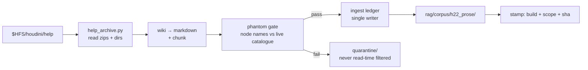
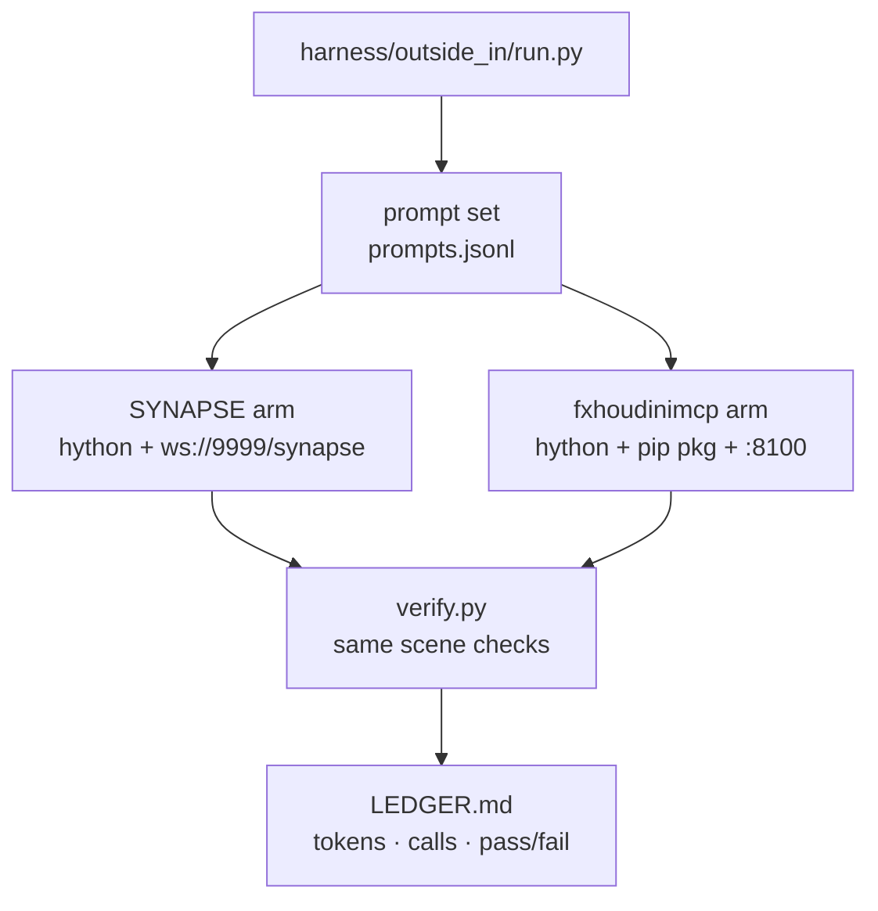

# FXHOUDINIMCP Harvest — Spec & Blueprint

2026-09-21 · Joe Ibrahim (authored by the CTO seat, Fable 5.1, on Joe's word) · living copy: https://claude.ai/code/artifact/fa6afee5-7ad7-4dac-a4be-84c252e0ab7f

## Intent and done criteria

SYNAPSE harvests three things from [fxhoudinimcp](https://github.com/healkeiser/fxhoudinimcp) (MIT, healkeiser): its help-archive loader as the reference for an H22 prose corpus, its 31 workflow guides as gate-checked retrieval material, and its 188-tool bridge as the outside-in arm of a benchmark. It never runs live beside SYNAPSE in the same Houdini process.

The harvest closes two named gaps in SYNAPSE's own README: "the retrieval corpus is Houdini 21 documentation" and "no genuine outside-in comparison has been built." Nothing here changes the five engines, the truth contract, undo grouping, or the Tier-0 ledger.

**What harvesting means.** Read their code, take what is useful under MIT with attribution, and put it through SYNAPSE's own gates before any of it can answer a prompt. Their prose is another author's prose until the phantom gate says otherwise.

**What it does not mean.** No second writer on the scene. No 188 tool schemas in the panel's context. No pip dependency (SYNAPSE vendors into hython). No fine-tune — retrieval upgrades all five engines at once; a fine-tune upgrades one.

**Done, in order:**

1. **Corpus done** when `rag/corpus/` carries an H22 prose corpus stamped against the running build, `phantom_gate_status` reads current, and the 25-probe adversarial set still reads 0/25 confident-wrong. Until this gate is green, nothing below starts.
2. **Guides done** when the 31 guides are ingested with per-chunk provenance, every node name in them resolved against the live catalogue, and any guide that fails resolution is quarantined rather than filtered at read time.
3. **Benchmark done** when one prompt set runs against both agents on the same scene, produces tokens and pass/fail per task, and the numbers have a producer path beside them in `harness/notes/outside_in/`.

## Source inventory

Pinned at commit `29b6695b6726b90537eab3f02411e05d7c6760a5` (main, 2026-09-20). MIT, "Copyright (c) 2026 FXHoudini-MCP Contributors". Read from a shallow clone on 2026-09-21; every path below was verified against that tree.

The repo is two halves: a Houdini-side plugin (`houdini/scripts/python/fxhoudinimcp_server/`, 19,272 lines of handlers) and a FastMCP relay (`python/fxhoudinimcp/`). Only the first three rows below get harvested; the last row is the benchmark opponent and stays in its own process.

| Asset | Path in fxhoudinimcp | Size | SYNAPSE takes |
| --- | --- | --- | --- |
| Help-archive loader | `houdini/scripts/python/fxhoudinimcp_server/handlers/help_handlers.py` | 262 lines | The loader pattern only: `$HFS/houdini/help/*.zip` plus loose dirs (copernicus, mpm, heightfields, ml), `.txt` pages keyed by zip-relative path. Search is substring match with no index — SYNAPSE keeps its own retrieval. |
| Workflow guides | `python/fxhoudinimcp/prompts/markdown/workflows/*.md` | 31 files, 1,853 lines | All 31, as retrieval chunks, after the phantom gate. Names track SideFX help scopes (`pyro.md` ↔ `pyro/`). |
| Node vocabulary tables | `tools/prompt_vocab.json` + `tools/gen_prompt_vocab.py` | 209-line generator | The grouping file only, as a cross-check against `h22_symbol_table.json`. Their tables are generated from it; SYNAPSE regenerates from its own symbol table. |
| Node-availability evidence | `tools/node_versions.json` | 1.1 MB, 20.5–22.0 | Nothing. SYNAPSE already stamps per build; this is 20.5/21 history SYNAPSE does not need. |
| Instructions and shared fragments | `prompts/markdown/instructions/`, `prompts/markdown/shared/` | 5 files | Nothing. Written for their tool surface. |
| The 188-tool bridge | `python/fxhoudinimcp/tools/*.py` + handlers | 23 modules | Nothing vendored. Installed via `pip install fxhoudinimcp` into a separate hython for the benchmark arm only. |

The 31 guides by name: anim, assets, character, composite, copernicus, copy, crowds, destruction, dopparticles, dyno, feathers, finiteelements, fluid, fur, grains, heightfields, heightfields_cop, io, ml, model, mpm, muscles, ocean, props, pyro, render, shade, solaris, tops, troubleshooting, vellum. Copernicus, ml, mpm and heightfields_cop are the four SYNAPSE's H21 prose cannot cover at all.

## Target 1: H22 prose corpus

The corpus is rebuilt from the help archives inside the running H22 install, so it can never disagree with the build the way an external download can. fxhoudinimcp's loader is the reference for the read step; SYNAPSE's existing ingest ledger and phantom gate own everything after it.

**Where the source lives.** `$HFS/houdini/help/` holds one `.zip` per manual (`pyro.zip`, `vellum.zip`, `solaris.zip`, `nodes.zip`) plus loose directories for the newer manuals that never got zipped: `copernicus/`, `mpm/`, `heightfields/`, `ml/`. Every page is a `.txt` in SideFX wiki markup, title on a `= Title =` line. On 22.0 that is 56 scopes and about 11,450 pages. Skip `files/`, `images/`, `videos/`, `licenses/`, `licensing/` — the licence texts alone are 250 pages of ordinary English that outrank real pages.

**What SYNAPSE writes: `rag/ingest/help_archive.py`.** A clean-room reader following the same three rules as theirs, which are the rules that make paths round-trip: read both zips and loose dirs; key every page by forward-slash path relative to the scope root with the extension dropped (`pyro/lookdev`, not `pyro\lookdev.txt`); decode as UTF-8 with replacement. About 80 lines. Their loader is 262 lines because it also carries search and excerpting, which SYNAPSE does not take.

**Pipeline, in order:**



The gate runs on the prose the same way it runs on the guides in Target 2: a chunk that names a node type absent from `h22_symbol_table.json` is written to quarantine with the reason, not dropped silently and not filtered at retrieval time.

**Chunk record.** One JSONL row per chunk, in `rag/corpus/h22_prose/<scope>.jsonl`:

```csv
field,type,example
id,str,"h22:pyro/lookdev#3"
scope,str,pyro
page,str,pyro/lookdev
title,str,"Pyro look development"
chunk_index,int,3
text,str,"Voxel size sets resolution..."
source,str,"hfs:22.0.400:$HFS/houdini/help/pyro.zip"
build,str,22.0.400
content_sha,str,<sha256 of text>
licence,str,sidefx-eula
```

`licence` matters: SideFX help text ships under the Houdini EULA, not MIT. The corpus is derived from the user's own install at ingest time and is never committed to the repo. `rag/corpus/h22_prose/` goes in `.gitignore`; what is committed is the builder, the stamp file, and the probe results.

**Stamp.** `rag/corpus/h22_prose/STAMP.json` records build, scope count, page count, chunk count, ingest timestamp, and the sha of `help_archive.py`. `phantom_gate_status` reads it and reports STALE when the running build differs from the stamp, the same contract the symbol table already has.

**Retiring H21.** `rag/skills/houdini21-reference` is not deleted at first. It stays as a fallback scope with lower retrieval priority until the H22 corpus passes the probe set, then moves to `rag/archive/` in a later, separate commit. Two corpora answering the same question is the confused state to avoid, so the retrieval layer takes H22 first and falls to H21 only on a miss, and every answer carries which one it came from.

## Target 2: workflow guides

The 31 guides are the part of fxhoudinimcp that SideFX's help does not contain: how nodes go together, which setting is the cost model, what catches people. They are ingested as retrieval chunks with a distinct scope, never as prompts, and every one passes the phantom gate before it can be retrieved.

**What they are.** Each guide is a prompt template of 30–120 lines: a `Goal: {description}` slot, then prose sections keyed to SideFX help pages by path (`pyro/lookdev`, `copernicus/spaces`), with node names in backticks. The node names are generated from `tools/prompt_vocab.json` and CI-checked against sampled builds 20.5–22.0, so a name that exists only in part of that range is dated in the text. Across the 31 files there are 57 references to fxhoudinimcp's own tools (`get_help_page`, `setup_pyro_sim`, `build_network`, `capture_screenshot`) and 27 files carry the `{description}` slot.

**Transform, in order.** `rag/ingest/guides.py` does four things to each file before chunking:

1. Strip the `Goal: {description}` line and the opening "You are setting up..." sentence. Those are prompt framing, not knowledge.
2. Rewrite tool references to SYNAPSE equivalents from a fixed map (`get_help_page` → the H22 prose lookup; `setup_pyro_sim` → the matching panel recipe or, where none exists, plain "build the network"). Unmapped references are dropped, and the drop is logged with file and line.
3. Resolve every backticked node name against `h22_symbol_table.json`. Pass: chunk is written. Fail: the whole guide goes to `rag/quarantine/guides/<name>.md` with the failing names listed at the top. Quarantine is a place to fix from, not a filter.
4. Chunk by `##` section, one chunk per section, with the guide name and section title carried on every chunk.

**Chunk record.** Same shape as Target 1, scope `guide`, plus two fields: `origin` = `fxhoudinimcp@29b6695b:prompts/markdown/workflows/pyro.md` and `licence` = `mit`. That pair is what makes the material removable in one query and attributable in one line.

**Retrieval priority.** H22 prose answers *what a node is and what a setting does*; guides answer *how to put it together*. When both scopes match a query the guide chunk ranks above the prose chunk for how-to phrasing ("set up", "why does", "how do I") and below it for reference phrasing (a bare node or parameter name). The rule lives in one place, `rag/retrieval/scope_weights.py`, and is a table, not a heuristic buried in code.

**Expected first-pass gate result.** A guess: 25–28 of 31 pass clean. `copernicus`, `ml`, `mpm` and `heightfields_cop` are the ones most likely to carry a name that moved between 22.0.368 and 22.0.400, and `troubleshooting` references their tool surface most heavily. The quarantine list is the first thing to read after the run.

**What is not taken.** `instructions/discipline.md` and `server_instructions.md` are behaviour rules for their agent. SYNAPSE has its own rulebook. `shared/` fragments are layout toggles for their `build_network`.

## Target 3: outside-in benchmark

The benchmark produces the first measured number behind SYNAPSE's founding claim: that cost scales with what you ask about, not with the scene. fxhoudinimcp is the outside-in arm because it is the most complete one that exists, it is MIT, and its own README measures a flat ~50 ms main-thread floor per call.

**Isolation is the whole design.** Two hwebserver plugins in one Houdini process is a state I have not tested and will not test here. Each arm gets its own hython, its own port, its own copy of the scene file. Nothing from the fxhoudinimcp arm touches SYNAPSE's ledger, undo stack or session store.



**Prompt set.** 24 prompts, in `harness/outside_in/prompts.jsonl`, four per domain: SOP modelling, Pyro, Vellum, Solaris/LOP, Copernicus, VEX wrangle. Each carries a `check` block — node types that must exist, a parameter value, a cook that must succeed, an attribute that must be present. Checks run through plain `hou` in a third verification process, never through either agent's own report of success.

**Three scenes.** Empty, the 5,764-node demo scene, and the 25,850-node ladder rung already used for the token benchmark. Same prompts on all three; the interesting column is how each arm's cost moves across them.

**Measured per run:** input and output tokens (from the provider response, not a proxy tokenizer — this closes the README's "no live-model arm" caveat), tool calls made, wall-clock, pass/fail from `verify.py`, and for SYNAPSE the ledger row count. Same engine on both arms, Claude via API, pinned model string in the ledger.

**Fairness rules, written down before the first run:**

- Both arms get the same prompt text, no arm-specific hints.
- fxhoudinimcp runs with its own server instructions intact. Stripping them would measure a crippled tool.
- SYNAPSE runs the panel path, not the external MCP surface, since `synapse_inspect_scene` is known to hang there.
- A prompt either arm cannot attempt (an unsupported context) scores UNKNOWN, not fail, and the count of UNKNOWN is a reported number.
- Three runs per cell; the ledger shows median and range, not the best.

**Cost ceiling.** 24 prompts × 3 scenes × 2 arms × 3 runs = 432 agent turns. At roughly 30k tokens a turn for the outside-in arm on the large scene, that is real money. The first pass runs the empty scene only (144 turns) and the large scene only after the harness is proven on the small one.

**Output.** `harness/notes/outside_in/LEDGER.md` with the producer command beside every table, following the house rule. The README's "no genuine outside-in comparison" line is replaced by the median row and a link to the ledger, and nothing else in the README changes.

## Repo layout

Everything lands under directories SYNAPSE already has. No new top-level directory; the one new tree under `python/synapse/_vendor/` follows the pattern the vendored dependencies already use.

| Path | New or changed | What it holds |
| --- | --- | --- |
| `rag/ingest/help_archive.py` | new | H22 help-archive reader (Target 1) |
| `rag/ingest/guides.py` | new | Guide transform + gate + chunker (Target 2) |
| `rag/ingest/tool_map.json` | new | fxhoudinimcp tool name → SYNAPSE equivalent, or `null` to drop |
| `rag/corpus/h22_prose/` | new, gitignored | Generated prose chunks + `STAMP.json` (stamp is committed) |
| `rag/corpus/guides/` | new | 31 guide chunk files, committed, MIT |
| `rag/quarantine/` | new | Gate failures with reasons; committed so the list is reviewable |
| `rag/retrieval/scope_weights.py` | new | The one table that ranks prose vs guide vs H21 |
| `rag/skills/houdini21-reference/` | unchanged, then moved | Fallback scope until probes pass; then `rag/archive/` |
| `python/synapse/_vendor/fxhoudinimcp/` | new | `LICENSE` (theirs, verbatim), `NOTICE.md` (commit, date, what was taken), the 31 source `.md` files unmodified |
| `harness/outside_in/` | new | `run.py`, `verify.py`, `prompts.jsonl`, `arms/synapse.py`, `arms/fxhoudinimcp.py` |
| `harness/notes/outside_in/LEDGER.md` | new | Benchmark results with producer commands |
| `tests/test_help_archive.py` | new | Reader round-trips on a fixture zip + loose dir; no `hou` needed |
| `tests/test_guides_ingest.py` | new | Transform, tool map, gate on fixtures; one deliberately failing guide |
| `tests/test_scope_weights.py` | new | The ranking table gives the documented order |
| `README.md` | changed | "What it knows" gains one line; "Known limitations" loses two |
| `.gitignore` | changed | `rag/corpus/h22_prose/*.jsonl` |

The unmodified source `.md` files sit in `_vendor/` so a diff between them and `rag/corpus/guides/` shows exactly what the transform changed. That is the audit trail for "we rewrote their tool names", and it is what makes a future upstream update a three-way merge instead of a rewrite.

## Provenance and attribution

Three layers, each doing a different job. None of them are optional, and the first is the one MIT requires.

**1. The licence travels with the code.** `python/synapse/_vendor/fxhoudinimcp/LICENSE` is their file, byte for byte: "MIT License, Copyright (c) 2026 FXHoudini-MCP Contributors". MIT's one condition is that this notice accompanies copies or substantial portions of the software, and the licence text covers "associated documentation files", so the 31 guides count. The `NOTICE.md` beside it says: upstream URL, commit `29b6695b`, harvest date, the list of files taken, and the sentence "the help-archive reader in `rag/ingest/help_archive.py` was written after reading `help_handlers.py` and follows its path conventions." That last line is not required. It is there because it is true.

**2. The README names the source.** One line in "What it knows, and where that comes from", under the prose branch: `rag/corpus/guides` — 31 workflow guides from [fxhoudinimcp](https://github.com/healkeiser/fxhoudinimcp) @ 29b6695b, MIT, gate-checked against 22.0.400. The house rule already asks for a producer path beside every number; this is the same rule applied to a source.

**3. Every chunk carries its origin.** `origin` and `licence` on each chunk record, as in Targets 1 and 2. This is the layer that does the work: a retrieval answer can say where it came from, a query can list every chunk from one upstream file, and removal is one filter, not an archaeology dig.

**Removal path, written now so it never has to be improvised.** If upstream relicenses, if a guide turns out wrong, or if Joe decides to drop the material: delete `rag/corpus/guides/`, delete the `_vendor/fxhoudinimcp/` tree, remove the README line, run the ingest ledger's purge on `origin LIKE 'fxhoudinimcp@%'`. Four steps, one commit, no orphaned chunks.

**The SideFX side.** The H22 prose corpus is derived from help text that ships under the Houdini EULA, not MIT. It is generated from each user's own install at ingest time and never committed. What the repo contains is the builder and the stamp. This keeps SYNAPSE's repo clean of SideFX text, which is the same posture `rag/corpus/h22_nodes.json` should be checked against — an open question below, not a finding.

**Not a lawyer.** The MIT reading above is the general shape. If SYNAPSE ever moves to a commercial licence, the vendored notice still travels; MIT does not care who the downstream is.

## Gates and verification

Each gate fails on an unfixed tree before it is trusted, the same discipline as `harness/progress.py`. Nothing in the README changes until G4 is green.

| Gate | Producer | Passes when |
| --- | --- | --- |
| G0 fixtures | `pytest tests/test_help_archive.py tests/test_guides_ingest.py tests/test_scope_weights.py` | Green on system Python with `hou` mocked. Fixture zip + loose dir round-trip; the deliberately broken guide lands in quarantine. |
| G1 ingest | `hython rag/ingest/help_archive.py --build` | `STAMP.json` written; scope count ≥ 50 and page count ≥ 11,000 on 22.0.400; zero chunks with an empty `source`. |
| G2 gate | `hython rag/ingest/guides.py --build` | Every guide is in exactly one of `rag/corpus/guides/` or `rag/quarantine/guides/`; the quarantine reasons file is non-empty for every quarantined guide. |
| G3 probes | `python harness/verify/retrieval_probes.py` (the 25-probe set already exercised by `tests/test_knowledge_retrieval_repair.py` / `harness/verify/checks.py`) | The 25 adversarial probes still read 0/25 confident-wrong with H22 prose ranked first and H21 as fallback. |
| G4 stale | `phantom_gate_status` | Reports CURRENT on 22.0.400 and STALE when `STAMP.json` build is edited by hand. Both directions demonstrated. |
| G5 bench-empty | `python harness/outside_in/run.py --scene empty --runs 3` | `LEDGER.md` has 24 rows per arm, every row has tokens from the provider response, UNKNOWN count reported. |
| G6 bench-scale | `python harness/outside_in/run.py --scene large --runs 3` | Same, on the 25,850-node scene. Runs only after G5. |

**What G3 actually protects.** Adding a corpus can make retrieval worse: a confident H22 chunk about a different node can outrank a correct H21 one. The probe set is the only thing standing between "we have more text" and "we answer better." If G3 drops from 0/25, the fix is in `scope_weights.py`, and the H22 corpus stays behind H21 until it passes.

**Verification independence.** G5 and G6 checks run in a third hython that opens the saved scene after each arm finishes. Neither arm's own success report is read by `verify.py`. This is the outside-in version of the truth contract.

## Mission split

Three missions, sequenced, each one leg with its own crucible. One agent per mission, not parallel runners — the second cannot start until the first's gate is green, so parallelism buys nothing here and costs tokens.

| Mission | Scope | Gates | Model | Rough size |
| --- | --- | --- | --- | --- |
| M1 corpus | `help_archive.py`, chunker, `STAMP.json`, stale wiring, H21 fallback, tests | G0 G1 G3 G4 | Opus for the reader and gate wiring; the chunker and tests are Haiku work | ~1 day of agent time, one hython run |
| M2 guides | `_vendor/` tree, `NOTICE.md`, `guides.py`, `tool_map.json`, quarantine, `scope_weights.py`, README line | G0 G2 G3 | Opus for the tool map and gate; Haiku for the transform | Half a day plus reading the quarantine list by hand |
| M3 bench | `harness/outside_in/`, arms, `verify.py`, prompts, ledger | G5 then G6 | Opus for `verify.py` and the fairness rules; the arms are plumbing | G5 is a 144-turn run; budget it as a separate day |

**Mission JSON shape.** Each follows the existing `mission JSON → compile → orchestrator → crucible → Joe says merge` path. The mission carries the gate commands verbatim, so the crucible has nothing to interpret.

**Hand-work Joe keeps.** Three things are not agent work: reading the G2 quarantine list and deciding fix-or-drop per guide; reading `tool_map.json` once, because a wrong mapping there is a wrong answer in every guide chunk; and reading the G5 ledger before deciding whether G6 is worth the spend.

**Order and the reason for it.** M1 before M2 because guides reference help pages by path and those paths must resolve in the H22 corpus before the guides can be gated. M2 before M3 because the benchmark should measure SYNAPSE with the upgraded knowledge layer, or the comparison is against a SYNAPSE that no longer exists.

**Done for the whole harvest** is G4 green plus G5 in the ledger. G6 is the stretch: worth running, not required to call this shipped.

## Risks and non-goals

**Risks, with what to do about each.**

- **Two corpora disagree.** H22 prose and H21 prose can both match; the wrong one wins on a phrasing quirk. G3 catches the confident-wrong case; the softer case (a stale-but-plausible H21 answer) does not show up in probes. Mitigation: every answer names its scope, so a user can see "H21" and discount it.
- **Wiki markup conversion.** SideFX help is a custom wiki format, not markdown. A lazy converter leaves `:ref:`-style cross references and table syntax as noise in chunks. Budget a fixture-driven converter with 10 hand-checked pages before trusting it on 11,000.
- **Guide drift.** Upstream rewrites a guide; the vendored copy goes stale. `NOTICE.md` pins the commit, and that is the honest answer: SYNAPSE ships what it gated, not what upstream has now. Re-harvest is a deliberate act.
- **hwebserver port collision in M3.** Both arms default to a port; fxhoudinimcp scans 8100–8115 and SYNAPSE holds 9999, so a collision is unlikely but untested. The runner pins both explicitly.
- **Token spend on G6.** 144 turns on a 25k-node scene against an outside-in agent is the expensive cell by design. The runner refuses to start G6 without a `--confirm-spend` flag and an estimate printed from G5's per-turn median.
- **`h22_nodes.json` posture.** The existing committed node reference is extracted from `nodes.zip`, which ships under the same EULA as the prose this spec keeps out of the repo. Open question, not a finding: does 603 entries of extracted structured reference sit differently from 11,000 pages of prose? Worth a look with the same care as the guides, on its own, later.

**Non-goals, stated so they stay out of scope.**

- No live fxhoudinimcp beside SYNAPSE in one Houdini process.
- No fxhoudinimcp tools in the panel's tool list.
- No fine-tune of any engine from this material.
- No `tools/node_versions.json` import. SYNAPSE stamps per build; 20.5 history is not a SYNAPSE concern.
- No fix for `synapse_inspect_scene` over external MCP. Their main-thread marshal is worth a diff read against it, but that is its own mission with its own gate.
- No change to the truth contract, undo grouping, Tier-0 ledger, or the five-engine seam.
